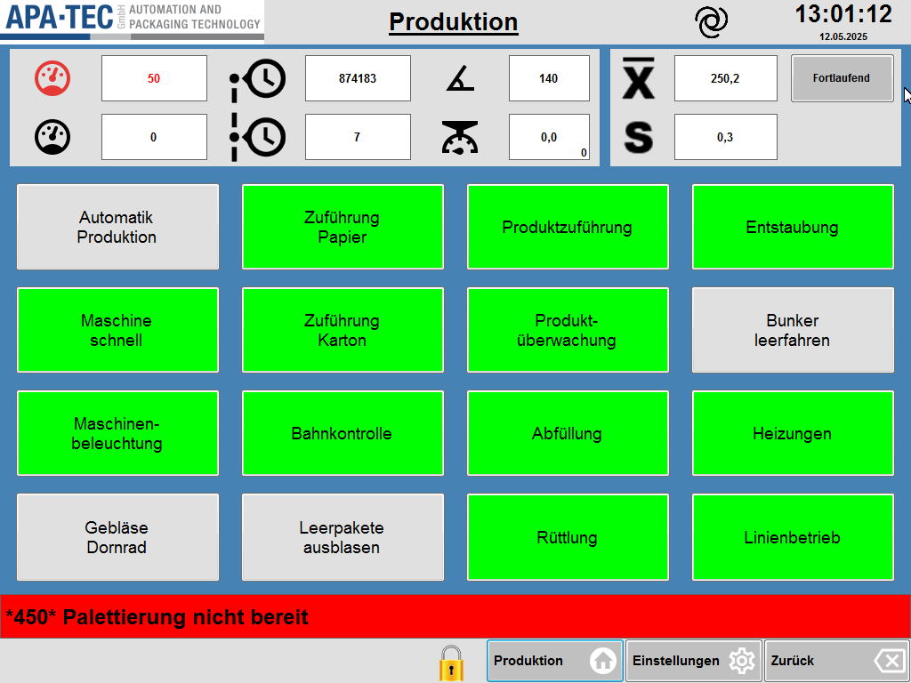

# RS-01 – Produktion
- Quelle: `src_Data/Referenz/Referenz.docx`, Kapitel „Produktion“ (Handbuch-Nr. 1); Bilder [RS-01_01](../Medien/RS-01_01.png) … [RS-01_09](../Medien/RS-01_09.png); Tabellen T1 (9 Zeilen inkl. Kopf), T2 (17 Zeilen inkl. Kopf)
- Navigationspfad: Produktion (Startseite; in der Seitenleiste des Designs „Home“). Unten links in der Funktionsleiste: Schaltflächen „Produktion“ (Haus-Symbol), „Einstellungen“ (Zahnrad-Symbol), „Zurück“.

## Zweck
Wortgetreu (Handbuch): „Die Hauptseite „Produktion“ dient der Überwachung und Steuerung der laufenden Produktionsprozesse. Sie ermöglicht es dem Bedienpersonal, wesentliche Funktionen direkt zu aktivieren bzw. zu deaktivieren und Betriebszustände in Echtzeit zu erkennen.“

## Aufbau (Bereiche, Layout)
Seitenbild:  – Screenshot der alten Oberfläche (Seitenverhältnis 4:3, 1024 × 768 Pixel), von oben nach unten:

1. **Kopfzeile** (hellgrau-blauer Streifen, Rahmen blau): links Logo „APA-TEC GmbH – AUTOMATION AND PACKAGING TECHNOLOGY“; mittig der unterstrichene Seitentitel „Produktion“; rechts davon ein blaues Wirbel-/Spiral-Symbol (Bedeutung im Handbuch nicht erklärt); ganz rechts Uhrzeit „13:01:12“ (groß) und Datum „12.05.2025“ (klein).
2. **Statusanzeige (oben)**, zwei weiße Felder-Gruppen auf blauem Grund:
   - Linke Gruppe (4 Spalten × 2 Zeilen, je Symbol + weißes Zahlenfeld): Zeile 1: rotes Tacho-Symbol, Feld „50“ (rote Schrift); Uhr-Symbol mit Punkt und gestrichelter Linie (Aktuelle Produktion), Feld „874183“; Winkel-Symbol, Feld „140“. Zeile 2: schwarzes Tacho-Symbol, Feld „0“; Uhr-Symbol mit gestrichelter Linie (Letzte Produktion), Feld „7“; Waagen-/Tacho-Symbol, Feld „0,0“ mit kleinerer „0“ unten rechts im Feld.
   - Rechte Gruppe: Symbol X-quer (Mittelwert), Feld „250,2“, rechts daneben graue Schaltfläche „Fortlaufend“; darunter Symbol „S“, Feld „0,3“.
3. **Steuerfunktionen (mittig)**: Raster aus 4 Spalten × 4 Zeilen = 16 große Tasten mit zweizeiliger Beschriftung. Tasten sind entweder grün (im Bild: aktiv, siehe Offene Punkte) oder grau (inaktiv). Anordnung im Bild:
   | | Spalte 1 | Spalte 2 | Spalte 3 | Spalte 4 |
   |---|---|---|---|---|
   | Zeile 1 | Automatik Produktion (grau) | Zuführung Papier (grün) | Produktzuführung (grün) | Entstaubung (grün) |
   | Zeile 2 | Maschine schnell (grün) | Zuführung Karton (grün) | Produkt-überwachung (grün) | Bunker leerfahren (grau) |
   | Zeile 3 | Maschinen-beleuchtung (grün) | Bahnkontrolle (grün) | Abfüllung (grün) | Heizungen (grün) |
   | Zeile 4 | Gebläse Dornrad (grau) | Leerpakete ausblasen (grau) | Rüttlung (grün) | Linienbetrieb (grün) |
4. **Meldezeile**: durchgehender roter Balken mit fetter Schrift „*450* Palettierung nicht bereit“ (Meldungsnummer in Sternchen, Text).
5. **Untere Funktionsleiste** (hellgrau): links ein gelbes Schloss-Symbol (offenes Vorhängeschloss, Bedeutung im Handbuch nicht erklärt); rechts drei Schaltflächen: „Produktion“ mit Haus-Symbol (hervorgehoben/umrandet), „Einstellungen“ mit Zahnrad-Symbol, „Zurück“ mit Rückschritt-Symbol (Pfeil in Tastenform).

## Elemente (Tabelle: Element | Typ | Funktion | verwendetes Modul)

### Statusanzeige (oben) – Tabelle T1 (8 Datenzeilen, Spalten Funktion | Beschreibung | Grafik)

| Element | Typ | Funktion (Handbuch wortgetreu) | Grafik | verwendetes Modul |
|---|---|---|---|---|
| Geschwindigkeit Soll | Zahlenfeld mit Symbol (Symbol bedienbar); im Bild „50“, rote Schrift | „Vorgabe der gewünschten Maschinengeschwindigkeit. Je nach Situation kann die Maschinengeschwindigkeit von diesem Wert abweichen. Ein Klick auf das rote Tachosymbol öffnet eine Eingabe für alle Geschwindigkeiten.“ (→ [RS-03](RS-03_Maschinengeschwindigkeit.md)) |  rotes Tacho-Symbol (48 × 48 px) | Modulkandidat: Kennzahl-Kachel (Symbol + Wert); Modulkandidat: Eingabe-Pop-up (Ziel RS-03) |
| Geschwindigkeit Ist | Zahlenfeld mit Symbol (nur Anzeige); im Bild „0“ | „Ausgabe der aktuellen Maschinengeschwindigkeit. Hat die Maschine einen zentralen Geber oder Servomotor entspricht der Wert dieser Geschwindigkeit. Handelt es sich um eine getaktete Maschine wird der Wert anhand der Ausbringung berechnet.“ |  schwarzes Tacho-Symbol (48 × 48) | Modulkandidat: Kennzahl-Kachel |
| Aktuelle Produktion | Zahlenfeld mit Symbol (Symbol bedienbar); im Bild „874183“ | „Ein rücksetzbarer Stückzähler. Ein Klick auf das Symbol öffnet das Pop-Up Produktionszähler.“ (→ [RS-02](RS-02_Produktionszaehler.md)) |  Uhr-Symbol mit Punkt darüber/links und gestrichelter Linie (73 × 73) | Modulkandidat: Kennzahl-Kachel; Modulkandidat: Eingabe-Pop-up (Ziel RS-02, siehe dort) |
| Letzte Produktion | Zahlenfeld mit Symbol (nur Anzeige); im Bild „7“ | „Der Wert des Stückzählers beim letzten Rücksetzen.“ |  Uhr-Symbol mit gestrichelter senkrechter Linie links (100 × 100) | Modulkandidat: Kennzahl-Kachel |
| Maschinenwinkel | Zahlenfeld mit Symbol; im Bild „140“ | „Winkel des Hauptgebers. Die meisten Nocken und Antriebe richten sich nach diesem Geber.“ |  Winkel-Symbol (spitzer Winkel mit Bogen, 48 × 48) | Modulkandidat: Kennzahl-Kachel |
| Letztes Gewicht | Zahlenfeld mit Symbol; im Bild „0,0“, kleine „0“ unten rechts im Feld | „Das letzte gewogene Gewicht in der Maschine. gibt es mehrere Dosierer oder Waagen zeigt der kleinere Wert unten rechts im Feld die Nummer des Dosierers oder der Waage an.“ |  Waagen-Symbol (Tacho-Halbkreis mit Zeiger unter Aufhängung, 48 × 48) | Modulkandidat: Kennzahl-Kachel (mit Index-Anzeige unten rechts) |
| Mittelwert | Zahlenfeld mit Symbol und Umschaltfläche; im Bild „250,2“, Schaltfläche „Fortlaufend“ | „Mittleres Gewicht der ausgebrachten Packungen. Kann fortlaufend oder stichprobenartig erfasst werden. Die Schaltfläche rechts vom Ausgabefeld erlaubt das Umschalten.“ |  Symbol „X“ mit Querstrich (Mittelwert-Zeichen, 48 × 48) | Modulkandidat: Kennzahl-Kachel; Modulkandidat: Umschalter (Fortlaufend / Stichprobe) |
| Standartabweichung | Zahlenfeld mit Symbol (nur Anzeige); im Bild „0,3“ | „Die Standartabweichung der ausgebrachten Packungen. Der Wert wird anhand derselben Gewichte wie der Mittelwert berechnet. Entsprechend kann die Ausgabe fortlaufend oder stichprobenartig sein.“ |  fettes „S“ (25 × 28) | Modulkandidat: Kennzahl-Kachel |

### Steuerfunktionen (mittig) – Tabelle T2 (16 Datenzeilen, Spalten Funktion | Beschreibung)

Alle Elemente sind Tasten (Typ: Schalter, an/aus) im 4×4-Raster von Bild [RS-01_01](../Medien/RS-01_01.png); Position in Klammern.

| Element | Typ | Funktion (Handbuch wortgetreu) | verwendetes Modul |
|---|---|---|---|
| Automatik Produktion (Z1/S1) | Taste, grau/grün | „Aktiviert alle Funktionen der Maschine für die Produktion. Ist die Schaltfläche grau, so ist mindestens eine Funktion abgewählt.“ | Modulkandidat: Funktionstaste (Schalter mit Zustandsfarbe) |
| Maschine schnell / langsam (Z2/S1, Beschriftung im Bild „Maschine schnell“) | Taste | „Erlaubt eine direkte Umschaltung zwischen zwei Geschwindigkeiten. Hilfreich beim Anlauf und bei der Problemsuche.“ | Modulkandidat: Funktionstaste |
| Maschinen-beleuchtung (Z3/S1) | Taste | „Schaltet die Maschinenbeleuchtung ein oder aus.“ | Modulkandidat: Funktionstaste |
| Gebläse Dornrad (Z4/S1) | Taste | „Erlaubt das Schalten des Sauggebläses im Dornrad. Wird in der Regel automatisch gesteuert.“ | Modulkandidat: Funktionstaste |
| Zuführung Papier (Z1/S2) | Taste | „Aktiviert die Zuführung für das Innenpapier.“ | Modulkandidat: Funktionstaste |
| Zuführung Karton (Z2/S2) | Taste | „Aktiviert die Zuführung des Außenkartons. Ist kein Papier auf dem Dorn wird kein Karton abgezogen.“ | Modulkandidat: Funktionstaste |
| Bahnkontrolle (Z3/S2) | Taste | „Schaltet die Überwachung des Papierabzugs in der Papierzuführung ein. Abhängig von der Nocke muss der entsprechende Sensor belegt werden und auch wieder frei werden. Fehler beim Abzug oder beim Nachfüllen führen zu einer Störung und zum Stopp der Maschine.“ | Modulkandidat: Funktionstaste |
| Leerpakete ausblasen (Z4/S2) | Taste | „Alle Packungen im Dornrad werden als schlecht markiert und bei der nächsten Möglichkeit ausgeblasen.“ | Modulkandidat: Funktionstaste |
| Produktzuführung (Z1/S3) | Taste | „Schaltet alle Komponenten ein welche für die Produktzuführung nötig sind. Das beinhaltet Bänder, Schnecken. Klappen werden geöffnet.“ | Modulkandidat: Funktionstaste |
| Produktüberwachung (Z2/S3, Beschriftung im Bild „Produkt-überwachung“) | Taste | „Ist die Überwachung aktiv, stoppt die Maschine mit einer Störung, wenn die Trichter und Füllrohre an den Dosierern leer sind. Zum Leerfahren der Produktzuführung muss die Überwachung abgeschaltet werden.“ | Modulkandidat: Funktionstaste |
| Abfüllung (Z3/S3) | Taste | „Damit kann das Abfüllen der Packungen abgeschaltet werden. Die Packungen werden auf den Waagen als schlecht markiert und werden an der nächsten Möglichkeit ausgeschleust.“ | Modulkandidat: Funktionstaste |
| Rüttlung (Z4/S3) | Taste | „Erlaubt das Zu- und Abschalten der Rüttlung im Schließteil der Maschine.“ | Modulkandidat: Funktionstaste |
| Entstaubung (Z1/S4) | Taste | „Steuert das Ventil für die Entstaubung in der Schließmaschine.“ | Modulkandidat: Funktionstaste |
| Bunker leerfahren (Z2/S4) | Taste | „Sendet ein Signal an die vorgelagerte Produktzuführung und fordert ein Leerfahren des Produktbunkers an.“ | Modulkandidat: Funktionstaste |
| Heizungen (Z3/S4) | Taste | „Erlaubt das Zu- und Abschalten aller Heizungen in der Maschine.“ (Detailseite: [RS-22](RS-22_Heizungen.md), Querbezug laut Übersicht) | Modulkandidat: Funktionstaste |
| Linienbetrieb (Z4/S4) | Taste | „Ist der Linienbetrieb aktiv, reagiert die Maschine auf nachfolgende Anlagen und Stoppt oder fährt Leer abhängig von den Signalen.“ | Modulkandidat: Funktionstaste |

### Rahmenelemente laut Seitenbild (nicht in den Handbuch-Tabellen beschrieben)

| Element | Typ | Beschreibung laut Bild | verwendetes Modul |
|---|---|---|---|
| Logo APA-TEC | Grafik | oben links | Modulkandidat: Kopfzeile |
| Seitentitel „Produktion“ | Text, unterstrichen | oben mittig | Modulkandidat: Kopfzeile |
| Wirbel-Symbol | Symbol | rechts neben dem Titel, blau, Funktion nicht beschrieben | Modulkandidat: Kopfzeile |
| Uhrzeit / Datum | Anzeige | „13:01:12“ / „12.05.2025“ | Modulkandidat: Kopfzeile |
| Meldezeile | Anzeige (Balken, rot) | „*450* Palettierung nicht bereit“; Antippen öffnet laut Referenz-Übersicht die Meldeanzeige ([RS-38](RS-38_Meldeanzeige.md)) | Modulkandidat: Meldezeile |
| Schloss-Symbol | Symbol (gelb) | untere Leiste links, Funktion nicht beschrieben | Modulkandidat: Funktionsleiste |
| Taste „Produktion“ (Haus) | Navigationstaste | untere Leiste, aktuelle Seite hervorgehoben | Modulkandidat: Navigationsleiste |
| Taste „Einstellungen“ (Zahnrad) | Navigationstaste | untere Leiste, führt laut Referenz-Übersicht zu [RS-04](RS-04_Einstellungen.md) | Modulkandidat: Navigationsleiste |
| Taste „Zurück“ | Navigationstaste | untere Leiste | Modulkandidat: Navigationsleiste |

## Verwendete Module (IDs)
Noch keine RM-IDs vergeben. Modulkandidaten dieser Seite: Kopfzeile, Meldezeile, Navigationsleiste (untere Funktionsleiste), Kennzahl-Kachel (Symbol + Wert, 7-mal; Variante mit Index unten rechts), Umschalter (Fortlaufend/Stichprobe), Funktionstaste (Schalter grau/grün, 16-mal), Eingabe-Pop-up (Ziele RS-02, RS-03).

## Zustände und Interaktion (inkl. Pop-ups, Berechtigungen, Fehlerfälle)
- Pop-ups: Klick auf das rote Tacho-Symbol (Geschwindigkeit Soll) öffnet [RS-03](RS-03_Maschinengeschwindigkeit.md); Klick auf das Symbol bei „Aktuelle Produktion“ öffnet [RS-02](RS-02_Produktionszaehler.md).
- Tasten der Steuerfunktionen: zwei Zustände, im Bild grün und grau. „Automatik Produktion“ ist grau, sobald mindestens eine Funktion abgewählt ist (im Bild: Automatik grau bei grauen Tasten Gebläse Dornrad, Leerpakete ausblasen, Bunker leerfahren).
- „Mittelwert“ / „Standartabweichung“: Schaltfläche rechts vom Mittelwert schaltet zwischen fortlaufender und stichprobenartiger Erfassung um (Anzeige im Bild: „Fortlaufend“); die Standartabweichung folgt derselben Einstellung.
- „Letztes Gewicht“: bei mehreren Dosierern/Waagen zeigt die kleine Zahl unten rechts im Feld die Nummer des Dosierers bzw. der Waage.
- Fehlerfälle laut Handbuch: Bahnkontrolle – Fehler beim Abzug oder Nachfüllen führen zu Störung und Maschinenstopp; Produktüberwachung – leere Trichter/Füllrohre führen zu Störung und Stopp.
- Meldezeile: roter Balken im Bild bei aktiver Meldung (Nummer + Text).
- Berechtigungen: im Handbuch zu dieser Seite nicht beschrieben.

## Prüfpunkte
| ID | Prüfung | erwartetes Ergebnis | Status |
|---|---|---|---|
| RS-01-P01 | Tabelle T1 „Statusanzeige (oben)“ gegen Quelle | alle 8 Datenzeilen (Geschwindigkeit Soll, Geschwindigkeit Ist, Aktuelle Produktion, Letzte Produktion, Maschinenwinkel, Letztes Gewicht, Mittelwert, Standartabweichung) mit wortgetreuer Beschreibung (inkl. Schreibweise „Standartabweichung“) im neuen Konzept abgebildet | offen |
| RS-01-P02 | Tabelle T2 „Steuerfunktionen (mittig)“ gegen Quelle | alle 16 Funktionen vorhanden: Automatik Produktion, Maschine schnell / langsam, Maschinenbeleuchtung, Gebläse Dornrad, Zuführung Papier, Zuführung Karton, Bahnkontrolle, Leerpakete ausblasen, Produktzuführung, Produktüberwachung, Abfüllung, Rüttlung, Entstaubung, Bunker leerfahren, Heizungen, Linienbetrieb | offen |
| RS-01-P03 | Bilder RS-01_01 … RS-01_09 | alle 9 Bilder verlinkt und beschrieben; Symbole der 8 Kennzahlen entsprechen RS-01_02 … RS-01_09 | offen |
| RS-01-P04 | Statusanzeige Layout | 2 × 4 Felder links (Soll, Ist, Aktuelle Produktion, Letzte Produktion, Maschinenwinkel, Letztes Gewicht) plus Mittelwert mit Umschalter und Standartabweichung rechts sind vorhanden | offen |
| RS-01-P05 | Klick auf rotes Tachosymbol (Geschwindigkeit Soll) | öffnet Pop-up Maschinengeschwindigkeit (RS-03) | offen |
| RS-01-P06 | Klick auf Symbol bei „Aktuelle Produktion“ | öffnet Pop-up Produktionszähler (RS-02) | offen |
| RS-01-P07 | Umschaltfläche rechts vom Mittelwert | wechselt zwischen fortlaufender und stichprobenartiger Erfassung; Beschriftung zeigt aktuellen Modus (im Bild „Fortlaufend“); Standartabweichung folgt | offen |
| RS-01-P08 | Anzeige „Letztes Gewicht“ bei mehreren Dosierern/Waagen | kleine Zahl unten rechts im Feld zeigt die Nummer des Dosierers bzw. der Waage | offen |
| RS-01-P09 | Taste „Automatik Produktion“ | grau, solange mindestens eine Funktion abgewählt ist; aktiviert alle Funktionen | offen |
| RS-01-P10 | Zustandsdarstellung der 16 Tasten | jede Taste zeigt aktiv/inaktiv unterscheidbar (Bild: grün/grau; neues HMI zusätzlich nicht nur über Farbe, Agent.md Abschnitt 6) | offen |
| RS-01-P11 | Meldezeile | zeigt Meldungsnummer und Text („*450* Palettierung nicht bereit“); bei aktiver Meldung rot | offen |
| RS-01-P12 | Rahmen / Navigation | Kopfzeile mit Logo, Titel, Uhrzeit und Datum; untere Leiste mit „Produktion“, „Einstellungen“, „Zurück“ vorhanden | offen |
| RS-01-P13 | Bahnkontrolle / Produktüberwachung | Fehlerverhalten (Störung und Stopp) wie im Handbuch beschrieben | offen |

## Offene Punkte
1. Farbbedeutung der Tasten (grün = aktiv, grau = inaktiv) ist im Handbuch nur für „Automatik Produktion“ („grau = mindestens eine Funktion abgewählt“) beschrieben; für die übrigen Tasten aus dem Bild abgeleitet.
2. Bedeutung des Wirbel-Symbols neben dem Seitentitel und des gelben Schloss-Symbols unten links nicht im Handbuch erklärt (Schloss vermutlich Benutzeranmeldung/Berechtigung).
3. „Maschine schnell / langsam“: Handbuch nennt „schnell / langsam“, die Taste im Bild heißt „Maschine schnell“; Beschriftung bei Zustand „langsam“ unbekannt.
4. Mittelwert-Umschalter: Beschriftung im anderen Zustand (vermutlich „Stichprobe“) nicht abgebildet.
5. Einheiten und Nachkommastellen der Kennzahlen (Geschwindigkeit, Winkel, Gewicht) nicht im Handbuch angegeben; Geschwindigkeit laut RS-03 in 1/min.
6. Klickziele von „Geschwindigkeit Ist“, „Maschinenwinkel“, „Letztes Gewicht“ usw. sind nicht beschrieben (nur Soll und Aktuelle Produktion öffnen ein Pop-up).
7. Berechtigungen für die Tasten nicht beschrieben.
8. Schreibweisen im Handbuch („Standartabweichung“, „Stoppt“, „Leer“ groß) werden unverändert übernommen; Korrektur im neuen HMI zu entscheiden.
