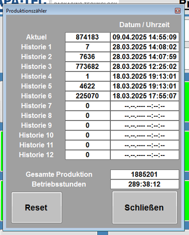

# RS-02 – Produktionszähler (Pop-up)
- Quelle: `src_Data/Referenz/Referenz.docx`, Kapitel „Produktionszähler“ (Handbuch-Nr. 2); Bild [RS-02_01](../Medien/RS-02_01.png); keine Tabellen
- Navigationspfad: Produktion › Produktionszähler (Pop-up, Klick auf das Symbol bei „Aktuelle Produktion“ auf [RS-01](RS-01_Produktion.md)). Schließen über die Taste „Schließen“ oder das Fenster-Kreuz oben rechts im Bild.

## Zweck
Wortgetreu: „Zeigt den Gesamtzähler mit allen produzierten Packungen an und die Betriebsstunden der Maschine. Zusätzlich kann eine manuelle Historie der Produktion geführt werden.“

## Aufbau (Bereiche, Layout)
Bild:  – kleines Pop-up-Fenster (hochformatig, grauer Hintergrund) mit Titelleiste „Produktionszähler“ und Schließen-Kreuz oben rechts. Von oben nach unten:

1. **Zählertabelle** mit zwei Spalten und 13 Zeilen: Spaltenüberschrift „Datum / Uhrzeit“ über der rechten Spalte; links fette Zeilenbeschriftung, mittig weißes Zahlenfeld, rechts weißes Datumsfeld.

   | Zeile | Zähler (Bild) | Datum / Uhrzeit (Bild) |
   |---|---|---|
   | Aktuell | 874183 | 09.04.2025 14:55:09 |
   | Historie 1 | 7 | 28.03.2025 14:08:02 |
   | Historie 2 | 7636 | 28.03.2025 14:07:59 |
   | Historie 3 | 773682 | 28.03.2025 12:25:02 |
   | Historie 4 | 1 | 18.03.2025 19:13:01 |
   | Historie 5 | 4622 | 18.03.2025 19:13:01 |
   | Historie 6 | 225070 | 18.03.2025 17:55:07 |
   | Historie 7 | 0 | --.--.---- --:--:-- |
   | Historie 8 | 0 | --.--.---- --:--:-- |
   | Historie 9 | 0 | --.--.---- --:--:-- |
   | Historie 10 | 0 | --.--.---- --:--:-- |
   | Historie 11 | 0 | --.--.---- --:--:-- |
   | Historie 12 | 0 | --.--.---- --:--:-- |
2. **Summenfelder**: „Gesamte Produktion“ mit Feld „1885201“; „Betriebsstunden“ mit Feld „289:38:12“.
3. **Tasten unten**: links große graue Taste „Reset“, rechts große graue Taste „Schließen“.

## Elemente (Tabelle: Element | Typ | Funktion | verwendetes Modul)
Das Kapitel enthält keine Tabelle; die Elemente stammen aus der Funktionsbeschreibung (Fließtext) und dem Bild.

| Element | Typ | Funktion (wortgetreu) | verwendetes Modul |
|---|---|---|---|
| Aktuell | Zahlenfeld + Datum/Uhrzeit-Feld (nur Anzeige) | „Die Felder *Aktuell* und *Historie 1 bis 12* zeigen die ausgebrachten Packungen seit dem Reset-Zeitpunkt, welcher in der Spalte *Datum / Uhrzeit* angezeigt wird, an.“ | Modulkandidat: Zählerzeile (Zähler + Zeitstempel) |
| Historie 1 … Historie 12 (12 Zeilen) | Zahlenfeld + Datum/Uhrzeit-Feld (nur Anzeige) | wie „Aktuell“. Bei leerer Historie: Zähler 0, Datum „--.--.---- --:--:--“ (Bild) | Modulkandidat: Zählerzeile |
| Spalte Datum / Uhrzeit | Spaltenüberschrift | zeigt den Reset-Zeitpunkt je Zähler | Modulkandidat: Zählerzeile |
| Gesamte Produktion | Zahlenfeld (nur Anzeige) | „zeigt den Gesamtzähler an. Das sind alle Packungen, welche seit der Inbetriebnahme der Maschine produziert wurden.“ | Modulkandidat: Kennzahl-Kachel |
| Betriebsstunden | Zeitfeld (nur Anzeige), Format hhh:mm:ss laut Bild | „zeigt die gesamte Zeit an, welche die Maschine bisher produziert hat.“ | Modulkandidat: Kennzahl-Kachel |
| Reset | Taste (gedrückt halten) | „Ein Reset wird ausgeführt, wenn die Taste *Reset* für eine kurze Zeit gehalten wird. Der Reset wurde erfolgreich ausgeführt, wenn alle Einträge um eine Spalte nach unten rutschen.“ | Modulkandidat: Funktionstaste (Haltetaste) |
| Schließen | Taste | „Mit *Schließen* wird das Pop-Up geschlossen.“ | Modulkandidat: Pop-up-Rahmen (Titel, Schließen) |
| Titelleiste mit Kreuz | Fensterrahmen | Titel „Produktionszähler“, Kreuz oben rechts (im Handbuch nicht beschrieben) | Modulkandidat: Pop-up-Rahmen |

## Verwendete Module (IDs)
Noch keine RM-IDs vergeben. Modulkandidaten: Pop-up-Rahmen, Zählerzeile, Kennzahl-Kachel, Funktionstaste (Haltetaste).

## Zustände und Interaktion (inkl. Pop-ups, Berechtigungen, Fehlerfälle)
- Öffnen: Klick auf das Symbol bei „Aktuelle Produktion“ auf RS-01.
- Reset: Taste kurz gedrückt halten; Erfolg zeigt sich darin, dass alle Einträge um eine Zeile nach unten rutschen („Aktuell“ wird zu „Historie 1“ usw.), der aktuelle Zähler beginnt neu mit neuem Reset-Zeitpunkt (Schluss aus dem Handbuchtext, siehe Offene Punkte).
- Leere Historieneinträge: Zähler 0, Datum als Platzhalter „--.--.---- --:--:--“ (Bild).
- Schließen: Taste „Schließen“.
- Berechtigungen und Fehlerfälle: im Handbuch nicht beschrieben.

## Prüfpunkte
| ID | Prüfung | erwartetes Ergebnis | Status |
|---|---|---|---|
| RS-02-P01 | Zählertabelle | 13 Zeilen: „Aktuell“ und „Historie 1“ bis „Historie 12“, je mit Zähler und Spalte „Datum / Uhrzeit“ | offen |
| RS-02-P02 | Leere Historie | Zeilen ohne Eintrag zeigen 0 und „--.--.---- --:--:--“ | offen |
| RS-02-P03 | Feld „Gesamte Produktion“ | zeigt alle Packungen seit Inbetriebnahme (Beispiel Bild: 1885201) | offen |
| RS-02-P04 | Feld „Betriebsstunden“ | zeigt gesamte Produktionszeit im Format hhh:mm:ss (Beispiel Bild: 289:38:12) | offen |
| RS-02-P05 | Taste „Reset“ kurz gedrückt halten | Reset wird ausgeführt; alle Einträge rutschen um eine Zeile nach unten | offen |
| RS-02-P06 | Taste „Reset“ nur kurz antippen | kein Reset (Reset nur bei gehaltener Taste) | offen |
| RS-02-P07 | Taste „Schließen“ | Pop-up wird geschlossen | offen |
| RS-02-P08 | Öffnen aus RS-01 | Klick auf das Symbol bei „Aktuelle Produktion“ öffnet das Pop-up | offen |
| RS-02-P09 | Bild RS-02_01 | verlinkt und beschrieben (Titel, 13 Zeilen, Summenfelder, Tasten Reset und Schließen) | offen |

## Offene Punkte
1. Haltedauer für „Reset“ ist im Handbuch nur als „eine kurze Zeit“ angegeben (Wert fehlt).
2. Berechtigung für Reset nicht beschrieben; Rückfrage/Bestätigungsdialog nicht beschrieben.
3. Die Historie wird laut Zweck „manuell“ geführt; ob Einträge editierbar oder löschbar sind, ist nicht beschrieben (Felder im Bild nur Anzeige).
4. Handbuch spricht von „einer Spalte nach unten“, das Bild zeigt Zeilen (Wortlaut „Spalte“ unverändert zitiert).
5. Bild-Details: Datumsformat TT.MM.JJJJ hh:mm:ss, Betriebsstundenformat hhh:mm:ss sind aus dem Bild abgeleitet.
6. Beispiel im Bild: „Historie 4“ und „Historie 5“ haben denselben Zeitstempel 18.03.2025 19:13:01; Bedeutung nicht erklärt.
