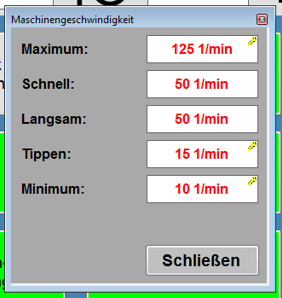

# RS-03 – Maschinengeschwindigkeit (Pop-up)
- Quelle: `src_Data/Referenz/Referenz.docx`, Kapitel „Maschinengeschwindigkeit“ (Handbuch-Nr. 3); Bild [RS-03_01](../Medien/RS-03_01.png); Tabelle T3 (7 Zeilen inkl. Kopf)
- Navigationspfad: Produktion › Maschinengeschwindigkeit (Pop-up, Klick auf das rote Tacho-Symbol auf [RS-01](RS-01_Produktion.md)). Schließen über Taste „Schließen“ (bzw. Fenster-Kreuz im Bild).

## Zweck
Wortgetreu: „Das Pop-up erlaubt das Einstellen der verschiedenen Geschwindigkeiten der Maschine. Geöffnet wird das Pop-up durch einen Klick auf das rote Tacho-Symbol auf der Produktions-Seite.“

## Aufbau (Bereiche, Layout)
Bild:  – kleines Pop-up-Fenster (grauer Hintergrund) mit Titelleiste „Maschinengeschwindigkeit“ und Schließen-Kreuz oben rechts. Fünf Zeilen, links fette Beschriftung mit Doppelpunkt, rechts je ein weißes Eingabefeld mit roter Schrift und Einheit „1/min“:

| Zeile | Wert im Bild | Besonderheit im Bild |
|---|---|---|
| Maximum: | 125 1/min | kleines gelbes Schlüssel-Symbol oben rechts im Feld |
| Schnell: | 50 1/min | ohne Symbol |
| Langsam: | 50 1/min | ohne Symbol |
| Tippen: | 15 1/min | kleines gelbes Schlüssel-Symbol |
| Minimum: | 10 1/min | kleines gelbes Schlüssel-Symbol |

Unten rechts große graue Taste „Schließen“.

## Elemente (Tabelle: Element | Typ | Funktion | verwendetes Modul)
Tabelle T3 (6 Datenzeilen, Spalten Funktion | Beschreibung):

| Element | Typ | Funktion (Handbuch wortgetreu) | verwendetes Modul |
|---|---|---|---|
| Maximum | Eingabefeld, Einheit 1/min, mit Schlüssel-Symbol (Bild) | „Die Obergrenze für die Maschinengeschwindigkeit.“ | [RM-05](../Module/RM-05_Eingabefeld-mit-Schluesselsymbol.md) |
| Schnell | Eingabefeld, Einheit 1/min | „Sollgeschwindigkeit, wenn die Taste Maschine Schnell aktiv ist.“ | [RM-05](../Module/RM-05_Eingabefeld-mit-Schluesselsymbol.md)) |
| Langsam | Eingabefeld, Einheit 1/min | „Sollgeschwindigkeit, wenn die Taste Maschine Schnell inaktiv ist.“ | [RM-05](../Module/RM-05_Eingabefeld-mit-Schluesselsymbol.md)) |
| Tippen | Eingabefeld, Einheit 1/min, mit Schlüssel-Symbol (Bild) | „Vorgabe für den Tippbetrieb. Ist in der Regel nahe dem Minimum.“ | [RM-05](../Module/RM-05_Eingabefeld-mit-Schluesselsymbol.md) |
| Minimum | Eingabefeld, Einheit 1/min, mit Schlüssel-Symbol (Bild) | „Die Untergrenze für die Maschinengeschwindigkeit.“ | [RM-05](../Module/RM-05_Eingabefeld-mit-Schluesselsymbol.md) |
| Taste Schließen | Taste | „Schließt das Pop-Up.“ | [RM-13](../Module/RM-13_Pop-up-Rahmen.md) (Titel, Schließen) |
| Titelleiste mit Kreuz | Fensterrahmen | Titel „Maschinengeschwindigkeit“, Kreuz oben rechts (im Handbuch nicht beschrieben) | [RM-13](../Module/RM-13_Pop-up-Rahmen.md) |

## Verwendete Module (IDs)

Module dieser Seite (Definitionen in der [Modulliste](../Module/Modulliste.md)):

- [RM-05](../Module/RM-05_Eingabefeld-mit-Schluesselsymbol.md) – Eingabefeld mit Schlüsselsymbol
- [RM-06](../Module/RM-06_Eingabe-Pop-up.md) – Eingabe-Pop-up
- [RM-13](../Module/RM-13_Pop-up-Rahmen.md) – Pop-up-Rahmen

## Zustände und Interaktion (inkl. Pop-ups, Berechtigungen, Fehlerfälle)
- Öffnen: Klick auf das rote Tacho-Symbol (Geschwindigkeit Soll) auf RS-01.
- „Schnell“ gilt, wenn die Taste „Maschine schnell“ (RS-01) aktiv ist, „Langsam“, wenn sie inaktiv ist.
- Schlüssel-Symbol bei Maximum, Tippen und Minimum: im Handbuch nicht erklärt; üblicherweise geschützter Wert (Berechtigung), siehe Offene Punkte.
- Werte werden im Bild in roter Schrift angezeigt (Bedeutung der Farbe nicht beschrieben).
- Wertebereiche, Standardwerte und Fehlermeldungen: im Handbuch nicht angegeben.

## Prüfpunkte
| ID | Prüfung | erwartetes Ergebnis | Status |
|---|---|---|---|
| RS-03-P01 | Tabelle T3 gegen Quelle | 6 Datenzeilen vorhanden: Maximum, Schnell, Langsam, Tippen, Minimum, Taste Schließen, mit wortgetreuer Beschreibung | offen |
| RS-03-P02 | Felder und Einheit | 5 Eingabefelder in der Reihenfolge Maximum, Schnell, Langsam, Tippen, Minimum, jeweils mit Einheit „1/min“ (Bild: 125, 50, 50, 15, 10) | offen |
| RS-03-P03 | Schlüssel-Symbole | Maximum, Tippen und Minimum tragen ein Schlüssel-Symbol, Schnell und Langsam nicht (laut Bild) | offen |
| RS-03-P04 | Öffnen aus RS-01 | Klick auf rotes Tacho-Symbol öffnet das Pop-up | offen |
| RS-03-P05 | Zuordnung Schnell/Langsam | Sollgeschwindigkeit entspricht „Schnell“, wenn Taste „Maschine schnell“ aktiv, sonst „Langsam“ | offen |
| RS-03-P06 | Taste „Schließen“ | Pop-up wird geschlossen | offen |
| RS-03-P07 | Bild RS-03_01 | verlinkt und beschrieben | offen |
| RS-03-P08 | Grenzen | Maschinengeschwindigkeit bleibt zwischen Minimum und Maximum (Obergrenze/Untergrenze) | offen |

## Offene Punkte
1. Bedeutung des gelben Schlüssel-Symbols bei Maximum, Tippen, Minimum nicht im Handbuch erklärt (vermutlich Berechtigung/Passwortschutz); Berechtigungsstufen nicht angegeben.
2. Wertebereiche, Standardwerte und Plausibilitätsregeln (z. B. Minimum < Tippen < Langsam/Schnell < Maximum) nicht angegeben.
3. Art der Werteingabe (Antippen öffnet Zahlenfeld?) nicht beschrieben.
4. Bedeutung der roten Schriftfarbe der Werte nicht beschrieben.
5. Ob „Schnell“ und „Langsam“ gleich sein dürfen (Bild: beide 50 1/min) nicht beschrieben.
6. Verhalten bei Werten außerhalb der Grenzen / Fehlermeldungen nicht beschrieben.
