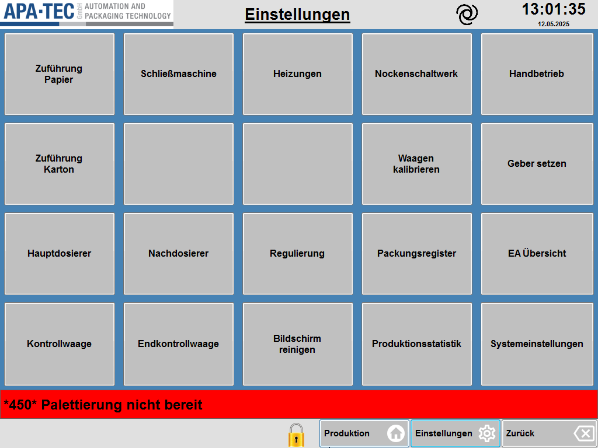

# RS-04 – Einstellungen
- Quelle: Handbuch `Referenz.docx`, Kapitel 4 „Einstellungen“ (Zweck, Seitenübersicht, Funktionsbeschreibung, Tabelle T4, 19 Zeilen inkl. Kopfzeile); Bild [RS-04_01.png](../Medien/RS-04_01.png)   - Navigationspfad: Einstellung (abgeleitet aus der [Referenz-Uebersicht](../Referenz-Uebersicht.md); im Bild ist kein Brotkrümel sichtbar). Erreichbar über die Taste „Einstellungen“ der unteren Leiste (im Bild sichtbar, Zahnrad-Symbol) bzw. die Seitenleiste „Einstellungen“ im Design.

## Zweck
Wortgetreu (Handbuch): „Die Einstellungs-Seite ist die zentrale Seite um zu allen Seiten zu kommen, welche für die Konfiguration und Fehlerbeseitigung nötig sind.“

Die Seite hat keine eigenen Parameter, Zahlenfelder oder Statusanzeigen, sondern nur Kacheltasten zur Navigation.

## Aufbau (Bereiche, Layout)
Beschreibung des Bildes [RS-04_01.png](../Medien/RS-04_01.png) (1024 × 768 px, Screenshot der alten HMI, Datum im Bild 12.05.2025):

- **Kopfzeile (oben):** links Logo „APA·TEC GmbH – Automation and Packaging Technology“; mittig der unterstrichene Seitentitel **„Einstellungen“**; rechts davon ein Spiralsymbol (schwarz, kreisförmig, Bedeutung im Handbuch nicht erklärt); ganz rechts Uhrzeit „13:01:35“ (groß) und darunter Datum „12.05.2025“.
- **Arbeitsbereich (blauer Hintergrund):** Raster aus **5 Spalten × 4 Zeilen = 20 graue Kacheltasten**, davon 18 beschriftet und 2 unbeschriftet (leer). Beschriftung fett, zentriert, mehrzeilig möglich.
- **Meldezeile (rot, volle Breite):** im Bild „\*450\* Palettierung nicht bereit“ (weiße/schwarze Fettschrift auf rotem Grund).
- **Fußleiste (unten, hellgrau):** rechts ein gelbes Schloss-Symbol (geschlossen), daneben drei Tasten: „Produktion“ (Haus-Symbol), „Einstellungen“ (Zahnrad-Symbol), „Zurück“ (Rückwärts-Löschen-Pfeil-Symbol). Links ist auf dieser Seite keine Taste vorhanden (leer).

Kachelraster (Zeile/Spalte wie im Bild, von links oben nach rechts unten):

| Zeile | Spalte 1 | Spalte 2 | Spalte 3 | Spalte 4 | Spalte 5 |
|---|---|---|---|---|---|
| 1 | Zuführung Papier | Schließmaschine | Heizungen | Nockenschaltwerk | Handbetrieb |
| 2 | Zuführung Karton | (leer) | (leer) | Waagen kalibrieren | Geber setzen |
| 3 | Hauptdosierer | Nachdosierer | Regulierung | Packungsregister | EA Übersicht |
| 4 | Kontrollwaage | Endkontrollwaage | Bildschirm reinigen | Produktionsstatistik | Systemeinstellungen |

Beschriftungen im Bild und im Text weichen teilweise ab: Bild „EA Übersicht“ (ohne Bindestrich) gegenüber Tabelle „EA-Übersicht“; Bild „Waagen kalibrieren“ zweizeilig. Die Reihenfolge der Tabelle T4 im Handbuch folgt dem Raster spaltenweise (Spalte 1 von oben nach unten, dann Spalte 2 usw.; leere Kacheln übersprungen), nicht zeilenweise.

## Elemente
Teil A: Kopfzeile, Meldezeile und Fußleiste (Rahmen, im Bild sichtbar).

| Element | Typ | Funktion | verwendetes Modul |
|---|---|---|---|
| Logo APA·TEC | Grafik | Firmenlogo links oben (nur im Bild erkennbar, nicht im Text beschrieben) | Modulkandidat: Seitenkopf |
| Seitentitel „Einstellungen“ | Text (unterstrichen, fett) | Zeigt den Namen der Seite | Modulkandidat: Seitenkopf |
| Spiralsymbol | Symbol | Im Handbuch nicht erklärt (siehe Offene Punkte) | Modulkandidat: Seitenkopf |
| Uhrzeit und Datum | Anzeige | Aktuelle Uhrzeit (Beispiel 13:01:35) und Datum (Beispiel 12.05.2025); im Text nicht beschrieben | Modulkandidat: Seitenkopf |
| Meldezeile (rot) | Anzeige/Taste | Zeigt anstehende Meldung (Beispiel „\*450\* Palettierung nicht bereit“); laut [Referenz-Uebersicht](../Referenz-Uebersicht.md) öffnet das Antippen die Meldeanzeige RS-38 | Modulkandidat: Meldezeile |
| Schloss-Symbol (gelb) | Symbol | Im Handbuch nicht erklärt; vermutlich Anmelde-/Berechtigungsstatus (siehe Offene Punkte) | Modulkandidat: Fußleiste |
| Taste „Produktion“ (Haus-Symbol) | Taste | Im Text nicht beschrieben; Beschriftung und Symbol laut Bild; Ziel: Produktionsseite RS-01 (laut Bezeichnung „Home“ in Referenz-Uebersicht) | Modulkandidat: Fußleiste |
| Taste „Einstellungen“ (Zahnrad-Symbol) | Taste | Wie oben, Ziel: diese Seite RS-04 | Modulkandidat: Fußleiste |
| Taste „Zurück“ (Pfeil-Symbol) | Taste | Wie oben, Ziel: vorherige Seite | Modulkandidat: Fußleiste |

Teil B: Funktionstabelle T4 (Handbuch, Spalten Funktion | Beschreibung | Abschnitt; alle 18 Datenzeilen, Beschreibung wortgetreu; die Spalte „Abschnitt“ ist in allen Zeilen leer). Jede Funktion ist eine Kacheltaste (Typ: Navigationstaste, Funktion: öffnet die genannte Seite).

| Nr. | Funktion (Kachel) | Beschreibung (wortgetreu) | Abschnitt | Zielseite | Position im Raster | verwendetes Modul |
|---|---|---|---|---|---|---|
| 1 | Zuführung Papier | Enthält alle Einstellungen der Papierzuführung. | (leer) | [RS-05](RS-05_Zufuehrung-Papier.md) | Z1/S1 | Modulkandidat: Navigationskachel |
| 2 | Zuführung Karton | Enthält alle Einstellungen der Kartonzuführung. Sowie das Heißleimgerät zuständig für die Kartonzuführung. | (leer) | [RS-06](RS-06_Zufuehrung-Karton.md) | Z2/S1 | Modulkandidat: Navigationskachel |
| 3 | Hauptdosierer | Die Einstellungen der beiden Hauptdosierer sowie deren Motorparameter. | (leer) | RS-11 | Z3/S1 | Modulkandidat: Navigationskachel |
| 4 | Kontrollwaage | Einstellungen der Kontrollwaage und ein Verlauf der letzten Gewichte und Statistik. | (leer) | RS-13 | Z4/S1 | Modulkandidat: Navigationskachel |
| 5 | Schließmaschine | Hier sind die Einstellungen für den Kopfleim, die Rüttlung und des Auslaufbands untergebracht. | (leer) | RS-16 | Z1/S2 | Modulkandidat: Navigationskachel |
| 6 | Nachdosierer | Die Einstellungen des Nachdosierers sowie dessen Motorparameter. | (leer) | RS-19 | Z3/S2 | Modulkandidat: Navigationskachel |
| 7 | Endkontrollwaage | Einstellungen der Endkontrollwaage und ein Verlauf der letzten Gewichte und Statistik. | (leer) | kein eigenes Kapitel im Handbuch (Annahme A-12) | Z4/S2 | Modulkandidat: Navigationskachel |
| 8 | Heizungen | Status und Einstellungen aller Heizungen im Dornrad und Schließmaschine. | (leer) | RS-22 | Z1/S3 | Modulkandidat: Navigationskachel |
| 9 | Regulierung | Parameter und Status der Regulierungen von Haupt- und Nachdosierer. | (leer) | RS-23 | Z3/S3 | Modulkandidat: Navigationskachel |
| 10 | Bildschirm reinigen | Eine Seite ohne Bedienelement. So lange die Seite angezeigt wird kann der Bildschirm gereinigt werden. | (leer) | RS-24 | Z4/S3 | Modulkandidat: Navigationskachel |
| 11 | Nockenschaltwerk | Erlaubt das Bearbeiten aller Nocken. Es gibt eine Übersicht aller Nocken. | (leer) | RS-25 (Übersicht RS-26) | Z1/S4 | Modulkandidat: Navigationskachel |
| 12 | Waagen kalibrieren | Systemseite zu Kalibrierung von Waagen und Wägezellen. | (leer) | RS-27 | Z2/S4 | Modulkandidat: Navigationskachel |
| 13 | Packungsregister | Zeigt den Status aller Packungen in der Maschine an. | (leer) | RS-28 | Z3/S4 | Modulkandidat: Navigationskachel |
| 14 | Produktionsstatistik | Eine grafische Darstellung der Produktion der letzten 30 Tage. | (leer) | RS-29 | Z4/S4 | Modulkandidat: Navigationskachel |
| 15 | Handbetrieb | Erlaub das steuern jeden Aktors der Maschine. | (leer) | RS-30 (danach RS-31) | Z1/S5 | Modulkandidat: Navigationskachel |
| 16 | Geber setzen | Systemseite für das Null-Setzen von Gebern. | (leer) | RS-32 | Z2/S5 | Modulkandidat: Navigationskachel |
| 17 | EA-Übersicht | Zeigt alle EA-Karten und den Zustand der entsprechenden Kanäle an. | (leer) | RS-33 | Z3/S5 | Modulkandidat: Navigationskachel |
| 18 | Systemeinstellungen | Erlaubt das Beenden und Minimieren der HMI. Der IPC kann neugestartet oder heruntergefahren werden. Funktionen wie das Meldearchive und Diagnose für Servo-Antriebe können über die Seite erreicht werden. | (leer) | RS-35 | Z4/S5 | Modulkandidat: Navigationskachel |
| 19 | (leere Kachel) | im Bild unbeschriftet, nicht im Text | – | keine | Z2/S2 | Modulkandidat: Navigationskachel (leer/inaktiv) |
| 20 | (leere Kachel) | im Bild unbeschriftet, nicht im Text | – | keine | Z2/S3 | Modulkandidat: Navigationskachel (leer/inaktiv) |

Die Zielseiten-Zuordnung (Spalte „Zielseite“) stammt aus der [Referenz-Uebersicht](../Referenz-Uebersicht.md), nicht aus der Tabelle T4. Die Kopfzeile von T4 hat die Spalten „Funktion“, „Beschreibung“, „Abschnitt“.

## Verwendete Module (IDs)
Noch keine RM-IDs vergeben. Modulkandidaten dieser Seite: Seitenkopf (Logo, Titel, Symbol, Uhr/Datum), Meldezeile, Fußleiste (Schloss, Produktion, Einstellungen, Zurück), Navigationskachel.

## Zustände und Interaktion (inkl. Pop-ups, Berechtigungen, Fehlerfälle)
- **Interaktion:** Antippen einer Kachel öffnet die zugehörige Seite (Ziele siehe Elemente Teil B). Das Handbuch beschreibt dies nur indirekt über die „Funktion“-Beschreibungen; ein ausdrücklicher Satz zum Antippen fehlt.
- **Pop-ups:** keine auf dieser Seite beschrieben. Unterseiten/Ziele: siehe Zielseiten oben.
- **Navigation:** Brotkrümel „Einstellung“ (abgeleitet aus der Referenz-Uebersicht, im Bild nicht sichtbar). Die Fußleiste mit „Produktion“, „Einstellungen“, „Zurück“ ist im Bild unten rechts sichtbar. „Navigation (unten links)“ ist auf dieser Seite im Bild leer. Im Design ist die Seitenleiste „Einstellungen“ der Einstieg (laut Referenz-Uebersicht).
- **Berechtigungen:** im Handbuch nicht beschrieben. Im Bild ist ein geschlossenes Schloss-Symbol zu sehen; ob einzelne Kacheln gesperrt sind, ist nicht erkennbar (alle 18 Kacheln erscheinen identisch grau).
- **Zustände der Kacheln:** nur ein Zustand erkennbar (grau, aktiv). Kein deaktivierter oder gewählter Zustand beschrieben.
- **Fehlerfälle/Meldungen:** Die rote Meldezeile zeigt eine Meldung (Beispiel „\*450\* Palettierung nicht bereit“); eine Beschreibung der Meldezeile gibt es in RS-04 nicht.

## Prüfpunkte
| ID | Prüfung | erwartetes Ergebnis | Status |
|---|---|---|---|
| RS-04-P01 | Funktionstabelle T4 mit Seitenbeschreibung abgleichen | Alle 18 Datenzeilen (Zuführung Papier, Zuführung Karton, Hauptdosierer, Kontrollwaage, Schließmaschine, Nachdosierer, Endkontrollwaage, Heizungen, Regulierung, Bildschirm reinigen, Nockenschaltwerk, Waagen kalibrieren, Packungsregister, Produktionsstatistik, Handbetrieb, Geber setzen, EA-Übersicht, Systemeinstellungen) sind mit wortgetreuer Beschreibung erfasst | offen |
| RS-04-P02 | Spalte „Abschnitt“ von T4 prüfen | In allen 18 Zeilen leer, in der Seitendatei als „(leer)“ vermerkt | offen |
| RS-04-P03 | Kachelraster im Bild zählen | 5 Spalten × 4 Zeilen = 20 Kacheln, 18 beschriftet, 2 leer (Zeile 2, Spalte 2 und 3) | offen |
| RS-04-P04 | Rasterposition jeder Kachel mit [RS-04_01.png](../Medien/RS-04_01.png) vergleichen | Anordnung entspricht der Rastertabelle (Z1: Zuführung Papier, Schließmaschine, Heizungen, Nockenschaltwerk, Handbetrieb; Z2: Zuführung Karton, leer, leer, Waagen kalibrieren, Geber setzen; Z3: Hauptdosierer, Nachdosierer, Regulierung, Packungsregister, EA Übersicht; Z4: Kontrollwaage, Endkontrollwaage, Bildschirm reinigen, Produktionsstatistik, Systemeinstellungen) | offen |
| RS-04-P05 | Seitentitel, Uhrzeit, Datum und Meldezeile im Bild | Titel „Einstellungen“, Beispielzeit 13:01:35, Datum 12.05.2025, Meldung „\*450\* Palettierung nicht bereit“ sind beschrieben | offen |
| RS-04-P06 | Fußleiste im Bild | Schloss-Symbol und Tasten „Produktion“, „Einstellungen“, „Zurück“ sind erfasst; links keine Taste | offen |
| RS-04-P07 | Zielseiten der Kacheln gegen [Referenz-Uebersicht](../Referenz-Uebersicht.md) abgleichen | Jede Kachel nennt ihre RS-Zielseite; „Endkontrollwaage“ ohne Ziel und mit Verweis auf A-12 | offen |
| RS-04-P08 | Links der Seite prüfen | Medienlink RS-04_01.png sowie Links auf RS-05 und RS-06 lösen auf | offen |
| RS-04-P09 | Neues HMI: Kachelnavigation | Jede der 18 Funktionen ist im neuen HMI als Navigationsziel erreichbar; leere Kacheln werden nicht erfunden | offen |

## Offene Punkte
1. Bedeutung des Spiralsymbols rechts neben dem Titel (Kopfzeile) ist im Handbuch nicht erklärt.
2. Bedeutung des Schloss-Symbols unten (Anmeldestatus? Berechtigungsstufe?) ist nicht beschrieben; ob einzelne Kacheln berechtigungsabhängig sind, ist unbekannt.
3. „Endkontrollwaage“ hat kein eigenes Handbuchkapitel (Annahme A-12); Zielseite unklar.
4. Die zwei leeren Kacheln (Zeile 2, Spalte 2 und 3) haben keine Funktion im Handbuch; Zweck (Reserve) ungeklärt.
5. Die Spalte „Abschnitt“ der Tabelle ist leer; vermutlich war ein Verweis auf das Handbuchkapitel vorgesehen.
6. Ob der „Handbetrieb“ und das „Nockenschaltwerk“ über RS-30 bzw. RS-25 direkt geöffnet werden, ist nur durch die Referenz-Uebersicht belegt, nicht im Text von RS-04.
7. Beschriftungsunterschiede Bild/Text („EA Übersicht“ gegenüber „EA-Übersicht“; „Hauptdosierer“ gegenüber „Hauptdosierer 1 & 2“ im Kapitel RS-11).
8. Funktion der Meldezeile, Uhr und Fußleistentasten ist in RS-04 nicht beschrieben (Beschreibung nur aus dem Bild).
