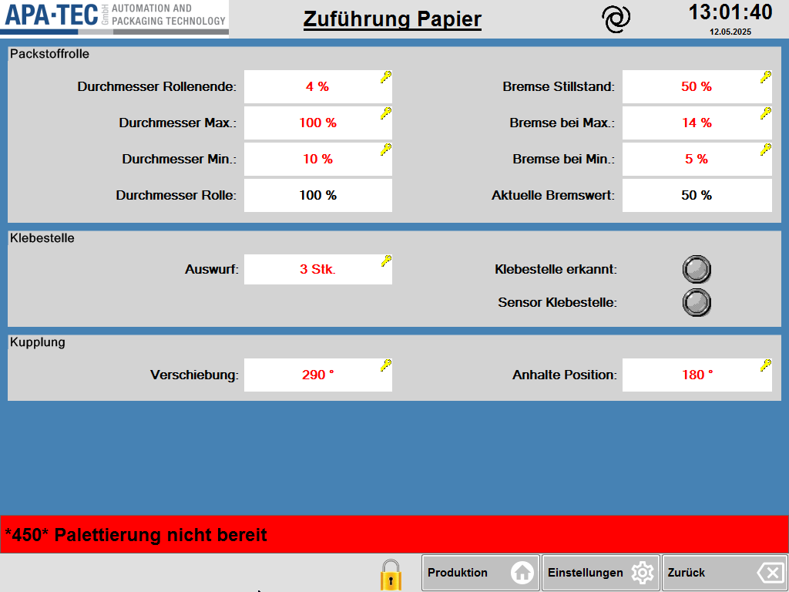

# RS-05 – Zuführung Papier
- Quelle: Handbuch `Referenz.docx`, Kapitel 5 „Zuführung Papier“ (Zweck, Seitenübersicht, Funktionsbeschreibung mit Unterbereichen Packstoffrolle, Klebestelle, Kupplung; Tabellen T5 (9 Zeilen), T6 (4 Zeilen), T7 (3 Zeilen), jeweils inkl. Kopfzeile); Bild [RS-05_01.png](../Medien/RS-05_01.png)   - Navigationspfad: Einstellung › Zuführung Papier (Kachel „Zuführung Papier“ auf [RS-04](RS-04_Einstellungen.md))

## Zweck
Wortgetreu: „Auf dieser Seite werden die Einstellungen für die Packstoffrolle, die Klebestelle und der Kupplung vorgenommen.“

## Aufbau (Bereiche, Layout)
Beschreibung des Bildes [RS-05_01.png](../Medien/RS-05_01.png) (1024 × 768 px, Datum im Bild 12.05.2025):

- **Kopfzeile:** Logo APA·TEC links, unterstrichener Titel **„Zuführung Papier“** mittig, Spiralsymbol, Uhrzeit „13:01:40“ und Datum „12.05.2025“ rechts (wie auf RS-04).
- **Arbeitsbereich (blau), drei hellgraue Gruppenrahmen untereinander,** jeweils mit Überschrift oben links; im unteren Drittel des Arbeitsbereichs bleibt eine leere blaue Fläche.
  1. **Gruppe „Packstoffrolle“:** zwei Spalten mit je 4 Zeilen (Beschriftung rechtsbündig links vom weißen Wertefeld).
     - Linke Spalte: „Durchmesser Rollenende:“ = **4 %**, „Durchmesser Max.:“ = **100 %**, „Durchmesser Min.:“ = **10 %** (alle drei rote Schrift mit gelbem Schlüssel-Symbol oben rechts im Feld), „Durchmesser Rolle:“ = **100 %** (schwarze Schrift, ohne Schlüssel).
     - Rechte Spalte: „Bremse Stillstand:“ = **50 %**, „Bremse bei Max.:“ = **14 %**, „Bremse bei Min.:“ = **5 %** (rot, mit Schlüssel), „Aktuelle Bremswert:“ = **50 %** (schwarz, ohne Schlüssel).
  2. **Gruppe „Klebestelle“:** links Feld „Auswurf:“ = **3 Stk.** (rot, Schlüssel); rechts zwei runde graue LED-Anzeigen mit Beschriftung „Klebestelle erkannt:“ und „Sensor Klebestelle:“ (im Bild beide grau, also aus/inaktiv).
  3. **Gruppe „Kupplung“:** links „Verschiebung:“ = **290 °**, rechts „Anhalte Position:“ = **180 °** (beide rot, Schlüssel).
- **Meldezeile (rot):** „\*450\* Palettierung nicht bereit“.
- **Fußleiste:** Schloss-Symbol (gelb), Tasten „Produktion“ (Haus), „Einstellungen“ (Zahnrad), „Zurück“ (Pfeil). Links unten keine Taste.

Bildgestaltung: rote Schrift mit gelbem Schlüssel = Eingabefeld; schwarze Schrift ohne Schlüssel = reine Anzeige. Diese Deutung der Farben ist aus dem Bild abgeleitet, im Handbuch nicht erklärt (siehe Offene Punkte).

## Elemente
Alle Zeilen der Handbuchtabellen T5, T6, T7 (Spalten Funktion | Beschreibung; Beschreibung wortgetreu). Wertebereiche, Standardwerte und Berechtigungen nennt das Handbuch nicht; angegeben ist deshalb nur der im Bild sichtbare Beispielwert samt Einheit (kein Standardwert).

### Bereich „Packstoffrolle“ (T5, 8 Datenzeilen)
| Element (Funktion) | Typ | Beschreibung (wortgetreu) | Wert im Bild, Einheit | verwendetes Modul |
|---|---|---|---|---|
| Durchmesser Rollenende | Eingabefeld (rot, Schlüssel) | Prozentualer Füllstand der Rolle, ab dem die Meldung *Rollenende* ausgegeben wird. Diese Meldung führt zum Stopp der Maschine. | 4 % | Modulkandidat: Eingabefeld mit Schlüsselsymbol |
| Bremse Stillstand | Eingabefeld (rot, Schlüssel) | Stellwert der an die Bremse gesendet wird, wenn die Maschine steht. Soll hoch genug sein um ein Abrollen zu verhindern aber nicht zu hoch, um ein übermäßiges Losbrechmoment zu vermeiden. | 50 % | Modulkandidat: Eingabefeld mit Schlüsselsymbol |
| Durchmesser Max | Eingabefeld (rot, Schlüssel) | Oberer Durchmesser, ab dem die Bremse den Stellwert aus dem Feld *Bremse bei Max* als Stellwert erhält. Bei größeren Durchmessern steigt der Bremsdruck nicht weiter. | 100 % (Bild: „Durchmesser Max.“) | Modulkandidat: Eingabefeld mit Schlüsselsymbol |
| Bremse bei Max | Eingabefeld (rot, Schlüssel) | Stellwert der Bremse bei dem Durchmesser welcher im Feld *Durchmesser Max* angegeben wird. Der Bremsdruck steigt im Betrieb nicht über diesen Wert hinaus. | 14 % (Bild: „Bremse bei Max.“) | Modulkandidat: Eingabefeld mit Schlüsselsymbol |
| Durchmesser Min | Eingabefeld (rot, Schlüssel) | Unterer Durchmesser, ab dem die Bremse den Wert aus dem Feld *Bremse bei Min* als Stellwert erhält. Bei kleineren Durchmessern sinkt der Bremsdruck nicht weiter. | 10 % (Bild: „Durchmesser Min.“) | Modulkandidat: Eingabefeld mit Schlüsselsymbol |
| Bremse bei Min | Eingabefeld (rot, Schlüssel) | Stellwert der Bremse bei dem Durchmesser welcher im Feld *Durchmesser Min* angegeben wird. Der Bremsdruck sinkt im Betrieb nicht unter diesen Wert. | 5 % (Bild: „Bremse bei Min.“) | Modulkandidat: Eingabefeld mit Schlüsselsymbol |
| Durchmesser Rolle | Anzeigefeld (schwarz, ohne Schlüssel) | Aktueller gemessener Rollendurchmesser. 100% entspricht dem maximalen Durchmesser, welcher auf der Maschine gefahren wird. 0% dem Rollenkern. Bei deutlichen Abweichungen sollte der Sensor zur Durchmessermessung geprüft und gegebenenfalls neu justiert werden. | 100 % (Wertebereich laut Text 0 % bis 100 %) | Modulkandidat: Anzeigefeld |
| Aktueller Bremsdruck | Anzeigefeld (schwarz, ohne Schlüssel) | Aktuell an die Bremse gesendeter Stellwert. | 50 % (Bild-Beschriftung: „Aktuelle Bremswert“) | Modulkandidat: Anzeigefeld |

### Bereich „Klebestelle“ (T6, 3 Datenzeilen)
| Element (Funktion) | Typ | Beschreibung (wortgetreu) | Wert im Bild, Einheit | verwendetes Modul |
|---|---|---|---|---|
| Auswurf | Eingabefeld (rot, Schlüssel) | Anzahl der Packungen, die bei Erkennung eines Klebestreifens ausgeworfen werden. Die Packungen werden um die erkannte Klebestelle herum als schlecht markiert. Bei einem Wert von 3 werden die betroffene Packung als schlecht markiert und je eine Packung davor und danach. | 3 Stk. | Modulkandidat: Eingabefeld mit Schlüsselsymbol |
| Klebestelle erkannt | Status-LED (rund, grau = im Bild aus) | Zeigt an, ob im letzten Takt eine Klebestelle erkannt wurde. | grau (aus); Farbe im Zustand „an“ nicht dargestellt | Modulkandidat: Status-LED |
| Sensor Klebestelle | Status-LED (rund, grau = im Bild aus) | Zeigt den aktuellen Status des Eingangs für den Klebestellensensor an. | grau (aus); Farbe im Zustand „an“ nicht dargestellt | Modulkandidat: Status-LED |

### Bereich „Kupplung“ (T7, 2 Datenzeilen)
| Element (Funktion) | Typ | Beschreibung (wortgetreu) | Wert im Bild, Einheit | verwendetes Modul |
|---|---|---|---|---|
| Verschiebung | Eingabefeld (rot, Schlüssel) | Einstellung der elektronischen Kupplung zur Hauptmaschine. Muss angepasst werden, wenn der Papierabzug nicht mit der Position des Dornrads übereinstimmt. Die Einstellung kann im Stillstand oder während der Produktion erfolgen. Beim Verstellen bewegt sich die Zuführung – eine Bewegung in beide Richtungen ist möglich, was zu einem Papierriss führen kann | 290 ° | Modulkandidat: Eingabefeld mit Schlüsselsymbol |
| Anhalte Position | Eingabefeld (rot, Schlüssel) | Position, an der die Zuführung zum Stillstand kommt, wenn sie ausgekoppelt wird. | 180 ° | Modulkandidat: Eingabefeld mit Schlüsselsymbol |

### Rahmenelemente (nur im Bild, nicht im Text)
| Element | Typ | Funktion | verwendetes Modul |
|---|---|---|---|
| Logo, Titel „Zuführung Papier“, Spiralsymbol, Uhrzeit und Datum | Seitenkopf | siehe Aufbau; Funktion nicht im Text beschrieben | Modulkandidat: Seitenkopf |
| Gruppenrahmen „Packstoffrolle“, „Klebestelle“, „Kupplung“ | Gruppenrahmen mit Überschrift | gliedert die Parameter | Modulkandidat: Gruppenrahmen |
| Meldezeile (rot) | Anzeige/Taste | Beispiel „\*450\* Palettierung nicht bereit“ | Modulkandidat: Meldezeile |
| Schloss-Symbol und Tasten „Produktion“, „Einstellungen“, „Zurück“ | Fußleiste | Navigation; im Text nicht beschrieben | Modulkandidat: Fußleiste |

Summe erfasst: 13 Datenzeilen aus den Handbuchtabellen (8 + 3 + 2), 1 Bild.

## Verwendete Module (IDs)
Noch keine RM-IDs vergeben. Modulkandidaten: Eingabefeld mit Schlüsselsymbol (9 Felder), Anzeigefeld (2), Status-LED (2), Gruppenrahmen (3), Seitenkopf, Meldezeile, Fußleiste. Das Eingabe-Pop-up (Modulkandidat: Pop-up-Eingabe) ist auf dieser Seite nicht beschrieben, wird aber beim Antippen der Eingabefelder vermutet (siehe Offene Punkte).

## Zustände und Interaktion (inkl. Pop-ups, Berechtigungen, Fehlerfälle)
- **Navigation:** Einstieg über Kachel „Zuführung Papier“ auf RS-04; zurück über „Zurück“ oder „Einstellungen“ der Fußleiste. Keine Unterseiten und keine Pop-ups im Handbuch beschrieben.
- **Eingabefelder:** Felder mit Schlüsselsymbol (rote Schrift) sind Einstellwerte; Anzeigefelder (schwarz) sind nur lesbar. Die Eingabe selbst (Tastenfeld/Pop-up, Bereichsprüfung) ist nicht beschrieben.
- **Berechtigungen:** Nicht im Text. Das gelbe Schlüssel-Symbol an den Feldern deutet eine berechtigungsgeschützte Eingabe an (Deutung aus dem Bild); die Berechtigungsstufe ist nicht genannt.
- **Meldung Rollenende:** Annahme (Auslegung): Wird ausgegeben, wenn der Füllstand den Wert „Durchmesser Rollenende“ unterschreitet; die Quelle sagt nur (Beschreibung: „Prozentualer Füllstand der Rolle, ab dem die Meldung *Rollenende* ausgegeben wird“); die Meldung führt zum Stopp der Maschine (Quelle).
- **Bremskennlinie:** Der Bremsstellwert verläuft zwischen „Durchmesser Min“ / „Bremse bei Min“ und „Durchmesser Max“ / „Bremse bei Max“; außerhalb dieser Durchmesser bleibt er auf dem jeweiligen Grenzwert. Im Stillstand gilt „Bremse Stillstand“. Der Verlauf zwischen den Punkten (linear?) ist nicht beschrieben.
- **Klebestelle:** Bei Erkennung werden „Auswurf“ Packungen als schlecht markiert (Wert 3: betroffene Packung plus je eine davor und danach). „Klebestelle erkannt“ gilt für den letzten Takt.
- **Kupplung:** Verstellen „Verschiebung“ bewegt die Zuführung in beide Richtungen, auch während der Produktion; Gefahr von Papierriss (Warnhinweis aus dem Handbuch, kein Pop-up beschrieben).
- **Abweichende Rollendurchmesser:** Bei deutlichen Abweichungen von „Durchmesser Rolle“ soll der Durchmessersensor geprüft und gegebenenfalls neu justiert werden (Hinweis im Handbuch).
- **Fehlerfälle/Meldungen:** Außer der Meldung „Rollenende“ keine; die rote Meldezeile ist im Bild vorhanden.

## Prüfpunkte
| ID | Prüfung | erwartetes Ergebnis | Status |
|---|---|---|---|
| RS-05-P01 | Tabelle T5 „Packstoffrolle“ abgleichen | Alle 8 Funktionen (Durchmesser Rollenende, Bremse Stillstand, Durchmesser Max, Bremse bei Max, Durchmesser Min, Bremse bei Min, Durchmesser Rolle, Aktueller Bremsdruck) mit wortgetreuer Beschreibung erfasst | offen |
| RS-05-P02 | Tabelle T6 „Klebestelle“ abgleichen | Alle 3 Funktionen (Auswurf, Klebestelle erkannt, Sensor Klebestelle) mit wortgetreuer Beschreibung erfasst | offen |
| RS-05-P03 | Tabelle T7 „Kupplung“ abgleichen | Beide Funktionen (Verschiebung, Anhalte Position) mit wortgetreuer Beschreibung erfasst, inkl. Warnung vor Papierriss | offen |
| RS-05-P04 | Beispielwerte aus [RS-05_01.png](../Medien/RS-05_01.png) | 4 %, 100 %, 10 %, 100 % (links) und 50 %, 14 %, 5 %, 50 % (rechts); Auswurf 3 Stk.; Verschiebung 290 °; Anhalte Position 180 ° | offen |
| RS-05-P05 | Einheiten | Durchmesser- und Bremsfelder in %, Auswurf in Stk., Verschiebung und Anhalte Position in ° | offen |
| RS-05-P06 | Eingabe- gegenüber Anzeigefeldern im Bild | 9 Felder mit Schlüsselsymbol und roter Schrift (Eingabe), 2 schwarze Felder ohne Schlüssel (Durchmesser Rolle, Aktueller Bremsdruck) | offen |
| RS-05-P07 | Status-LEDs | „Klebestelle erkannt“ und „Sensor Klebestelle“ sind runde LEDs, im Bild grau | offen |
| RS-05-P08 | Beschriftungsabweichung Bild/Text | „Aktuelle Bremswert“ (Bild) gegenüber „Aktueller Bremsdruck“ (Text) ist dokumentiert | offen |
| RS-05-P09 | Gruppen und Layout | 3 Gruppenrahmen in der Reihenfolge Packstoffrolle, Klebestelle, Kupplung; zweispaltig; Bild vollständig beschrieben | offen |
| RS-05-P10 | Navigation und Fußleiste | Pfad „Einstellung › Zuführung Papier“, Fußleiste (Schloss, Produktion, Einstellungen, Zurück) und Meldezeile erfasst | offen |
| RS-05-P11 | Links | Medienlink RS-05_01.png und Link auf RS-04 lösen auf | offen |
| RS-05-P12 | Neues HMI: Bremsparameter | Alle 6 Bremsparameter-Eingabefelder und die 2 Anzeigewerte sind vorhanden, Rollenende-Meldung führt zum Maschinenstopp | offen |

## Offene Punkte
1. Wertebereiche (Min/Max) und Standardwerte aller Eingabefelder sind im Handbuch nicht angegeben (nur Beispielwerte im Bild).
2. Berechtigungsstufe für die Felder mit Schlüsselsymbol und Bedeutung des Schloss-Symbols in der Fußleiste sind nicht beschrieben.
3. Das Eingabeverfahren (Pop-up/Tastenfeld, Bestätigung, Plausibilitätsprüfung z. B. Max > Min) ist nicht beschrieben.
4. Beschriftung weicht ab: Bild „Aktuelle Bremswert“, Text „Aktueller Bremsdruck“; Bild „Durchmesser Max.:“ mit Punkt, Text „Durchmesser Max“.
5. Farben der Status-LEDs im Zustand „an“ sind nicht dokumentiert (Bild zeigt nur grau).
6. Verlauf der Bremskennlinie zwischen Min und Max (linear?) ist nicht beschrieben.
7. Die Funktion der Anzeige „Durchmesser Rolle“ nutzt „100 %“ als maximalen Durchmesser; das Handbuch nennt keinen absoluten Wert in mm.
8. Kein Warnhinweis/Pop-up beim Verstellen der „Verschiebung“ beschrieben; der Satz im Handbuch endet ohne Punkt.
