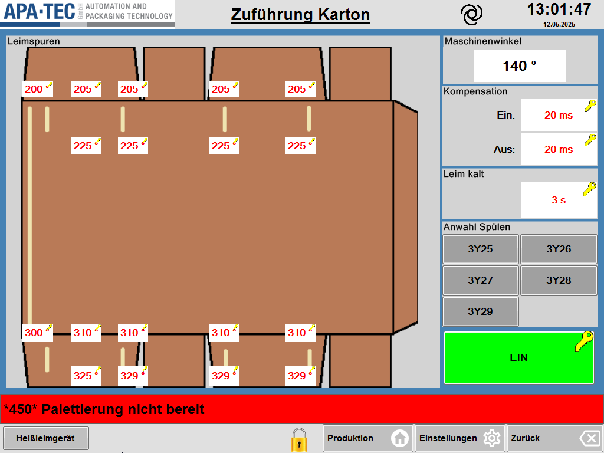

# RS-06 – Zuführung Karton
- Quelle: Handbuch `Referenz.docx`, Kapitel 6 „Zuführung Karton“ (Zweck, Seitenübersicht, Funktionsbeschreibung; Tabelle T8, 8 Zeilen inkl. Kopfzeile); Bild [RS-06_01.png](../Medien/RS-06_01.png)   - Navigationspfad: Einstellung › Zuführung Karton (Kachel „Zuführung Karton“ auf [RS-04](RS-04_Einstellungen.md)); Unterseite über Taste „Heißleimgerät“: Einstellung › Zuführung Karton › Heißleimgerät (RS-07)

## Zweck
Wortgetreu: „Auf dieser Seite werden die Leimspuren auf dem Karton eingestellt, sowie die Kompensationszeit der Leimventile und ab wann ein Karton schlecht markiert wird, weil der Heißleim kalt ist. Für das Leimspülen, werden hier die Ventile angewählt und der Heißleimauftrag kann abgewählt werden.“

## Aufbau (Bereiche, Layout)
Beschreibung des Bildes [RS-06_01.png](../Medien/RS-06_01.png) (1024 × 768 px, Datum im Bild 12.05.2025):

- **Kopfzeile:** Logo APA·TEC, unterstrichener Titel **„Zuführung Karton“**, Spiralsymbol, Uhrzeit „13:01:47“, Datum „12.05.2025“.
- **Linker großer Bereich (ca. 3/4 der Breite), Gruppe „Leimspuren“** (Überschrift oben links): Grafik eines aufgefalteten braunen Kartonzuschnitts (Faltschachtel-Abwicklung, Draufsicht) mit Hauptfläche in der Mitte, Klappen oben (4 Stück) und unten (4 Stück) und Verschlusslasche rechts. Darauf helle, senkrechte Striche als Leimspuren: eine lange Spur am linken Rand der Hauptfläche, kurze Spuren oben (an 4 Stellen) und unten (an 4 Stellen) sowie kurze Spuren an den unteren Klappen. An den Spuren liegen **18 weiße Eingabefelder** (rote Zahl, gelbes Schlüssel-Symbol, kleines Gradzeichen neben der Zahl sichtbar), angeordnet in 4 Reihen:
  - Reihe 1 (oberhalb des Zuschnitts, auf den oberen Klappen), 5 Felder von links nach rechts: **200, 205, 205, 205, 205**.
  - Reihe 2 (oben im Zuschnitt unter der Oberkante), 4 Felder: **225, 225, 225, 225** (ausgerichtet unter den Feldern 2 bis 5 der Reihe 1).
  - Reihe 3 (unten im Zuschnitt über der Unterkante), 5 Felder: **300, 310, 310, 310, 310**.
  - Reihe 4 (auf den unteren Klappen), 4 Felder: **325, 329, 329, 329** (ausgerichtet unter den Feldern 2 bis 5 der Reihe 3).
  Die Zahlen sind nach Bild Winkelwerte (Maschinenwinkel, Einheit Grad); die Einheit „°“ ist neben den Zahlen nur klein erkennbar.
- **Rechte Spalte (ca. 1/4 der Breite), von oben nach unten:**
  1. Gruppe **„Maschinenwinkel“:** weißes Anzeigefeld mit **140 °** (schwarz, ohne Schlüssel).
  2. Gruppe **„Kompensation“:** zwei Felder „Ein:“ = **20 ms** und „Aus:“ = **20 ms** (rot, Schlüssel).
  3. Gruppe **„Leim kalt“:** ein Feld (ohne Beschriftung neben dem Feld) = **3 s** (rot, Schlüssel).
  4. Gruppe **„Anwahl Spülen“:** 5 graue Tasten in 2 Spalten: **3Y25, 3Y26, 3Y27, 3Y28, 3Y29** (die letzte Taste allein in der dritten Zeile links; alle im Bild grau, d. h. nicht gewählt/aus).
  5. Große **grüne Taste „EIN“** mit gelbem Schlüssel-Symbol oben rechts (im Bild grün mit Text „EIN“).
- **Meldezeile (rot):** „\*450\* Palettierung nicht bereit“.
- **Fußleiste:** links unten Taste **„Heißleimgerät“** (nur auf dieser Seite); rechts Schloss-Symbol (gelb), Tasten „Produktion“ (Haus), „Einstellungen“ (Zahnrad), „Zurück“ (Pfeil).

## Elemente
Alle 7 Datenzeilen der Handbuchtabelle T8 (Spalten Funktion | Beschreibung; Beschreibung wortgetreu). Wertebereiche, Standardwerte und Berechtigungen nennt das Handbuch nicht; angegeben ist nur der im Bild sichtbare Beispielwert (kein Standardwert).

| Element (Funktion) | Typ | Beschreibung (wortgetreu) | Wert im Bild, Einheit | verwendetes Modul |
|---|---|---|---|---|
| Maschinenwinkel | Anzeigefeld (schwarz, ohne Schlüssel) | Zeigt den aktuellen Maschinenwinkel an. Dieser wird für die Einstellung der Leimspuren benötigt. | 140 ° | [RM-07](../Module/RM-07_Anzeigefeld.md) |
| Leimspuren | 18 Eingabefelder (rot, Schlüssel) in der Kartongrafik | Einstellungen für die Leimspuren. Jede Spur besitzt einen Anfangs- und Endpunkt, bezogen auf den *Maschinenwinkel*. | Reihe 1: 200, 205, 205, 205, 205; Reihe 2: 225, 225, 225, 225; Reihe 3: 300, 310, 310, 310, 310; Reihe 4: 325, 329, 329, 329; Einheit vermutlich ° | [RM-28](../Module/RM-28_Leimspuren-Grafik.md) (Karton mit Winkelfeldern); [RM-05](../Module/RM-05_Eingabefeld-mit-Schluesselsymbol.md) |
| Kompensation | 2 Eingabefelder „Ein:“ und „Aus:“ (rot, Schlüssel) | Zeit in Millisekunden, welche die Leimventile zum Ein- bzw. Ausschalten benötigen. Die Ein- und Ausschaltzeitpunkte werden um diesen Betrag verschoben, um einen gleichmäßigen Leimauftrag unabhängig von der Maschinengeschwindigkeit zu gewährleisten. | Ein: 20 ms; Aus: 20 ms | [RM-05](../Module/RM-05_Eingabefeld-mit-Schluesselsymbol.md) |
| Leim kalt | Eingabefeld (rot, Schlüssel) | Wird die Maschine gestoppt, werden alle Kartons mit Leim in der Zuführung nach der Zeitspanne als „schlecht“ markiert. | 3 s | [RM-05](../Module/RM-05_Eingabefeld-mit-Schluesselsymbol.md) |
| Anwahl Spülen | 5 Tasten (Umschalter, grau im Bild) 3Y25, 3Y26, 3Y27, 3Y28, 3Y29 | An der Zuführung ist eine Hardwaretaste *Leim Spülen* montiert, über die Tasten im Bereich *Anwahl Spülen* kann festgelegt werden, welche Leimventile spülen. | alle fünf grau (Zustand „gewählt“ im Bild nicht dargestellt) | [RM-10](../Module/RM-10_Umschalter-Taste.md) (Ventilanwahl) |
| Taste Ein / Aus | Taste mit Schlüssel-Symbol, im Bild grün mit Text „EIN“ | Erlaubt das Abwählen vom Heißleimauftrag. | „EIN“ (grün) | [RM-10](../Module/RM-10_Umschalter-Taste.md) Ein/Aus |
| Heißleimgerät | Taste (links unten, Fußleiste) | Öffnet die Seite mit Status- und Einstellmöglichkeiten für das Heißleimgerät der Zuführung. | – | [RM-03](../Module/RM-03_Funktionsleiste-unten.md) (Fußleiste links) |

Einzelne Leimspur-Felder (Bild, zur Prüfung der Vollständigkeit; Position von links nach rechts):

| Reihe | Lage | Feld 1 | Feld 2 | Feld 3 | Feld 4 | Feld 5 |
|---|---|---|---|---|---|---|
| 1 | oben, obere Klappen | 200 | 205 | 205 | 205 | 205 |
| 2 | oben im Zuschnitt | – | 225 | 225 | 225 | 225 |
| 3 | unten im Zuschnitt | 300 | 310 | 310 | 310 | 310 |
| 4 | untere Klappen | – | 325 | 329 | 329 | 329 |

Hinweis: Feld 1 der Reihen 1 und 3 (200 und 300) liegt an der langen linken Leimspur; die Zuordnung „Anfangs-/Endpunkt“ zu Reihen (oben = Anfang, unten = Ende?) ist im Handbuch nicht beschrieben, aber aus dem Satz „Jede Spur besitzt einen Anfangs- und Endpunkt“ plausibel. Ob Reihe 1 und 2 bzw. 3 und 4 je einen Anfangs- und Endpunkt derselben Spur darstellen, ist nicht belegt (siehe Offene Punkte).

Rahmenelemente (nur im Bild): Seitenkopf (Logo, Titel, Spiralsymbol, Uhrzeit, Datum; [RM-01](../Module/RM-01_Kopfzeile.md)), Gruppenrahmen „Leimspuren“, „Maschinenwinkel“, „Kompensation“, „Leim kalt“, „Anwahl Spülen“ ([RM-15](../Module/RM-15_Gruppenrahmen.md)), Meldezeile ([RM-02](../Module/RM-02_Meldezeile.md)), Fußleiste mit Schloss und Tasten „Produktion“, „Einstellungen“, „Zurück“ ([RM-03](../Module/RM-03_Funktionsleiste-unten.md)).

Summe erfasst: 7 Datenzeilen aus T8, 18 Leimspur-Felder, 1 Bild.

## Verwendete Module (IDs)

Module dieser Seite (Definitionen in der [Modulliste](../Module/Modulliste.md)):

- [RM-01](../Module/RM-01_Kopfzeile.md) – Kopfzeile
- [RM-02](../Module/RM-02_Meldezeile.md) – Meldezeile
- [RM-03](../Module/RM-03_Funktionsleiste-unten.md) – Funktionsleiste unten
- [RM-05](../Module/RM-05_Eingabefeld-mit-Schluesselsymbol.md) – Eingabefeld mit Schlüsselsymbol
- [RM-06](../Module/RM-06_Eingabe-Pop-up.md) – Eingabe-Pop-up
- [RM-07](../Module/RM-07_Anzeigefeld.md) – Anzeigefeld
- [RM-10](../Module/RM-10_Umschalter-Taste.md) – Umschalter-Taste
- [RM-15](../Module/RM-15_Gruppenrahmen.md) – Gruppenrahmen
- [RM-28](../Module/RM-28_Leimspuren-Grafik.md) – Leimspuren-Grafik

Das Eingabe-Pop-up ([RM-06](../Module/RM-06_Eingabe-Pop-up.md)) ist nicht beschrieben, wird aber vermutet.

## Zustände und Interaktion (inkl. Pop-ups, Berechtigungen, Fehlerfälle)
- **Navigation:** Einstieg über Kachel „Zuführung Karton“ auf RS-04. Taste „Heißleimgerät“ öffnet RS-07 (Heißleim Nordson); von dort weitere Seiten RS-08 bis RS-10 laut Referenz-Uebersicht. Zurück über „Zurück“/„Einstellungen“.
- **Eingabefelder:** Rote Zahlen mit Schlüsselsymbol sind Einstellwerte, schwarze Anzeige nur lesbar (Deutung aus dem Bild). Das Eingabeverfahren ist nicht beschrieben.
- **Berechtigungen:** Im Text nicht genannt; Schlüsselsymbole an den Feldern und an der EIN-Taste im Bild.
- **Leimspuren:** Jede Spur hat einen Anfangs- und Endpunkt bezogen auf den Maschinenwinkel; der aktuelle Maschinenwinkel wird zur Einstellung angezeigt (140 °).
- **Kompensation:** Die Ein- und Ausschaltzeitpunkte werden um den Betrag verschoben (unabhängig von der Maschinengeschwindigkeit gleichmäßiger Leimauftrag).
- **Leim kalt:** Nach Maschinenstopp werden alle Kartons mit Leim in der Zuführung nach Ablauf der Zeitspanne als „schlecht“ markiert.
- **Anwahl Spülen:** Die Tasten wählen, welche Leimventile beim Betätigen der Hardwaretaste *Leim Spülen* an der Zuführung spülen. Ein gewählter Zustand ist im Bild nicht zu sehen (alle grau).
- **Taste Ein / Aus:** Wählt den Heißleimauftrag ab. Im Bild grün „EIN“; die Darstellung „AUS“ ist nicht gezeigt.
- **Pop-ups/Unterseiten:** Unterseite Heißleimgerät (RS-07). Kein Pop-up beschrieben.
- **Fehlerfälle:** Keine beschrieben; Meldezeile im Bild rot.

## Prüfpunkte
| ID | Prüfung | erwartetes Ergebnis | Status |
|---|---|---|---|
| RS-06-P01 | Tabelle T8 abgleichen | Alle 7 Funktionen (Maschinenwinkel, Leimspuren, Kompensation, Leim kalt, Anwahl Spülen, Taste Ein / Aus, Heißleimgerät) mit wortgetreuer Beschreibung erfasst | offen |
| RS-06-P02 | Leimspur-Felder im Bild zählen | 18 Eingabefelder: Reihe 1 (200, 205, 205, 205, 205), Reihe 2 (225 ×4), Reihe 3 (300, 310, 310, 310, 310), Reihe 4 (325, 329, 329, 329) | offen |
| RS-06-P03 | Anzeige Maschinenwinkel | Anzeigefeld mit Beispielwert 140 °, schwarz, ohne Schlüssel | offen |
| RS-06-P04 | Kompensation | Zwei Felder „Ein:“ und „Aus:“, je 20 ms (Einheit Millisekunden laut Text) | offen |
| RS-06-P05 | Leim kalt | Ein Feld, Beispielwert 3 s | offen |
| RS-06-P06 | Anwahl Spülen | 5 Tasten 3Y25, 3Y26, 3Y27, 3Y28, 3Y29 in Anordnung 2 + 2 + 1 | offen |
| RS-06-P07 | Taste Ein / Aus | Große Taste „EIN“ (grün) mit Schlüssel-Symbol; erlaubt das Abwählen vom Heißleimauftrag | offen |
| RS-06-P08 | Taste „Heißleimgerät“ | Links unten in der Fußleiste, Ziel RS-07, Link lösbar | offen |
| RS-06-P09 | Grafik Leimspuren | Kartonzuschnitt mit Klappen oben und unten, Verschlusslasche rechts, helle Leimspuren (1 lange am linken Rand) sind beschrieben | offen |
| RS-06-P10 | Layout rechte Spalte | Reihenfolge von oben: Maschinenwinkel, Kompensation, Leim kalt, Anwahl Spülen, EIN-Taste | offen |
| RS-06-P11 | Navigation, Fußleiste, Meldezeile | Pfad „Einstellung › Zuführung Karton“, Schloss und Tasten Produktion/Einstellungen/Zurück, Meldung „\*450\* Palettierung nicht bereit“ erfasst | offen |
| RS-06-P12 | Links | Medienlink RS-06_01.png, Links auf RS-04 und RS-07 lösen auf | offen |
| RS-06-P13 | Neues HMI: Leimspuren | Alle 18 Winkelfelder je Spur (Anfang/Ende), Kompensation Ein/Aus, Leim kalt, Spülventil-Anwahl (5 Ventile) und Ein/Aus-Taste vorhanden | offen |

## Offene Punkte
1. Wertebereiche und Standardwerte aller Eingabefelder (Leimspuren in °, Kompensation in ms, Leim kalt in s) fehlen im Handbuch; nur Beispielwerte im Bild.
2. Einheit der Leimspur-Felder im Handbuch nicht genannt (im Bild „°“ nur klein erkennbar, daher vermutet).
3. Zuordnung der 18 Felder zu Spuren (welche Felder Anfang bzw. Ende welcher Spur sind; 18 Felder gegenüber 9 sichtbaren Spuren) ist nicht beschrieben.
4. Berechtigung/Benutzerstufe der Schlüssel-Felder und Bedeutung des Schloss-Symbols nicht beschrieben; Eingabeverfahren (Pop-up) ebenfalls nicht.
5. Zustände der Tasten „Anwahl Spülen“ (gewählt/nicht gewählt) und „Taste Ein / Aus“ (AUS-Darstellung, Farbe) sind im Bild nur mit einem Zustand sichtbar.
6. Verwendete Bezeichnungen der Ventile (3Y25 bis 3Y29) sind elektrische Betriebsmittelkennzeichen; Bezug zu den Leimspuren/Düsen nicht erklärt.
7. Das Feld bei „Leim kalt“ hat im Bild keine eigene Beschriftung/Einheit außer „s“; der Text nennt keine Einheit („Zeitspanne“).
8. Auswirkung von „Taste Ein / Aus“ (Abwählen des Heißleimauftrags) auf Betrieb und Meldungen nicht beschrieben.
