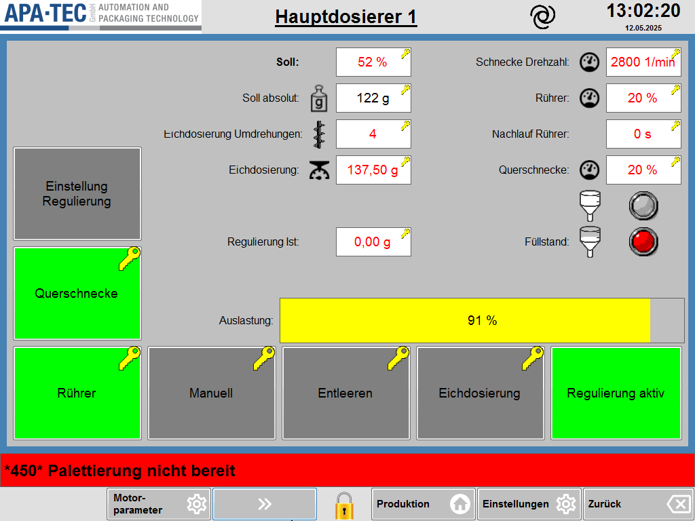

# RS-11 – Hauptdosierer 1 & 2

- Quelle: `src_Data/Referenz/Referenz.docx`, Kapitel 11 „Hauptdosierer 1 & 2“ (Zweck, Seitenübersicht, Funktionsbeschreibung mit Tabellen T14, T15, T16); Bilder `RS-11_01` … `RS-11_09` (siehe [Medienliste](../Medien/Medienliste.md))
- Navigationspfad: Einstellung › Hauptdosierer (Herkunft: Handbuch; Zugang: Eintrag in der Tabelle von RS-04; Pfeiltasten wechseln zwischen Hauptdosierer 1 und 2)

## Zweck

Wortgetreu (Handbuch): „Die Seite Hauptdosierer beinhaltet die Parameter, die Anwahlen und den Status der beiden Schneckendosierer.“

Es gibt eine Seite, die für Hauptdosierer 1 und Hauptdosierer 2 verwendet wird; die Pfeiltasten in der Navigation unten links schalten zwischen beiden um. Der Screenshot zeigt Hauptdosierer 1 (Seitentitel „Hauptdosierer 1“).

## Aufbau (Bereiche, Layout)

Abbildung der Seite:  ([RS-11_01.png](../Medien/RS-11_01.png), 1024 × 768 px, Seitenverhältnis 4:3)

Beschreibung des Bildes (von oben nach unten):

1. **Kopfzeile** (hellgrauer Streifen): links Logo „APA-TEC GmbH – AUTOMATION AND PACKAGING TECHNOLOGY“; Mitte der unterstrichene fette Seitentitel „Hauptdosierer 1“; rechts davon ein schwarzes Spiral-/Wirbel-Symbol (Funktion im Handbuch nicht beschrieben); ganz rechts die Uhrzeit „13:02:20“ (groß, fett) mit Datum „12.05.2025“ darunter.
2. **Arbeitsfläche** (hellgraues Panel mit blauem Rahmen/Hintergrund), dreispaltig aufgebaut:
   - **Linke Spalte, Schaltflächen (hochkant):** oben „Einstellung Regulierung“ (grau, ohne Schlüsselsymbol), darunter „Querschnecke“ (grün, mit gelbem Schlüsselsymbol oben rechts).
   - **Mittlere Spalte, Beschriftungen und Eingabefelder (links ausgerichtet, Beschriftung rechtsbündig vor dem Feld):** „Soll:“ (fett) – Feld „52 %“ (rote Schrift, Schlüsselsymbol); „Soll absolut:“ mit Gewichts-Symbol – Feld „122 g“ (schwarze Schrift, Schlüsselsymbol); „Eichdosierung Umdrehungen:“ mit Schnecken-Symbol – Feld „4“ (rot, Schlüsselsymbol); „Eichdosierung:“ mit Waagschalen-Symbol – Feld „137,50 g“ (rot, Schlüsselsymbol); „Regulierung Ist:“ – Feld „0,00 g“ (rot, Schlüsselsymbol).
   - **Rechte Spalte:** „Schnecke Drehzahl:“ mit Tacho-Symbol – Feld „2800 1/min“ (rot, Schlüsselsymbol); „Rührer:“ mit Tacho-Symbol – Feld „20 %“ (rot, Schlüsselsymbol); „Nachlauf Rührer:“ (ohne Symbol) – Feld „0 s“ (rot, Schlüsselsymbol); „Querschnecke:“ mit Tacho-Symbol – Feld „20 %“ (rot, Schlüsselsymbol); darunter zwei Trichter-Symbole (oberes: Füllstand oben, unteres: Füllstand unten) mit je einer runden Kontrollleuchte rechts daneben (oben grau, unten rot); neben dem unteren Trichter die Beschriftung „Füllstand:“.
   - **Unterhalb der Felder, über die Breite:** Balkenanzeige „Auslastung:“ mit Prozentwert „91 %“ mittig im Balken; Balken gelb gefüllt bis ca. 91 % der Länge, Rest grau.
   - **Untere Schaltflächenreihe der Arbeitsfläche (fünf gleich große Tasten):** „Rührer“ (grün, Schlüsselsymbol), „Manuell“ (grau, Schlüsselsymbol), „Entleeren“ (grau, Schlüsselsymbol), „Eichdosierung“ (grau, Schlüsselsymbol), „Regulierung aktiv“ (grün, ohne Schlüsselsymbol).
3. **Meldezeile** (rot, volle Breite): Text „*450* Palettierung nicht bereit“ (fett, schwarz auf rot).
4. **Funktionsleiste unten** (hellgrau): von links nach rechts: Taste „Motor-parameter“ mit Zahnrad-Symbol; Taste mit Doppelpfeil „»“ (grau); mittig ein gelbes Schloss-Symbol (geschlossen); Taste „Produktion“ mit Haus-Symbol; Taste „Einstellungen“ mit Zahnrad-Symbol; Taste „Zurück“ mit Rückwärts-Löschen-Symbol (Pfeil in Tastenform).

Hinweis: Die Anordnung des Screenshots ist Referenz für Funktionsumfang; Layout des neuen HMI folgt dem Design (Agent.md, Abschnitt 2).

## Elemente (Tabelle: Element | Typ | Funktion | verwendetes Modul)

Gemeinsame Hinweise zu den Tabellen: Das Handbuch nennt für keine Zeile Wertebereich, Standardwert oder Berechtigung. Die Spalte „Wert/Einheit im Screenshot“ gibt den im Bild sichtbaren Wert wieder (Beispielwert, kein Standardwert). Ein gelbes Schlüsselsymbol an der Feld-/Tastenecke ist im Screenshot sichtbar; seine Bedeutung (Berechtigungsstufe) ist im Handbuch nicht beschrieben (siehe Offene Punkte).

### Tabelle T14 – Parameter und Status (13 Zeilen inkl. Kopfzeile; 12 Datenzeilen; Spalten Funktion | Beschreibung | Grafik)

| Nr. | Element (Funktion) | Typ | Beschreibung (wortgetreu, Handbuch) | Grafik (Handbuch) | Wert/Einheit im Screenshot | verwendetes Modul |
|---|---|---|---|---|---|---|
| 1 | Soll | Eingabefeld (rote Schrift, Schlüssel), Beschriftung fett | „Anteil des Zielgewichts, welches bei der Kontrollwaage angegeben wird, welches für den jeweiligen Hauptdosierer abzufüllen ist.“ | keine | „52 %“ (Einheit %) | [RM-05](../Module/RM-05_Eingabefeld-mit-Schluesselsymbol.md) (Eingabefeld mit Schlüsselsymbol) |
| 2 | Soll absolut | Anzeigefeld (schwarze Schrift, Schlüsselsymbol am Feld sichtbar) | „Das abzufüllende Gewicht. Ergibt sich aus der Zielgewicht und dem prozentualen Anteil des Dosierers.“ |  [RS-11_02.png](../Medien/RS-11_02.png) – Gewichtsstück-Symbol (Flasche mit Schild „g“, grau, 68 × 85 px) | „122 g“ (Einheit g) | [RM-05](../Module/RM-05_Eingabefeld-mit-Schluesselsymbol.md) |
| 3 | Eichdosierung Umdrehungen | Eingabefeld (rot, Schlüssel) | „Anzahl Umdrehungen der Dosierschnecke welche bei der *Eichdosierung* ausgeführt wird. Anhand der Umdrehungen und des Gewichtes im Feld *Eichdosierung* berechnet die Maschine die Umdrehungen im Automatikbetrieb.“ |  [RS-11_03.png](../Medien/RS-11_03.png) – Schnecken-Symbol (schwarze Förderschnecke, hochkant, 45 × 87 px) | „4“ (ohne Einheit) | [RM-05](../Module/RM-05_Eingabefeld-mit-Schluesselsymbol.md) |
| 4 | Eichdosierung | Eingabefeld (rot, Schlüssel) | „Hier wird das Gewicht, des während der *Eichdosierung* dosierten Produkts, eingetragen.“ |  [RS-11_04.png](../Medien/RS-11_04.png) – Waagschalen-Symbol (schwarzes Symbol: Schale mit Tropfen/Zeiger, 48 × 48 px) | „137,50 g“ (Einheit g, zwei Nachkommastellen) | [RM-05](../Module/RM-05_Eingabefeld-mit-Schluesselsymbol.md) |
| 5 | Regulierung Ist | Eingabefeld (rot, Schlüssel) | „Aktueller Korrekturwert von der Regulierung. Dieses Gewicht wird auf das *Soll absolut* aufaddiert. Der Wert kann manuell geändert werden.“ | keine | „0,00 g“ (Einheit g, zwei Nachkommastellen) | [RM-05](../Module/RM-05_Eingabefeld-mit-Schluesselsymbol.md) |
| 6 | Schnecke Drehzahl | Eingabefeld (rot, Schlüssel) | „Solldrehzahl der Dosierschnecke.“ |  [RS-11_05.png](../Medien/RS-11_05.png) – Tacho-Symbol (schwarzer Halbkreis-Tacho mit Zeiger, 48 × 48 px) | „2800 1/min“ (Einheit 1/min) | [RM-05](../Module/RM-05_Eingabefeld-mit-Schluesselsymbol.md) |
| 7 | Rührer | Eingabefeld (rot, Schlüssel) | „Sollgeschwindigkeit des Rührers im Trichter.“ |  [RS-11_06.png](../Medien/RS-11_06.png) – Tacho-Symbol (identisch zu RS-11_05) | „20 %“ (Einheit %) | [RM-05](../Module/RM-05_Eingabefeld-mit-Schluesselsymbol.md) |
| 8 | Nachlauf Rührer | Eingabefeld (rot, Schlüssel) | „Zeit, welche der Rührer bei einem Stopp der Maschine nachläuft.“ | keine | „0 s“ (Einheit s) | [RM-05](../Module/RM-05_Eingabefeld-mit-Schluesselsymbol.md) |
| 9 | Querschnecke | Eingabefeld (rot, Schlüssel) | „Sollgeschwindigkeit der Querschnecke in der Produktzuführung.“ |  [RS-11_07.png](../Medien/RS-11_07.png) – Tacho-Symbol (identisch zu RS-11_05) | „20 %“ (Einheit %) | [RM-05](../Module/RM-05_Eingabefeld-mit-Schluesselsymbol.md) |
| 10 | Füllstand Trichter oben | Zustandsanzeige (Trichter-Symbol + runde Kontrollleuchte) | „Zeigt den Status des Sensors im oberen Bereich des Trichters an.“ |  [RS-11_08.png](../Medien/RS-11_08.png) – Trichter-Symbol, Füllstandslinie im oberen Trichterbereich (87 × 121 px) | im Screenshot Kontrollleuchte grau | [RM-08](../Module/RM-08_Status-LED.md) (Trichter + Status-LED) |
| 11 | Füllstand Trichter unten | Zustandsanzeige (Trichter-Symbol + runde Kontrollleuchte) | „Zeigt den Status des Sensors im unteren Bereich des Trichters an.“ |  [RS-11_09.png](../Medien/RS-11_09.png) – Trichter-Symbol, Füllstandslinie im unteren Trichterbereich (97 × 126 px); im Screenshot mit Beschriftung „Füllstand:“ | im Screenshot Kontrollleuchte rot | [RM-08](../Module/RM-08_Status-LED.md) (Trichter + Status-LED) |
| 12 | Auslastung | Balkenanzeige mit Prozentwert | „Zeigt an wieviel Prozent der verfügbaren Zeit der Dosiervorgang benötigt. Die Zeit ergibt sich aus der Länge der Nocke für den Dosierer und der Maschinengeschwindigkeit.“ | keine | „91 %“ (Einheit %), Balken gelb | [RM-09](../Module/RM-09_Fortschrittsbalken.md) (Auslastung) |

### Tabelle T15 – Schaltflächen (8 Zeilen inkl. Kopfzeile; 7 Datenzeilen; Spalten Funktion | Beschreibung)

| Nr. | Element (Funktion) | Typ | Beschreibung (wortgetreu, Handbuch) | Zustand im Screenshot | verwendetes Modul |
|---|---|---|---|---|---|
| 1 | Einstellung Regulierung | Navigationstaste (links oben in der Arbeitsfläche) | „Öffnet die Seite *Regulierung*.“ (Zielseite: [RS-23](RS-23_Regulierung.md)) | grau, kein Schlüsselsymbol | [RM-11](../Module/RM-11_Aktionstaste.md) |
| 2 | Querschnecke | Umschalttaste mit Zustandsfarbe | „Erlaubt das Abwählen der Querschnecke. Dadurch wird kein Produkt in den Trichter nachgefüllt.“ | grün (angewählt), Schlüsselsymbol | [RM-10](../Module/RM-10_Umschalter-Taste.md) (Umschalter mit Zustandsfarbe) |
| 3 | Rührer | Umschalttaste mit Zustandsfarbe | „Abwahl für den Rührer im Trichter.“ | grün (angewählt), Schlüsselsymbol | [RM-10](../Module/RM-10_Umschalter-Taste.md) (Umschalter mit Zustandsfarbe) |
| 4 | Manuel (sic, so im Handbuch; Beschriftung im Screenshot „Manuell“) | Aktionstaste | „Anforderung eines Dosiervorgangs.“ | grau, Schlüsselsymbol | [RM-11](../Module/RM-11_Aktionstaste.md) mit Schlüsselsymbol |
| 5 | Entleeren | Aktionstaste (Dauerfunktion) | „Der Dosierer fördert kontinuierlich Produkt, bis der Vorgang abgebrochen wird.“ | grau, Schlüsselsymbol | [RM-11](../Module/RM-11_Aktionstaste.md) mit Schlüsselsymbol |
| 6 | Eichdosierung | Aktionstaste | „Es wird ein Dosiervorgang gestartet. Der Dosierer macht die im Feld Eichdosierung Umdrehungen angegebenen Umdrehungen. Das dosierte Produkt muss aufgefangen und gewogen werden. Das Gewicht in das Feld Eichdosierung eintragen.“ | grau, Schlüsselsymbol | [RM-11](../Module/RM-11_Aktionstaste.md) mit Schlüsselsymbol |
| 7 | Regulierung aktiv | Umschalttaste mit Zustandsfarbe | „Die automatische Regulierung kann mit dieser Schaltfläche abgewählt werden.“ | grün (aktiv), kein Schlüsselsymbol | [RM-10](../Module/RM-10_Umschalter-Taste.md) (Umschalter mit Zustandsfarbe) |

### Tabelle T16 – Navigation (unten links) (3 Zeilen inkl. Kopfzeile; 2 Datenzeilen; Spalten Funktion | Beschreibung)

| Nr. | Element (Funktion) | Typ | Beschreibung (wortgetreu, Handbuch) | Darstellung im Screenshot | verwendetes Modul |
|---|---|---|---|---|---|
| 1 | Pfeiltasten vor / zurück | Tastenpaar (Seitenumschaltung) | „Schaltet die Seiten zwischen den beiden Hauptdosieren um.“ (sic) | Im Bild ist nur eine Taste mit Doppelpfeil „»“ sichtbar (grau, zweite Taste von links); eine Rückwärts-Taste „«“ ist nicht zu sehen | [RM-04](../Module/RM-04_Blaettertasten.md) (Pfeiltasten) |
| 2 | Motorparameter | Navigationstaste | „Öffnet die Seite für die Motorparameter für den aktuellen Dosierer.“ (Zielseite: [RS-12](RS-12_Motorparameter.md)) | Taste ganz links, Beschriftung „Motor-parameter“, Zahnrad-Symbol | [RM-11](../Module/RM-11_Aktionstaste.md) |

### Weitere Elemente, die nur im Screenshot sichtbar sind (nicht im Handbuch beschrieben)

| Element | Typ | Beobachtung | verwendetes Modul |
|---|---|---|---|
| Logo APA-TEC | Bild | Kopfzeile links | [RM-01](../Module/RM-01_Kopfzeile.md) (Kopfzeile) |
| Seitentitel „Hauptdosierer 1“ | Text | unterstrichen, fett, mittig | [RM-01](../Module/RM-01_Kopfzeile.md) |
| Spiral-Symbol | Symbol | Kopfzeile, rechts vom Titel; Bedeutung nicht beschrieben | [RM-01](../Module/RM-01_Kopfzeile.md) |
| Uhrzeit/Datum | Anzeige | „13:02:20“, „12.05.2025“ | [RM-01](../Module/RM-01_Kopfzeile.md) |
| Meldezeile | Anzeige | „*450* Palettierung nicht bereit“, rot; Antippen öffnet laut Referenz-Übersicht [RS-38](RS-38_Meldeanzeige.md) | [RM-02](../Module/RM-02_Meldezeile.md) |
| Schloss-Symbol | Symbol | unten mittig, gelb, geschlossen; Bedeutung nicht beschrieben (vermutlich Anmelde-/Sperrzustand) | [RM-03](../Module/RM-03_Funktionsleiste-unten.md) (Schloss) |
| Taste „Produktion“ | Navigationstaste | Haus-Symbol; Ziel [RS-01](RS-01_Produktion.md) (Annahme anhand Beschriftung) | [RM-03](../Module/RM-03_Funktionsleiste-unten.md) |
| Taste „Einstellungen“ | Navigationstaste | Zahnrad-Symbol; Ziel [RS-04](RS-04_Einstellungen.md) (Annahme) | [RM-03](../Module/RM-03_Funktionsleiste-unten.md) |
| Taste „Zurück“ | Navigationstaste | Pfeil-Symbol; Ziel: vorherige Seite (Annahme) | [RM-03](../Module/RM-03_Funktionsleiste-unten.md) |

## Verwendete Module (IDs)

Module dieser Seite (Definitionen in der [Modulliste](../Module/Modulliste.md)):

- [RM-01](../Module/RM-01_Kopfzeile.md) – Kopfzeile
- [RM-02](../Module/RM-02_Meldezeile.md) – Meldezeile
- [RM-03](../Module/RM-03_Funktionsleiste-unten.md) – Funktionsleiste unten
- [RM-04](../Module/RM-04_Blaettertasten.md) – Blättertasten
- [RM-05](../Module/RM-05_Eingabefeld-mit-Schluesselsymbol.md) – Eingabefeld mit Schlüsselsymbol
- [RM-06](../Module/RM-06_Eingabe-Pop-up.md) – Eingabe-Pop-up
- [RM-08](../Module/RM-08_Status-LED.md) – Status-LED
- [RM-09](../Module/RM-09_Fortschrittsbalken.md) – Fortschrittsbalken
- [RM-10](../Module/RM-10_Umschalter-Taste.md) – Umschalter-Taste
- [RM-11](../Module/RM-11_Aktionstaste.md) – Aktionstaste
- [RM-18](../Module/RM-18_Dosierer-Seitengeruest.md) – Dosierer-Seitengerüst

## Zustände und Interaktion (inkl. Pop-ups, Berechtigungen, Fehlerfälle)

- **Unterseiten / Navigationsziele:** „Einstellung Regulierung“ → [RS-23](RS-23_Regulierung.md); „Motorparameter“ → [RS-12](RS-12_Motorparameter.md) (für den aktuellen Dosierer); Pfeiltasten → Umschaltung zwischen Hauptdosierer 1 und 2 (gleiche Seite, anderer Dosierer, vermutlich Titel „Hauptdosierer 2“).
- **Pop-ups:** Im Handbuch zu dieser Seite werden keine Pop-ups beschrieben. Das Handbuch erwähnt an anderer Stelle (RS-10) ein Pop-up „mit derselben Struktur“ für Eingaben; ob die Felder dieser Seite beim Antippen ein Eingabe-Pop-up öffnen, ist nicht beschrieben.
- **Berechtigungen:** Handbuch nennt keine. Im Screenshot haben die Felder Soll, Soll absolut, Eichdosierung Umdrehungen, Eichdosierung, Regulierung Ist, Schnecke Drehzahl, Rührer, Nachlauf Rührer, Querschnecke und die Tasten Querschnecke, Rührer, Manuell, Entleeren, Eichdosierung ein gelbes Schlüsselsymbol; „Einstellung Regulierung“ und „Regulierung aktiv“ haben keines.
- **Anzeigezustände (nur aus dem Screenshot):** Schrift rot = Eingabewert (alle Eingabefelder), Schrift schwarz = Soll absolut (berechneter Wert); Tasten grün = angewählt, grau = nicht angewählt/Aktion; Füllstands-Kontrollleuchten grau und rot; Auslastungsbalken gelb bei 91 %. Die Bedeutung der Farben ist im Handbuch nicht beschrieben.
- **Fehler-/Zustandsbeschreibungen im Handbuch:** keine. Beschrieben ist nur, dass bei „Soll absolut“ das Ergebnis aus Zielgewicht und Prozentanteil berechnet wird, „Regulierung Ist“ auf „Soll absolut“ aufaddiert wird und manuell geändert werden kann.
- **Abläufe:** Eichdosierung: Taste „Eichdosierung“ startet Dosiervorgang mit den im Feld „Eichdosierung Umdrehungen“ angegebenen Umdrehungen; das dosierte Produkt muss aufgefangen und gewogen werden; das Gewicht wird im Feld „Eichdosierung“ eingetragen; daraus berechnet die Maschine die Umdrehungen im Automatikbetrieb.
- **Gemeinsame Rahmenelemente der Seite** (Kopfzeile, Meldezeile, Funktionsleiste) siehe Tabelle „Weitere Elemente“.

## Prüfpunkte (Tabelle: ID | Prüfung | erwartetes Ergebnis | Status)

| ID | Prüfung | erwartetes Ergebnis | Status |
|---|---|---|---|
| RS-11-P01 | Zweck-Satz und Seitenbeschreibung gegen Handbuchkapitel 11 prüfen | Zweck wortgetreu: Parameter, Anwahlen und Status der beiden Schneckendosierer | offen |
| RS-11-P02 | T14 „Parameter und Status“ auf Vollständigkeit prüfen | 12 Datenzeilen erfasst: Soll, Soll absolut, Eichdosierung Umdrehungen, Eichdosierung, Regulierung Ist, Schnecke Drehzahl, Rührer, Nachlauf Rührer, Querschnecke, Füllstand Trichter oben, Füllstand Trichter unten, Auslastung | offen |
| RS-11-P03 | T15 „Schaltflächen“ auf Vollständigkeit prüfen | 7 Datenzeilen erfasst: Einstellung Regulierung, Querschnecke, Rührer, Manuel, Entleeren, Eichdosierung, Regulierung aktiv | offen |
| RS-11-P04 | T16 „Navigation (unten links)“ auf Vollständigkeit prüfen | 2 Datenzeilen erfasst: Pfeiltasten vor/zurück, Motorparameter | offen |
| RS-11-P05 | Beschreibungstexte der drei Tabellen mit dem Handbuch vergleichen | wortgetreu übernommen, inklusive Schreibweisen „Manuel“ und „Hauptdosieren“ als Zitat | offen |
| RS-11-P06 | Bildverweise prüfen | alle 9 Bilder RS-11_01 … RS-11_09 sind verlinkt und beschrieben; Links lösen auf | offen |
| RS-11-P07 | Einheiten der Felder im Screenshot prüfen | Soll %, Soll absolut g, Eichdosierung Umdrehungen ohne Einheit, Eichdosierung g (2 Nachkommastellen), Regulierung Ist g (2 Nachkommastellen), Schnecke Drehzahl 1/min, Rührer %, Nachlauf Rührer s, Querschnecke % | offen |
| RS-11-P08 | Neue HMI-Seite: Gewicht „Soll absolut“ | Anzeige wird aus Zielgewicht und Prozentanteil berechnet und ist nicht frei eingebbar (Eingabefähigkeit im Handbuch nicht ausdrücklich beschrieben, siehe Offene Punkte) | offen |
| RS-11-P09 | Neue HMI-Seite: Navigation | „Einstellung Regulierung“ öffnet Regulierung (RS-23); „Motorparameter“ öffnet Motorparameter des aktuellen Dosierers (RS-12); Pfeiltasten schalten zwischen Hauptdosierer 1 und 2 um | offen |
| RS-11-P10 | Neue HMI-Seite: Anwahl-Tasten | Querschnecke, Rührer und Regulierung aktiv sind Umschalter mit sichtbarem Zustand, nicht nur über Farbe (Symbol oder Text zusätzlich) | offen |
| RS-11-P11 | Neue HMI-Seite: Eichdosierung-Ablauf | Taste Eichdosierung startet Dosierung mit Umdrehungen aus „Eichdosierung Umdrehungen“; Gewicht wird in Feld „Eichdosierung“ eingetragen | offen |
| RS-11-P12 | Neue HMI-Seite: Füllstandsanzeigen | zwei getrennte Zustände (oben, unten) mit Symbol/Text zusätzlich zur Farbe | offen |
| RS-11-P13 | Neue HMI-Seite: Auslastung | Balken mit Prozentwert als Text; Wert in % | offen |
| RS-11-P14 | Gemeinsame Rahmenelemente | Kopfzeile, Meldezeile, Funktionsleiste unten (inkl. Schloss, Produktion, Einstellungen, Zurück) vorhanden | offen |
| RS-11-P15 | Brotkrümel | „Einstellung › Hauptdosierer“; Seitentitel „Hauptdosierer 1“ bzw. „Hauptdosierer 2“ | offen |

## Offene Punkte

1. Wertebereiche, Standardwerte und Berechtigungsstufen (Bedeutung des gelben Schlüsselsymbols) aller Felder und Tasten sind im Handbuch nicht angegeben.
2. Ob die Eingabefelder beim Antippen ein Eingabe-Pop-up öffnen (Tastatur, Wertebereichsprüfung, Fehlermeldung bei Wert außerhalb des Bereichs), ist für diese Seite nicht beschrieben.
3. Bedeutung der Farben: rote Schrift (Eingabewert) gegenüber schwarzer Schrift (Soll absolut); Farbschwellen des Auslastungsbalkens (hier gelb bei 91 %); Zustände der Füllstands-Kontrollleuchten (grau, rot) sind im Handbuch nicht beschrieben (welche Farbe = Füllstand erreicht/nicht erreicht?).
4. Der Screenshot zeigt in der Navigation unten nur die Taste „»“; im Handbuch heißt es „Pfeiltasten vor / zurück“. Unklar, ob bei Hauptdosierer 2 die Rückwärts-Taste „«“ erscheint (bzw. die Taste „»“ bei Dosierer 2 ausgeblendet ist).
5. Das Handbuch nennt „Soll absolut“ nicht als eingebbar; im Screenshot hat das Feld ein Schlüsselsymbol und schwarze Schrift. Unklar, ob das Feld nur Anzeige ist.
6. Das Spiral-Symbol in der Kopfzeile und das Schloss-Symbol in der Funktionsleiste sind im Handbuch nicht beschrieben.
7. Das Handbuch beschreibt für Hauptdosierer 2 keinen eigenen Screenshot; die Seite für Dosierer 2 wird nur als Umschaltung beschrieben.
8. Schreibfehler im Handbuch (zitiert, nicht korrigiert): „Manuel“ (Beschriftung im Screenshot „Manuell“), „Hauptdosieren“, „aus der Zielgewicht“. „Einstellung Regulierung“ ist im Handbuch unter „Schaltflächen“ beschrieben, nicht unter „Navigation (unten links)“, steht im Screenshot aber links oben in der Arbeitsfläche.
