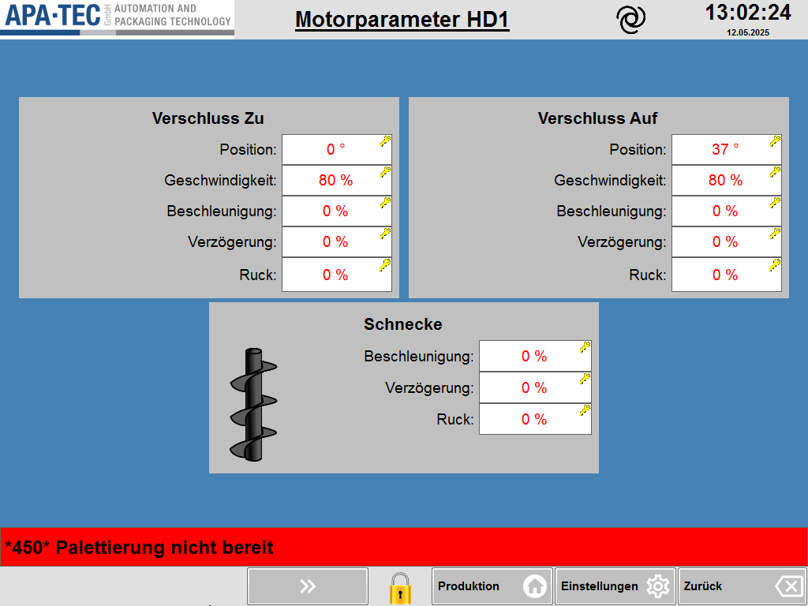

# RS-12 – Motorparameter (Hauptdosierer)

- Quelle: `src_Data/Referenz/Referenz.docx`, Kapitel 12 „Motorparameter“ (Zweck, Seitenübersicht, Funktionsbeschreibung mit Tabellen T17, T18); Bild `RS-12_01` (siehe [Medienliste](../Medien/Medienliste.md))
- Navigationspfad: Einstellung › Hauptdosierer › Motorparameter (Herkunft: Handbuch; Zugang: Taste „Motorparameter“ in der Navigation unten links der Seite [RS-11](RS-11_Hauptdosierer-1-und-2.md), gilt für den aktuell angewählten Dosierer)

## Zweck

Wortgetreu (Handbuch): „Auf dieser Seite werden die Bewegungsparameter für den Verschluss und die Schnecke eines Schneckendosierers konfiguriert. Die Einstellungen ermöglichen eine optimale Anpassung an das Produktverhalten und die Maschinengeschwindigkeit.“

Das Kapitel ist textgleich zu [RS-20](RS-20_Motorparameter.md) (Nachdosierer) und RS-17 (Schließmaschine, Handbuchposition); auch das Bild ist byteidentisch (`image29.png`).

## Aufbau (Bereiche, Layout)

Abbildung der Seite:  ([RS-12_01.png](../Medien/RS-12_01.png), 1024 × 768 px)

Beschreibung des Bildes:

1. **Kopfzeile:** Logo APA-TEC (links), unterstrichener fetter Titel „Motorparameter HD1“ (HD1 = Hauptdosierer 1), schwarzes Spiral-Symbol rechts vom Titel, Uhrzeit „13:02:24“ und Datum „12.05.2025“ rechts.
2. **Arbeitsfläche** (blauer Hintergrund, ohne umlaufendes graues Hauptpanel), drei hellgraue Karten:
   - **Karte links oben „Verschluss Zu“** (fette Überschrift, zentriert) mit fünf Zeilen, Beschriftung rechtsbündig, Eingabefeld rechts daneben (weißes Feld, rote Schrift, gelbes Schlüsselsymbol oben rechts im Feld): Position „0 °“, Geschwindigkeit „80 %“, Beschleunigung „0 %“, Verzögerung „0 %“, Ruck „0 %“.
   - **Karte rechts oben „Verschluss Auf“** (gleicher Aufbau): Position „37 °“, Geschwindigkeit „80 %“, Beschleunigung „0 %“, Verzögerung „0 %“, Ruck „0 %“.
   - **Karte unten mittig „Schnecke“** (fette Überschrift) mit Schnecken-Symbol (schwarze Förderschnecke) links und drei Zeilen: Beschleunigung „0 %“, Verzögerung „0 %“, Ruck „0 %“ (je Eingabefeld, rote Schrift, Schlüsselsymbol).
3. **Meldezeile** (rot): „*450* Palettierung nicht bereit“.
4. **Funktionsleiste unten:** nur die graue Doppelpfeil-Taste „»“ (zweite Position von links, Taste „Motorparameter“ fehlt hier, erste Position leer), mittig gelbes Schloss-Symbol, rechts „Produktion“ (Haus-Symbol), „Einstellungen“ (Zahnrad-Symbol), „Zurück“ (Pfeil-Symbol).

## Elemente (Tabelle: Element | Typ | Funktion | verwendetes Modul)

Gemeinsame Hinweise: Das Handbuch nennt für keine Zeile Wertebereich, Standardwert, Einheitenvorgabe (außer „Grad“ bzw. „Prozent“ in der Beschreibung) oder Berechtigung. Die Spalte „Wert/Einheit im Screenshot“ gibt den im Bild sichtbaren Beispielwert wieder (kein Standardwert). Alle Felder haben im Bild ein gelbes Schlüsselsymbol (Bedeutung nicht beschrieben).

### Tabelle T17 – Verschluss Zu / Verschluss Auf (6 Zeilen inkl. Kopfzeile; 5 Datenzeilen; Spalten Funktion | Beschreibung)

Die Tabelle gilt für beide Karten „Verschluss Zu“ und „Verschluss Auf“ (je ein Eingabefeld pro Zeile und Karte, also 10 Felder).

| Nr. | Element (Funktion) | Typ | Beschreibung (wortgetreu, Handbuch) | Wert/Einheit im Screenshot (Zu / Auf) | verwendetes Modul |
|---|---|---|---|---|---|
| 1 | Position | Eingabefeld (rot, Schlüssel) | „Position in Grad, an der der Verschluss geöffnet bzw. geschlossen ist.“ | „0 °“ / „37 °“ (Einheit Grad) | [RM-16](../Module/RM-16_Motorparameter-Karte.md) (Verschluss-Karte) |
| 2 | Geschwindigkeit | Eingabefeld (rot, Schlüssel) | „Bewegungsgeschwindigkeit des Aktors in Prozent.“ | „80 %“ / „80 %“ (Einheit %) | [RM-16](../Module/RM-16_Motorparameter-Karte.md) (Verschluss-Karte) |
| 3 | Beschleunigung | Eingabefeld (rot, Schlüssel) | „Anstieg der Geschwindigkeit beim Start der Bewegung.“ | „0 %“ / „0 %“ | [RM-16](../Module/RM-16_Motorparameter-Karte.md) (Verschluss-Karte) |
| 4 | Verzögerung | Eingabefeld (rot, Schlüssel) | „Abbremsen vor Erreichen der Endposition.“ | „0 %“ / „0 %“ | [RM-16](../Module/RM-16_Motorparameter-Karte.md) (Verschluss-Karte) |
| 5 | Ruck | Eingabefeld (rot, Schlüssel) | „Änderung der Beschleunigung (sanfter Bewegungsbeginn und -ende).“ | „0 %“ / „0 %“ | [RM-16](../Module/RM-16_Motorparameter-Karte.md) (Verschluss-Karte) |

### Tabelle T18 – Schnecke (4 Zeilen inkl. Kopfzeile; 3 Datenzeilen; Spalten Funktion | Beschreibung)

| Nr. | Element (Funktion) | Typ | Beschreibung (wortgetreu, Handbuch) | Wert/Einheit im Screenshot | verwendetes Modul |
|---|---|---|---|---|---|
| 1 | Beschleunigung | Eingabefeld (rot, Schlüssel) | „Anstieg der Drehgeschwindigkeit beim Start.“ | „0 %“ | [RM-16](../Module/RM-16_Motorparameter-Karte.md) (Schnecke-Karte) |
| 2 | Verzögerung | Eingabefeld (rot, Schlüssel) | „Abbremsen der Drehung beim Stoppen.“ | „0 %“ | [RM-16](../Module/RM-16_Motorparameter-Karte.md) (Schnecke-Karte) |
| 3 | Ruck | Eingabefeld (rot, Schlüssel) | „Änderung der Beschleunigung für eine produktschonende Bewegung.“ | „0 %“ | [RM-16](../Module/RM-16_Motorparameter-Karte.md) (Schnecke-Karte) |

### Weitere Elemente, die nur im Screenshot sichtbar sind (nicht im Handbuch beschrieben)

| Element | Typ | Beobachtung | verwendetes Modul |
|---|---|---|---|
| Seitentitel „Motorparameter HD1“ | Text | unterstrichen, fett; Zusatz „HD1“ kennzeichnet den Dosierer | [RM-01](../Module/RM-01_Kopfzeile.md) (Kopfzeile) |
| Logo, Spiral-Symbol, Uhrzeit/Datum | Anzeige | wie auf RS-11 | [RM-01](../Module/RM-01_Kopfzeile.md) |
| Schnecken-Symbol in Karte „Schnecke“ | Bild | schwarze Förderschnecke (kein eigener Bildverweis im Handbuch-Text) | [RM-16](../Module/RM-16_Motorparameter-Karte.md) (Schnecke-Karte) |
| Meldezeile | Anzeige | „*450* Palettierung nicht bereit“ | [RM-02](../Module/RM-02_Meldezeile.md) |
| Taste „»“ | Navigationstaste | grau, Doppelpfeil; Funktion im Handbuch zu dieser Seite nicht beschrieben | [RM-04](../Module/RM-04_Blaettertasten.md) (Pfeiltasten) |
| Schloss-Symbol | Symbol | gelb, geschlossen | [RM-03](../Module/RM-03_Funktionsleiste-unten.md) |
| Tasten „Produktion“, „Einstellungen“, „Zurück“ | Navigationstasten | wie auf RS-11 | [RM-03](../Module/RM-03_Funktionsleiste-unten.md) |

## Verwendete Module (IDs)

Module dieser Seite (Definitionen in der [Modulliste](../Module/Modulliste.md)):

- [RM-01](../Module/RM-01_Kopfzeile.md) – Kopfzeile
- [RM-02](../Module/RM-02_Meldezeile.md) – Meldezeile
- [RM-03](../Module/RM-03_Funktionsleiste-unten.md) – Funktionsleiste unten
- [RM-04](../Module/RM-04_Blaettertasten.md) – Blättertasten
- [RM-05](../Module/RM-05_Eingabefeld-mit-Schluesselsymbol.md) – Eingabefeld mit Schlüsselsymbol
- [RM-06](../Module/RM-06_Eingabe-Pop-up.md) – Eingabe-Pop-up
- [RM-16](../Module/RM-16_Motorparameter-Karte.md) – Motorparameter-Karte

## Zustände und Interaktion (inkl. Pop-ups, Berechtigungen, Fehlerfälle)

- **Unterseiten / Navigationsziele:** keine eigenen; Rückweg über „Zurück“ (Annahme: führt zu [RS-11](RS-11_Hauptdosierer-1-und-2.md)) oder „Produktion“/„Einstellungen“.
- **Pop-ups:** im Handbuch zu dieser Seite nicht beschrieben.
- **Berechtigungen:** im Handbuch nicht genannt; im Screenshot trägt jedes der 13 Felder ein gelbes Schlüsselsymbol.
- **Bezug zum Dosierer:** Die Parameter gelten für den Dosierer, von dem aus die Seite geöffnet wurde („Öffnet die Seite für die Motorparameter für den aktuellen Dosierer“, RS-11); im Screenshot „HD1“.
- **Fehlerfälle/Zustände:** im Handbuch keine beschrieben.
- **Einheiten:** Position in Grad (°), alle übrigen Felder in Prozent (%), entnommen aus Handbuchtext und Screenshot.

## Prüfpunkte (Tabelle: ID | Prüfung | erwartetes Ergebnis | Status)

| ID | Prüfung | erwartetes Ergebnis | Status |
|---|---|---|---|
| RS-12-P01 | Zweck-Text gegen Handbuch prüfen | wortgetreu: Bewegungsparameter für Verschluss und Schnecke eines Schneckendosierers | offen |
| RS-12-P02 | T17 auf Vollständigkeit prüfen | 5 Datenzeilen: Position, Geschwindigkeit, Beschleunigung, Verzögerung, Ruck | offen |
| RS-12-P03 | T18 auf Vollständigkeit prüfen | 3 Datenzeilen: Beschleunigung, Verzögerung, Ruck | offen |
| RS-12-P04 | Karten „Verschluss Zu“ und „Verschluss Auf“ | beide Karten mit je 5 Feldern vorhanden (gesamt 10 Felder) | offen |
| RS-12-P05 | Karte „Schnecke“ | 3 Felder (Beschleunigung, Verzögerung, Ruck) mit Schnecken-Symbol | offen |
| RS-12-P06 | Einheiten | Position in ° (Beispiel 0 ° und 37 °), Geschwindigkeit in % (Beispiel 80 %), übrige Felder in % | offen |
| RS-12-P07 | Bild RS-12_01 verlinkt und beschrieben | Link löst auf; Beschreibung nennt Titel „Motorparameter HD1“ und alle drei Karten | offen |
| RS-12-P08 | Zugang | Aufruf über „Motorparameter“ in RS-11 für den aktuell angewählten Dosierer | offen |
| RS-12-P09 | Neue HMI-Seite: Eingabefeld | jedes Feld ist ein editierbares Eingabefeld mit Hinweis auf Berechtigung (Schlüsselsymbol im Altsystem) | offen |
| RS-12-P10 | Gemeinsame Rahmenelemente | Kopfzeile, Meldezeile, Funktionsleiste (Schloss, Produktion, Einstellungen, Zurück) vorhanden | offen |
| RS-12-P11 | Brotkrümel | „Einstellung › Hauptdosierer › Motorparameter“ | offen |

## Offene Punkte

1. Wertebereiche, Standardwerte, Einheiten außerhalb der Beispielwerte, Berechtigungsstufen (Schlüsselsymbol) und Eingabe-Pop-up sind im Handbuch nicht beschrieben.
2. Unklar, was die Prozentwerte bei Beschleunigung, Verzögerung und Ruck physikalisch bedeuten (Bezugsgröße); Handbuch nennt nur Prozent bei „Geschwindigkeit“ und Grad bei „Position“, die Einheit der übrigen Felder ergibt sich nur aus dem Screenshot.
3. Funktion der Taste „»“ in der Funktionsleiste dieser Seite (Wechsel zu Dosierer 2?) ist nicht beschrieben; die Taste „Motorparameter“ der Seite RS-11 ist hier nicht vorhanden.
4. Das Handbuch hat keinen Hinweis, wie die Seite für Hauptdosierer 2 („HD2“) erscheint; nur HD1 ist abgebildet.
