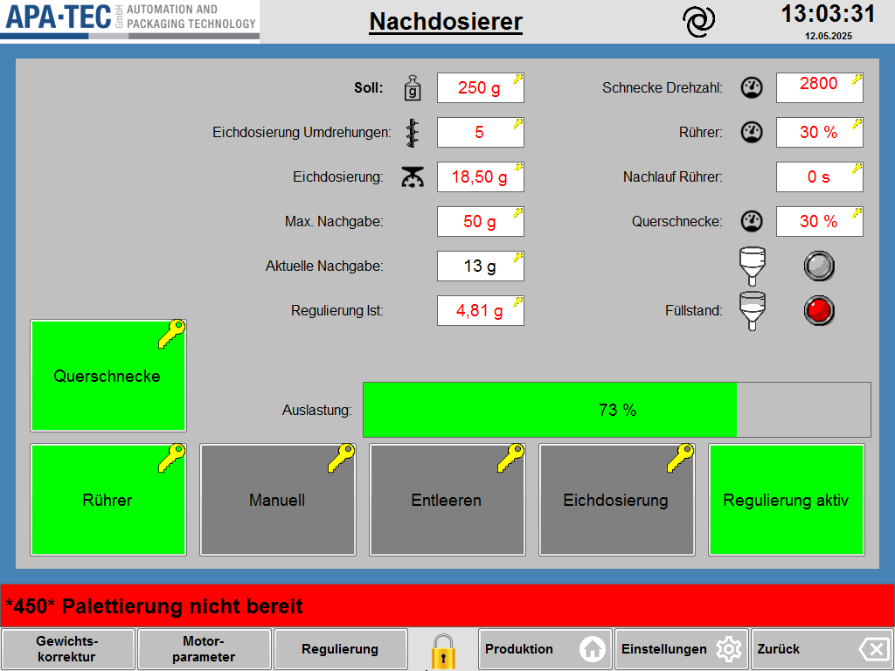
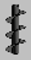

# RS-19 – Nachdosierer

- Quelle: `src_Data/Referenz/Referenz.docx`, Kapitel 19 „Nachdosierer“ (Zweck, Seitenübersicht, Funktionsbeschreibung mit Tabellen T27, T28, T29); Bilder `RS-19_01` … `RS-19_09` (siehe [Medienliste](../Medien/Medienliste.md))
- Navigationspfad: Einstellung › Nachdosierer (Herkunft: Handbuch; Zugang: Eintrag in der Tabelle von RS-04)

## Zweck

Wortgetreu (Handbuch): „Die Seite Nachdosierer beinhaltet die Parameter, die Anwahlen und den Status des Schneckendosierers.“

Der Nachdosierer ergänzt die Hauptdosierer ([RS-11](RS-11_Hauptdosierer-1-und-2.md)) und dosiert laut Handbuch die Differenz zum Zielgewicht anhand des von der Kontrollwaage gemeldeten Packungsgewichts (siehe Zeile „Soll“). Die Seite ist gegenüber RS-11 sehr ähnlich aufgebaut (Modulkandidat „Dosierer-Seite“).

## Aufbau (Bereiche, Layout)

Abbildung der Seite:  ([RS-19_01.png](../Medien/RS-19_01.png), 1024 × 768 px, Seitenverhältnis 4:3)

Beschreibung des Bildes (von oben nach unten):

1. **Kopfzeile** (hellgrauer Streifen): links Logo „APA-TEC GmbH – AUTOMATION AND PACKAGING TECHNOLOGY“; Mitte der unterstrichene fette Seitentitel „Nachdosierer“; rechts davon das schwarze Spiral-Symbol; ganz rechts Uhrzeit „13:03:31“ und Datum „12.05.2025“.
2. **Arbeitsfläche** (hellgraues Panel mit blauem Rahmen), zweispaltige Felderanordnung:
   - **Linke Feldspalte** (Beschriftung rechtsbündig, Eingabefeld rechts daneben, Symbole zwischen Beschriftung und Feld): „Soll:“ (fett) mit Gewichts-Symbol – „250 g“ (rot, Schlüsselsymbol); „Eichdosierung Umdrehungen:“ mit Schnecken-Symbol – „5“ (rot, Schlüsselsymbol); „Eichdosierung:“ mit Waagschalen-Symbol – „18,50 g“ (rot, Schlüsselsymbol); „Max. Nachgabe:“ – „50 g“ (rot, Schlüsselsymbol); „Aktuelle Nachgabe:“ – „13 g“ (schwarze Schrift, Schlüsselsymbol); „Regulierung Ist:“ – „4,81 g“ (rot, Schlüsselsymbol).
   - **Rechte Feldspalte:** „Schnecke Drehzahl:“ mit Tacho-Symbol – „2800“ (rot, Schlüsselsymbol, im Bild ohne Einheit „1/min“); „Rührer:“ mit Tacho-Symbol – „30 %“ (rot, Schlüsselsymbol); „Nachlauf Rührer:“ – „0 s“ (rot, Schlüsselsymbol); „Querschnecke:“ mit Tacho-Symbol – „30 %“ (rot, Schlüsselsymbol); darunter zwei Trichter-Symbole mit je einer runden Kontrollleuchte (oben grau, unten rot), neben dem unteren Trichter die Beschriftung „Füllstand:“.
   - **Schaltfläche links:** „Querschnecke“ (grün, Schlüsselsymbol), links neben dem Bereich „Auslastung“ und über der Taste „Rührer“.
   - **Balkenanzeige „Auslastung:“** mit „73 %“ mittig; Balken grün gefüllt bis ca. 73 %, Rest grau.
   - **Untere Schaltflächenreihe der Arbeitsfläche (fünf Tasten):** „Rührer“ (grün, Schlüsselsymbol), „Manuell“ (grau, Schlüsselsymbol), „Entleeren“ (grau, Schlüsselsymbol), „Eichdosierung“ (grau, Schlüsselsymbol), „Regulierung aktiv“ (grün, ohne Schlüsselsymbol).
3. **Meldezeile** (rot, volle Breite): „*450* Palettierung nicht bereit“.
4. **Funktionsleiste unten** (hellgrau), von links nach rechts: Tasten „Gewichts-korrektur“, „Motor-parameter“, „Regulierung“ (alle drei grau, nebeneinander ganz links, ohne Symbol); gelbes Schloss-Symbol (mittig); „Produktion“ (Haus-Symbol), „Einstellungen“ (Zahnrad-Symbol), „Zurück“ (Pfeil-Symbol). Keine Pfeiltasten zur Seitenumschaltung (es gibt nur einen Nachdosierer).

Hinweis: Anordnung im Screenshot ist Referenz für den Funktionsumfang; Layout des neuen HMI folgt dem Design (Agent.md, Abschnitt 2).

## Elemente (Tabelle: Element | Typ | Funktion | verwendetes Modul)

Gemeinsame Hinweise: Das Handbuch nennt für keine Zeile Wertebereich, Standardwert oder Berechtigung. Die Spalte „Wert/Einheit im Screenshot“ gibt den sichtbaren Beispielwert wieder (kein Standardwert). Das gelbe Schlüsselsymbol an Feld-/Tastenecken im Screenshot ist im Handbuch nicht erklärt.

### Tabelle T27 – Parameter und Status (14 Zeilen inkl. Kopfzeile; 13 Datenzeilen; Spalten Funktion | Beschreibung | Grafik)

| Nr. | Element (Funktion) | Typ | Beschreibung (wortgetreu, Handbuch) | Grafik (Handbuch) | Wert/Einheit im Screenshot | verwendetes Modul |
|---|---|---|---|---|---|---|
| 1 | Soll | Eingabefeld (rot, Schlüssel), Beschriftung fett | „Zielgewicht des Produkts. Der Nachdosierer bekommt das aktuelle Gewicht der Packung von der Kontrollwaage und dosiert die Differenz.“ |  [RS-19_02.png](../Medien/RS-19_02.png) – Gewichtsstück-Symbol (Flasche mit Schild „g“, grau, 68 × 85 px) | „250 g“ (g) | Modulkandidat: Dosierer-Parameterfeld (Eingabefeld mit Schlüsselsymbol) |
| 2 | Eichdosierung Umdrehungen | Eingabefeld (rot, Schlüssel) | „Anzahl Umdrehungen der Dosierschnecke welche bei der *Eichdosierung* ausgeführt wird. Anhand der Umdrehungen und des Gewichtes im Feld *Eichdosierung* berechnet die Maschine die Umdrehungen im Automatikbetrieb.“ |  [RS-19_03.png](../Medien/RS-19_03.png) – Schnecken-Symbol (schwarze Förderschnecke, 45 × 87 px) | „5“ (ohne Einheit) | Modulkandidat: Dosierer-Parameterfeld |
| 3 | Eichdosierung | Eingabefeld (rot, Schlüssel) | „Hier wird das Gewicht, des während der *Eichdosierung* dosierten Produkts, eingetragen.“ |  [RS-19_04.png](../Medien/RS-19_04.png) – Waagschalen-Symbol (schwarz, Schale mit Tropfen/Zeiger, 48 × 48 px) | „18,50 g“ (g, zwei Nachkommastellen) | Modulkandidat: Dosierer-Parameterfeld |
| 4 | Max. Nachgabe | Eingabefeld (rot, Schlüssel) | „Obergrenze an zu dosierendem Produkt. Ist die Fehlmenge in einer Packung größer, wird nicht dosiert und die Packung wird als nIO ausgeschieden.“ | keine | „50 g“ (g) | Modulkandidat: Dosierer-Parameterfeld |
| 5 | Aktuelle Nachgabe | Anzeigefeld (schwarze Schrift, Schlüsselsymbol am Feld sichtbar) | „Zu dosierendes Produkt in die aktuelle Packung.“ | keine | „13 g“ (g) | Modulkandidat: Dosierer-Parameterfeld |
| 6 | Regulierung Ist | Eingabefeld (rot, Schlüssel) | „Aktueller Korrekturwert von der Regulierung. Dieses Gewicht wird auf die *aktuelle Nachgabe* aufaddiert. Der Wert kann manuell geändert werden.“ | keine | „4,81 g“ (g, zwei Nachkommastellen) | Modulkandidat: Dosierer-Parameterfeld |
| 7 | Schnecke Drehzahl | Eingabefeld (rot, Schlüssel) | „Solldrehzahl der Dosierschnecke.“ |  [RS-19_05.png](../Medien/RS-19_05.png) – Tacho-Symbol (schwarzer Halbkreis-Tacho mit Zeiger, 48 × 48 px) | „2800“ (Einheit im Bild nicht sichtbar; RS-11 zeigt „1/min“) | Modulkandidat: Dosierer-Parameterfeld |
| 8 | Rührer | Eingabefeld (rot, Schlüssel) | „Sollgeschwindigkeit des Rührers im Trichter.“ |  [RS-19_06.png](../Medien/RS-19_06.png) – Tacho-Symbol (identisch zu RS-19_05) | „30 %“ (%) | Modulkandidat: Dosierer-Parameterfeld |
| 9 | Nachlauf Rührer | Eingabefeld (rot, Schlüssel) | „Zeit, welche der Rührer bei einem Stopp der Maschine nachläuft.“ | keine | „0 s“ (s) | Modulkandidat: Dosierer-Parameterfeld |
| 10 | Querschnecke | Eingabefeld (rot, Schlüssel) | „Sollgeschwindigkeit der Querschnecke in der Produktzuführung.“ |  [RS-19_07.png](../Medien/RS-19_07.png) – Tacho-Symbol (identisch zu RS-19_05) | „30 %“ (%) | Modulkandidat: Dosierer-Parameterfeld |
| 11 | Füllstand Trichter oben | Zustandsanzeige (Trichter-Symbol + runde Kontrollleuchte) | „Zeigt den Status des Sensors im oberen Bereich des Trichters an.“ |  [RS-19_08.png](../Medien/RS-19_08.png) – Trichter-Symbol, Füllstandslinie im oberen Trichterbereich (87 × 121 px) | Kontrollleuchte grau | Modulkandidat: Füllstandsanzeige (Trichter + Status-LED) |
| 12 | Füllstand Trichter unten | Zustandsanzeige (Trichter-Symbol + runde Kontrollleuchte) | „Zeigt den Status des Sensors im unteren Bereich des Trichters an.“ |  [RS-19_09.png](../Medien/RS-19_09.png) – Trichter-Symbol, Füllstandslinie im unteren Trichterbereich (97 × 126 px); im Screenshot Beschriftung „Füllstand:“ | Kontrollleuchte rot | Modulkandidat: Füllstandsanzeige (Trichter + Status-LED) |
| 13 | Auslastung | Balkenanzeige mit Prozentwert | „Zeigt an wieviel Prozent der verfügbaren Zeit der Dosiervorgang benötigt. Die Zeit ergibt sich aus der Länge der Nocke für den Dosierer und der Maschinengeschwindigkeit.“ | keine | „73 %“ (%), Balken grün | Modulkandidat: Fortschrittsbalken (Auslastung) |

### Tabelle T28 – Schaltflächen (7 Zeilen inkl. Kopfzeile; 6 Datenzeilen; Spalten Funktion | Beschreibung)

| Nr. | Element (Funktion) | Typ | Beschreibung (wortgetreu, Handbuch) | Zustand im Screenshot | verwendetes Modul |
|---|---|---|---|---|---|
| 1 | Querschnecke | Umschalttaste mit Zustandsfarbe | „Erlaubt das Abwählen der Querschnecke. Dadurch wird kein Produkt in den Trichter nachgefüllt.“ | grün (angewählt), Schlüsselsymbol | Modulkandidat: Anwahl-Taste (Umschalter mit Zustandsfarbe) |
| 2 | Rührer | Umschalttaste mit Zustandsfarbe | „Abwahl für den Rührer im Trichter.“ | grün (angewählt), Schlüsselsymbol | Modulkandidat: Anwahl-Taste |
| 3 | Manuel (sic; Beschriftung im Screenshot „Manuell“) | Aktionstaste | „Anforderung eines Dosiervorgangs.“ | grau, Schlüsselsymbol | Modulkandidat: Aktionstaste mit Schlüsselsymbol |
| 4 | Entleeren | Aktionstaste (Dauerfunktion) | „Der Dosierer fördert kontinuierlich Produkt, bis der Vorgang abgebrochen wird.“ | grau, Schlüsselsymbol | Modulkandidat: Aktionstaste mit Schlüsselsymbol |
| 5 | Eichdosierung | Aktionstaste | „Es wird ein Dosiervorgang gestartet. Der Dosierer macht die im Feld Eichdosierung Umdrehungen angegebenen Umdrehungen. Das dosierte Produkt muss aufgefangen und gewogen werden. Das Gewicht in das Feld Eichdosierung eintragen.“ | grau, Schlüsselsymbol | Modulkandidat: Aktionstaste mit Schlüsselsymbol |
| 6 | Regulierung aktiv | Umschalttaste mit Zustandsfarbe | „Die automatische Regulierung kann mit dieser Schaltfläche abgewählt werden.“ | grün (aktiv), kein Schlüsselsymbol | Modulkandidat: Anwahl-Taste |

### Tabelle T29 – Navigation (unten links) (4 Zeilen inkl. Kopfzeile; 3 Datenzeilen; Spalten Funktion | Beschreibung)

| Nr. | Element (Funktion) | Typ | Beschreibung (wortgetreu, Handbuch) | Darstellung im Screenshot | verwendetes Modul |
|---|---|---|---|---|---|
| 1 | Gewichtskorrektur | Navigationstaste | „Öffnet eine Seite, welches erlaubt die Dosiergenauigkeit zu verbessern.“ (sic) Zielseite: [RS-21](RS-21_Gewichtskorrektur.md) | Taste ganz links, Beschriftung „Gewichts-korrektur“ (zweizeilig), grau | Modulkandidat: Seitenlink-Taste |
| 2 | Motorparameter | Navigationstaste | „Öffnet die Seite für die Motorparameter für den aktuellen Dosierer.“ Zielseite: [RS-20](RS-20_Motorparameter.md) | zweite Taste von links, „Motor-parameter“, grau | Modulkandidat: Seitenlink-Taste |
| 3 | Regulierung | Navigationstaste | „Öffnet die Seite *Regulierung*.“ Zielseite: [RS-23](RS-23_Regulierung.md) | dritte Taste von links, grau | Modulkandidat: Seitenlink-Taste |

### Weitere Elemente, die nur im Screenshot sichtbar sind (nicht im Handbuch beschrieben)

| Element | Typ | Beobachtung | verwendetes Modul |
|---|---|---|---|
| Logo APA-TEC | Bild | Kopfzeile links | Modulkandidat: Statuskopf (Kopfzeile) |
| Seitentitel „Nachdosierer“ | Text | unterstrichen, fett | Modulkandidat: Statuskopf |
| Spiral-Symbol | Symbol | Kopfzeile; Bedeutung nicht beschrieben | Modulkandidat: Statuskopf |
| Uhrzeit/Datum | Anzeige | „13:03:31“, „12.05.2025“ | Modulkandidat: Statuskopf |
| Meldezeile | Anzeige | „*450* Palettierung nicht bereit“ (rot); Antippen öffnet laut Referenz-Übersicht [RS-38](RS-38_Meldeanzeige.md) | Modulkandidat: Meldezeile |
| Schloss-Symbol | Symbol | gelb, geschlossen, unten mittig | Modulkandidat: Funktionsleiste unten |
| Tasten „Produktion“, „Einstellungen“, „Zurück“ | Navigationstasten | Haus-, Zahnrad-, Pfeil-Symbol; Ziele laut Beschriftung (Annahme): [RS-01](RS-01_Produktion.md), [RS-04](RS-04_Einstellungen.md), vorherige Seite | Modulkandidat: Funktionsleiste unten |

## Verwendete Module (IDs)

Noch keine RM-IDs vergeben. Modulkandidaten dieser Seite:

- Statuskopf (Kopfzeile), Meldezeile, Funktionsleiste unten (links: Seitenlink-Tasten Gewichtskorrektur, Motorparameter, Regulierung)
- Dosierer-Seite (gemeinsames Gerüst mit RS-11)
- Dosierer-Parameterfeld (Eingabefeld mit Schlüsselsymbol)
- Eingabe-Pop-up (nicht beschrieben)
- Füllstandsanzeige (Trichter + Status-LED), Fortschrittsbalken (Auslastung)
- Anwahl-Taste (Umschalter mit Zustandsfarbe), Aktionstaste mit Schlüsselsymbol, Seitenlink-Taste

## Zustände und Interaktion (inkl. Pop-ups, Berechtigungen, Fehlerfälle)

- **Unterseiten / Navigationsziele:** „Gewichtskorrektur“ → [RS-21](RS-21_Gewichtskorrektur.md); „Motorparameter“ → [RS-20](RS-20_Motorparameter.md) (aktueller Dosierer); „Regulierung“ → [RS-23](RS-23_Regulierung.md).
- **Pop-ups:** im Handbuch zu dieser Seite nicht beschrieben.
- **Berechtigungen:** Handbuch nennt keine. Im Screenshot tragen alle Eingabe-/Anzeigefelder und die Tasten Querschnecke, Rührer, Manuell, Entleeren, Eichdosierung ein gelbes Schlüsselsymbol; „Regulierung aktiv“ und die Tasten der Funktionsleiste nicht.
- **Fehler-/Zustandsbeschreibung (Handbuch):** Ist die Fehlmenge in einer Packung größer als „Max. Nachgabe“, wird nicht dosiert und die Packung wird als nIO ausgeschieden. „Regulierung Ist“ wird auf die aktuelle Nachgabe aufaddiert und kann manuell geändert werden.
- **Abläufe:** Eichdosierung wie bei RS-11: Taste „Eichdosierung“ startet Dosiervorgang mit den Umdrehungen aus „Eichdosierung Umdrehungen“; Produkt auffangen und wiegen; Gewicht in Feld „Eichdosierung“ eintragen; daraus berechnet die Maschine die Umdrehungen im Automatikbetrieb. Nachdosierer erhält das aktuelle Packungsgewicht von der Kontrollwaage und dosiert die Differenz zum Zielgewicht.
- **Darstellungszustände (aus Screenshot, nicht beschrieben):** Tasten grün/grau; Auslastungsbalken grün bei 73 % (bei RS-11 gelb bei 91 %); Füllstandsleuchten grau/rot; schwarze Schrift bei „Aktuelle Nachgabe“ (berechneter Wert), rote Schrift bei Eingabewerten.

## Prüfpunkte (Tabelle: ID | Prüfung | erwartetes Ergebnis | Status)

| ID | Prüfung | erwartetes Ergebnis | Status |
|---|---|---|---|
| RS-19-P01 | Zweck-Satz gegen Handbuch prüfen | wortgetreu: Parameter, Anwahlen und Status des Schneckendosierers | offen |
| RS-19-P02 | T27 auf Vollständigkeit prüfen | 13 Datenzeilen: Soll, Eichdosierung Umdrehungen, Eichdosierung, Max. Nachgabe, Aktuelle Nachgabe, Regulierung Ist, Schnecke Drehzahl, Rührer, Nachlauf Rührer, Querschnecke, Füllstand Trichter oben, Füllstand Trichter unten, Auslastung | offen |
| RS-19-P03 | T28 auf Vollständigkeit prüfen | 6 Datenzeilen: Querschnecke, Rührer, Manuel, Entleeren, Eichdosierung, Regulierung aktiv | offen |
| RS-19-P04 | T29 auf Vollständigkeit prüfen | 3 Datenzeilen: Gewichtskorrektur, Motorparameter, Regulierung | offen |
| RS-19-P05 | Beschreibungstexte wortgetreu | stimmen mit Handbuch überein (inkl. Schreibweisen „nIO“, „Manuel“) | offen |
| RS-19-P06 | Bildverweise | alle 9 Bilder RS-19_01 … RS-19_09 verlinkt und beschrieben; Links lösen auf | offen |
| RS-19-P07 | Einheiten im Screenshot | Soll g, Eichdosierung Umdrehungen ohne Einheit, Eichdosierung g (2 Nachkommastellen), Max. Nachgabe g, Aktuelle Nachgabe g, Regulierung Ist g (2 Nachkommastellen), Schnecke Drehzahl (1/min, im Bild ohne Einheit), Rührer %, Nachlauf Rührer s, Querschnecke %, Auslastung % | offen |
| RS-19-P08 | Unterschied zu RS-11 | RS-19 hat Felder „Max. Nachgabe“ und „Aktuelle Nachgabe“ statt „Soll absolut“, keine Taste „Einstellung Regulierung“ in der Arbeitsfläche, drei Navigationstasten statt Pfeiltasten | offen |
| RS-19-P09 | Neue HMI-Seite: Navigation | „Gewichtskorrektur“ → RS-21, „Motorparameter“ → RS-20, „Regulierung“ → RS-23 | offen |
| RS-19-P10 | Neue HMI-Seite: nIO-Logik | Beschreibung/Hinweis zu „Max. Nachgabe“: Fehlmenge größer als Obergrenze → keine Dosierung, Packung nIO | offen |
| RS-19-P11 | Neue HMI-Seite: Anwahl-Tasten | Querschnecke, Rührer, Regulierung aktiv sind Umschalter mit Zustandsanzeige nicht nur über Farbe | offen |
| RS-19-P12 | Neue HMI-Seite: Füllstandsanzeigen und Auslastung | zwei Füllstände (oben, unten) und Auslastungsbalken mit Prozentwert vorhanden | offen |
| RS-19-P13 | Neue HMI-Seite: Wiederverwendung | Dosierer-Parameterfelder, Füllstandsanzeige, Auslastung und Tasten sind dieselben Module wie auf RS-11 (keine Kopien) | offen |
| RS-19-P14 | Gemeinsame Rahmenelemente | Kopfzeile, Meldezeile, Funktionsleiste (Schloss, Produktion, Einstellungen, Zurück) vorhanden | offen |
| RS-19-P15 | Brotkrümel | „Einstellung › Nachdosierer“; Seitentitel „Nachdosierer“ | offen |

## Offene Punkte

1. Wertebereiche, Standardwerte, Berechtigungsstufen (Bedeutung des Schlüsselsymbols) und Eingabe-Pop-up sind im Handbuch nicht beschrieben.
2. Das Feld „Soll“ heißt hier „Zielgewicht des Produkts“ (absolut, in g), bei RS-11 „Anteil des Zielgewichts“ (in %); Bezug des Nachdosierer-Sollwerts zum Hauptdosierer-Anteil ist nicht erklärt. Fachlich unklar, wie „Soll“ (250 g) und „Sollgewicht“ (250,4 g) auf RS-21 zusammenhängen.
3. „Aktuelle Nachgabe“ erscheint im Screenshot in schwarzer Schrift (Anzeigewert) mit Schlüsselsymbol; ob editierbar, ist nicht beschrieben.
4. „Schnecke Drehzahl“ zeigt im Screenshot „2800“ ohne Einheit (RS-11: „2800 1/min“); Einheit im Handbuch nicht genannt.
5. Reihenfolge der Navigationstasten: Handbuch (Tabelle T29) nennt Gewichtskorrektur, Motorparameter, Regulierung; Screenshot zeigt dieselbe Reihenfolge von links nach rechts. Bedeutung der Farben (Auslastungsbalken grün/gelb, Füllstandsleuchten grau/rot) ist nicht beschrieben.
6. Schreibfehler im Handbuch (zitiert): „Manuel“, „eine Seite, welches“. „nIO“ nicht erklärt (Annahme: nicht in Ordnung).
7. Das Handbuch beschreibt für den Nachdosierer keine Umschaltung zwischen mehreren Dosierern; im Screenshot gibt es keine Pfeiltasten.
