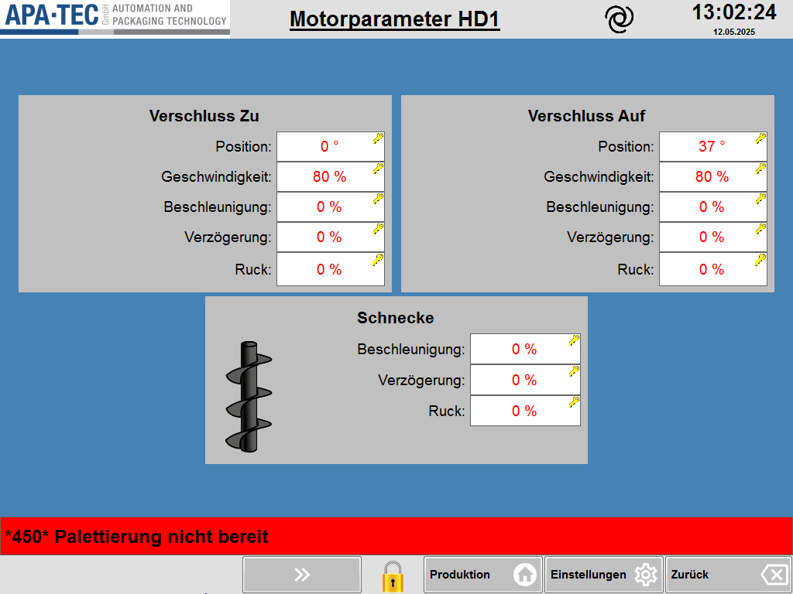

# RS-20 – Motorparameter (Nachdosierer)

- Quelle: `src_Data/Referenz/Referenz.docx`, Kapitel 20 „Motorparameter“ (Zweck, Seitenübersicht, Funktionsbeschreibung mit Tabellen T30, T31); Bild `RS-20_01` (siehe [Medienliste](../Medien/Medienliste.md))
- Navigationspfad: Einstellung › Nachdosierer › Motorparameter (Herkunft: Handbuch; Zugang: Taste „Motorparameter“ in der Navigation unten links der Seite [RS-19](RS-19_Nachdosierer.md))

## Zweck

Wortgetreu (Handbuch): „Auf dieser Seite werden die Bewegungsparameter für den Verschluss und die Schnecke eines Schneckendosierers konfiguriert. Die Einstellungen ermöglichen eine optimale Anpassung an das Produktverhalten und die Maschinengeschwindigkeit.“

Text und Tabellen sind identisch zu [RS-12](RS-12_Motorparameter.md) (Hauptdosierer). Modulkandidat „Motorparameter“ wird für beide Seiten gleich verwendet.

## Aufbau (Bereiche, Layout)

Abbildung der Seite:  ([RS-20_01.png](../Medien/RS-20_01.png), 1024 × 768 px; byteidentisch zu [RS-12_01.png](../Medien/RS-12_01.png))

Beschreibung des Bildes (identisch zu RS-12): Kopfzeile mit Logo APA-TEC, unterstrichenem Titel **„Motorparameter HD1“**, Spiral-Symbol, Uhrzeit „13:02:24“, Datum „12.05.2025“. Auf blauem Hintergrund drei hellgraue Karten: links oben „Verschluss Zu“ (Position „0 °“, Geschwindigkeit „80 %“, Beschleunigung „0 %“, Verzögerung „0 %“, Ruck „0 %“), rechts oben „Verschluss Auf“ (Position „37 °“, Geschwindigkeit „80 %“, Beschleunigung „0 %“, Verzögerung „0 %“, Ruck „0 %“), unten mittig „Schnecke“ mit Schnecken-Symbol (Beschleunigung „0 %“, Verzögerung „0 %“, Ruck „0 %“). Alle Felder: weißes Eingabefeld, rote Schrift, gelbes Schlüsselsymbol. Darunter rote Meldezeile „*450* Palettierung nicht bereit“ und Funktionsleiste mit grauer Taste „»“, gelbem Schloss-Symbol, „Produktion“, „Einstellungen“, „Zurück“.

Wichtig: Das Bild zeigt die Seite des **Hauptdosierers 1** (Titel „Motorparameter HD1“), nicht des Nachdosierers (siehe Offene Punkte).

## Elemente (Tabelle: Element | Typ | Funktion | verwendetes Modul)

Gemeinsame Hinweise: Das Handbuch nennt für keine Zeile Wertebereich, Standardwert oder Berechtigung. Beispielwerte stammen aus dem Screenshot (Hauptdosierer 1) und gelten nicht als Standardwerte für den Nachdosierer.

### Tabelle T30 – Verschluss Zu / Verschluss Auf (6 Zeilen inkl. Kopfzeile; 5 Datenzeilen; Spalten Funktion | Beschreibung)

Gilt für beide Karten „Verschluss Zu“ und „Verschluss Auf“.

| Nr. | Element (Funktion) | Typ | Beschreibung (wortgetreu, Handbuch) | Wert/Einheit im Screenshot (Zu / Auf) | verwendetes Modul |
|---|---|---|---|---|---|
| 1 | Position | Eingabefeld (rot, Schlüssel) | „Position in Grad, an der der Verschluss geöffnet bzw. geschlossen ist.“ | „0 °“ / „37 °“ (Grad) | Modulkandidat: Motorparameter (Verschluss-Karte) |
| 2 | Geschwindigkeit | Eingabefeld (rot, Schlüssel) | „Bewegungsgeschwindigkeit des Aktors in Prozent.“ | „80 %“ / „80 %“ (%) | Modulkandidat: Motorparameter (Verschluss-Karte) |
| 3 | Beschleunigung | Eingabefeld (rot, Schlüssel) | „Anstieg der Geschwindigkeit beim Start der Bewegung.“ | „0 %“ / „0 %“ | Modulkandidat: Motorparameter (Verschluss-Karte) |
| 4 | Verzögerung | Eingabefeld (rot, Schlüssel) | „Abbremsen vor Erreichen der Endposition.“ | „0 %“ / „0 %“ | Modulkandidat: Motorparameter (Verschluss-Karte) |
| 5 | Ruck | Eingabefeld (rot, Schlüssel) | „Änderung der Beschleunigung (sanfter Bewegungsbeginn und -ende).“ | „0 %“ / „0 %“ | Modulkandidat: Motorparameter (Verschluss-Karte) |

### Tabelle T31 – Schnecke (4 Zeilen inkl. Kopfzeile; 3 Datenzeilen; Spalten Funktion | Beschreibung)

| Nr. | Element (Funktion) | Typ | Beschreibung (wortgetreu, Handbuch) | Wert/Einheit im Screenshot | verwendetes Modul |
|---|---|---|---|---|---|
| 1 | Beschleunigung | Eingabefeld (rot, Schlüssel) | „Anstieg der Drehgeschwindigkeit beim Start.“ | „0 %“ | Modulkandidat: Motorparameter (Schnecke-Karte) |
| 2 | Verzögerung | Eingabefeld (rot, Schlüssel) | „Abbremsen der Drehung beim Stoppen.“ | „0 %“ | Modulkandidat: Motorparameter (Schnecke-Karte) |
| 3 | Ruck | Eingabefeld (rot, Schlüssel) | „Änderung der Beschleunigung für eine produktschonende Bewegung.“ | „0 %“ | Modulkandidat: Motorparameter (Schnecke-Karte) |

### Weitere Elemente, die nur im Screenshot sichtbar sind (nicht im Handbuch beschrieben)

| Element | Typ | Beobachtung | verwendetes Modul |
|---|---|---|---|
| Seitentitel | Text | im Bild „Motorparameter HD1“; für den Nachdosierer wäre ein anderer Zusatz zu erwarten (nicht belegt) | Modulkandidat: Statuskopf (Kopfzeile) |
| Logo, Spiral-Symbol, Uhrzeit/Datum | Anzeige | wie RS-11 | Modulkandidat: Statuskopf |
| Schnecken-Symbol in Karte „Schnecke“ | Bild | schwarze Förderschnecke | Modulkandidat: Motorparameter (Schnecke-Karte) |
| Meldezeile | Anzeige | „*450* Palettierung nicht bereit“ | Modulkandidat: Meldezeile |
| Taste „»“ | Navigationstaste | grau, Doppelpfeil, Funktion nicht beschrieben | Modulkandidat: Seitenumschalter (Pfeiltasten) |
| Schloss-Symbol; Tasten „Produktion“, „Einstellungen“, „Zurück“ | Funktionsleiste | wie RS-11 | Modulkandidat: Funktionsleiste unten |

## Verwendete Module (IDs)

Noch keine RM-IDs vergeben. Modulkandidaten: Motorparameter (Verschluss-Karte, Schnecke-Karte), Dosierer-Parameterfeld (Eingabefeld mit Schlüsselsymbol), Eingabe-Pop-up, Statuskopf, Meldezeile, Funktionsleiste unten, Seitenumschalter (Pfeiltasten).

## Zustände und Interaktion (inkl. Pop-ups, Berechtigungen, Fehlerfälle)

- **Unterseiten / Navigationsziele:** keine eigenen; Rückweg über „Zurück“ (Annahme: führt zu [RS-19](RS-19_Nachdosierer.md)).
- **Pop-ups:** im Handbuch zu dieser Seite nicht beschrieben.
- **Berechtigungen:** nicht genannt; im Screenshot hat jedes der 13 Felder ein gelbes Schlüsselsymbol.
- **Bezug zum Dosierer:** Die Parameter gelten für den Nachdosierer (Handbuch RS-19: „Öffnet die Seite für die Motorparameter für den aktuellen Dosierer“).
- **Fehlerfälle/Zustände:** im Handbuch keine beschrieben.

## Prüfpunkte (Tabelle: ID | Prüfung | erwartetes Ergebnis | Status)

| ID | Prüfung | erwartetes Ergebnis | Status |
|---|---|---|---|
| RS-20-P01 | Zweck-Text gegen Handbuch prüfen | wortgetreu wie RS-12 (Bewegungsparameter Verschluss und Schnecke) | offen |
| RS-20-P02 | T30 auf Vollständigkeit prüfen | 5 Datenzeilen: Position, Geschwindigkeit, Beschleunigung, Verzögerung, Ruck | offen |
| RS-20-P03 | T31 auf Vollständigkeit prüfen | 3 Datenzeilen: Beschleunigung, Verzögerung, Ruck | offen |
| RS-20-P04 | Karten im Bild | „Verschluss Zu“, „Verschluss Auf“ (je 5 Felder), „Schnecke“ (3 Felder) beschrieben | offen |
| RS-20-P05 | Einheiten | Position in °, Geschwindigkeit in %, übrige Felder in % (Screenshot) | offen |
| RS-20-P06 | Bild RS-20_01 verlinkt | Link löst auf; Hinweis, dass Bild Titel „Motorparameter HD1“ zeigt | offen |
| RS-20-P07 | Zugang | Aufruf über „Motorparameter“ in RS-19 | offen |
| RS-20-P08 | Neue HMI-Seite: Wiederverwendung | Seite nutzt dasselbe Motorparameter-Modul wie RS-12 (keine Kopie) | offen |
| RS-20-P09 | Gemeinsame Rahmenelemente | Kopfzeile, Meldezeile, Funktionsleiste vorhanden | offen |
| RS-20-P10 | Brotkrümel | „Einstellung › Nachdosierer › Motorparameter“ | offen |

## Offene Punkte

1. Das Seitenbild zeigt „Motorparameter HD1“ (Hauptdosierer 1); es gibt keinen Screenshot mit Nachdosierer-Bezeichnung. Ob die Seite für den Nachdosierer identisch aufgebaut ist (Titel, Werte), ist nicht belegt (Annahme: identisch, Handbuchtext ist identisch).
2. Wertebereiche, Standardwerte, Berechtigungsstufen (Schlüsselsymbol), Bezugsgröße der Prozentwerte und Eingabe-Pop-up sind nicht beschrieben (siehe RS-12).
3. Funktion der Taste „»“ in der Funktionsleiste ist nicht beschrieben.
