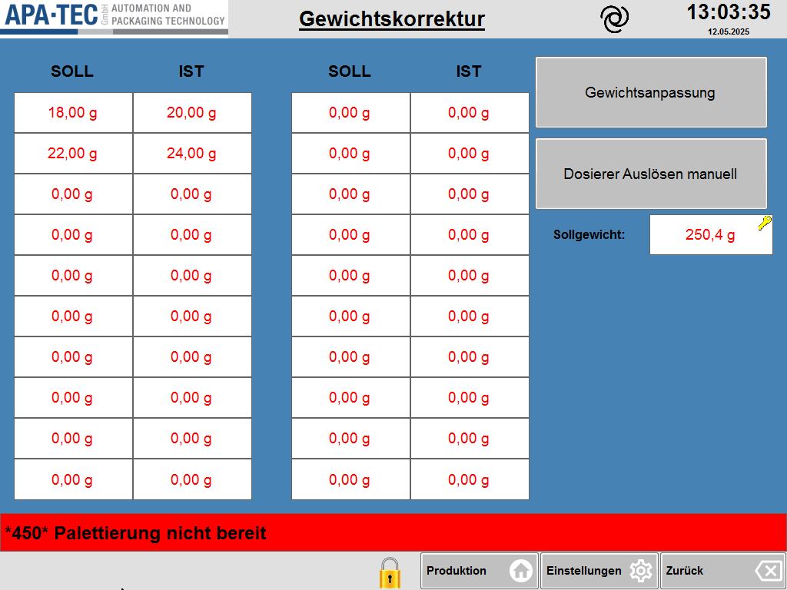

# RS-21 – Gewichtskorrektur (Nachdosierer)

- Quelle: `src_Data/Referenz/Referenz.docx`, Kapitel 21 „Gewichtskorrektur“ (Zweck, Seitenübersicht, Funktionsbeschreibung: „Anwendung und Bedienung“ als nummerierte Liste, „Hinweise zur optimalen Nutzung“ als Aufzählung; keine Tabellen); Bild `RS-21_01` (siehe [Medienliste](../Medien/Medienliste.md))
- Navigationspfad: Einstellung › Nachdosierer › Gewichtskorrektur (Herkunft: Handbuch; Zugang: Taste „Gewichtskorrektur“ in der Navigation unten links der Seite [RS-19](RS-19_Nachdosierer.md))

## Zweck

Wortgetreu (Handbuch): „Diese Seite dient der Korrektur und Feinabstimmung der Dosiergenauigkeit von Schneckendosierern. Durch die Eingabe mehrerer Soll-Ist-Wertepaare werden sogenannte Stützstellen definiert. Daraus berechnet die Steuerung eine Korrekturkurve, mit der die Dosierleistung über den gesamten Gewichtsbereich verbessert wird.“

Das Kapitel ist textgleich zu RS-18 (Gewichtskorrektur, Handbuchposition unter Schließmaschine); das Bild ist dieselbe Originaldatei (`image42.png`) wie `RS-18_01`.

## Aufbau (Bereiche, Layout)

Abbildung der Seite:  ([RS-21_01.png](../Medien/RS-21_01.png), Original `image42.png`)

Beschreibung des Bildes (von oben nach unten):

1. **Kopfzeile:** Logo „APA-TEC GmbH – AUTOMATION AND PACKAGING TECHNOLOGY“ links; unterstrichener fetter Titel „Gewichtskorrektur“; Spiral-Symbol; Uhrzeit „13:03:35“ und Datum „12.05.2025“.
2. **Arbeitsfläche** auf blauem Hintergrund:
   - **Linke zwei Drittel: zwei Tabellenblöcke nebeneinander** mit jeweils den Spaltenköpfen „SOLL“ und „IST“ (fett, schwarz) und je **10 Zeilen** Eingabefeldern (weiße Felder, rote Schrift, Einheit „g“, zwei Nachkommastellen). Insgesamt also 20 Wertepaare (20 Stützstellen-Zeilen), 40 Felder. Im Screenshot: linker Block Zeile 1 „18,00 g“ / „20,00 g“, Zeile 2 „22,00 g“ / „24,00 g“, Zeilen 3–10 je „0,00 g“ / „0,00 g“; rechter Block alle 10 Zeilen „0,00 g“ / „0,00 g“.
   - **Rechte Spalte:** Taste „Gewichtsanpassung“ (grau, oben); darunter Taste „Dosierer Auslösen manuell“ (grau); darunter Eingabefeld „Sollgewicht:“ (fette Beschriftung) mit Wert „250,4 g“ (rote Schrift, gelbes Schlüsselsymbol oben rechts im Feld).
3. **Meldezeile** (rot): „*450* Palettierung nicht bereit“.
4. **Funktionsleiste unten:** mittig gelbes Schloss-Symbol; rechts „Produktion“ (Haus-Symbol), „Einstellungen“ (Zahnrad-Symbol), „Zurück“ (Pfeil-Symbol). Keine Tasten links (keine Pfeiltasten, keine Seitenlinks).

## Elemente (Tabelle: Element | Typ | Funktion | verwendetes Modul)

Das Kapitel enthält keine Tabellen mit Funktions-/Beschreibungsspalten. Erfasst sind daher alle Handbuchschritte (Anwendung und Bedienung), alle Hinweise sowie alle im Screenshot sichtbaren Elemente. Wertebereiche, Standardwerte und Berechtigungen nennt das Handbuch nicht.

### Anwendung und Bedienung (nummerierte Liste im Handbuch, 4 Schritte)

| Nr. | Schritt | Beschreibung (wortgetreu, Handbuch) | betroffenes Element | verwendetes Modul |
|---|---|---|---|---|
| 1 | Dosiergewicht einstellen | „Geben Sie rechts unten das gewünschte Zielgewicht ein (*Sollgewicht*). Dieses Gewicht wird bei der manuellen Dosierung verwendet.“ | Eingabefeld „Sollgewicht“ | [RM-05](../Module/RM-05_Eingabefeld-mit-Schluesselsymbol.md) |
| 2 | Manuelle Auslösung des Dosierers | „Verwenden Sie die Taste **Dosierer Auslösen manuell**, um eine Probe mit dem eingestellten Sollgewicht zu dosieren. Die Probe in einem Behälter auffangen und wiegen.“ | Taste „Dosierer Auslösen manuell“ | [RM-11](../Module/RM-11_Aktionstaste.md) |
| 3 | Wert eintragen | „Tragen Sie das verwendete Sollgewicht in die linke Spalte (*SOLL*) ein und das gemessene tatsächliche Gewicht in die rechte Spalte (*IST*). Wiederholen Sie diesen Vorgang für mehrere Gewichte über den typischen Arbeitsbereich des Dosierers hinweg.“ | Tabelle Soll/Ist (Stützstellen) | [RM-17](../Module/RM-17_Gewichtskorrektur-Tabelle.md) (Stützstellen-Tabelle) |
| 4 | Gewichtsanpassung berechnen | „Nachdem mehrere Stützstellen eingetragen wurden, drücken Sie die Taste **Gewichtsanpassung**. Die Steuerung erstellt daraus eine Korrekturkennlinie, mit der das Dosierergebnis automatisch an das tatsächliche Verhalten des Systems angepasst wird.“ | Taste „Gewichtsanpassung“ | [RM-11](../Module/RM-11_Aktionstaste.md) |

### Hinweise zur optimalen Nutzung (Aufzählung im Handbuch, 4 Punkte)

| Nr. | Hinweis (wortgetreu, Handbuch) |
|---|---|
| 1 | „Es sollten mindestens drei, besser fünf bis acht Stützstellen gleichmäßig über den gesamten Gewichtsbereich verteilt eingetragen werden.“ |
| 2 | „Die Werte sollten unter reproduzierbaren Bedingungen aufgenommen werden (z. B. gleiche Produkttemperatur, gleiche Füllhöhe).“ |
| 3 | „Tragen Sie nur gültige Messwerte ein – leere Felder bleiben unberücksichtigt.“ |
| 4 | „Diese Korrektur ist insbesondere bei nichtlinearer Dosiercharakteristik hilfreich (z. B. bei fein rieselnden oder klebrigen Produkten).“ |

### Elemente der Seite laut Screenshot

| Element | Typ | Funktion / Beobachtung | Wert/Einheit im Screenshot | verwendetes Modul |
|---|---|---|---|---|
| Spaltenkopf „SOLL“ (zweimal) | Beschriftung | Spalte der verwendeten Sollgewichte | – | [RM-17](../Module/RM-17_Gewichtskorrektur-Tabelle.md) (Stützstellen-Tabelle) |
| Spaltenkopf „IST“ (zweimal) | Beschriftung | Spalte der gemessenen Istgewichte | – | [RM-17](../Module/RM-17_Gewichtskorrektur-Tabelle.md) (Stützstellen-Tabelle) |
| SOLL-Felder linker Block (10) | Eingabefeld (rot) | Soll-Gewicht je Stützstelle | „18,00 g“, „22,00 g“, 8 × „0,00 g“ | [RM-17](../Module/RM-17_Gewichtskorrektur-Tabelle.md) (Stützstellen-Tabelle) |
| IST-Felder linker Block (10) | Eingabefeld (rot) | gemessenes Ist-Gewicht je Stützstelle | „20,00 g“, „24,00 g“, 8 × „0,00 g“ | [RM-17](../Module/RM-17_Gewichtskorrektur-Tabelle.md) (Stützstellen-Tabelle) |
| SOLL-Felder rechter Block (10) | Eingabefeld (rot) | wie oben | 10 × „0,00 g“ | [RM-17](../Module/RM-17_Gewichtskorrektur-Tabelle.md) (Stützstellen-Tabelle) |
| IST-Felder rechter Block (10) | Eingabefeld (rot) | wie oben | 10 × „0,00 g“ | [RM-17](../Module/RM-17_Gewichtskorrektur-Tabelle.md) (Stützstellen-Tabelle) |
| Taste „Gewichtsanpassung“ | Aktionstaste (grau) | berechnet die Korrekturkennlinie aus den Stützstellen (Handbuch Schritt 4) | – | [RM-11](../Module/RM-11_Aktionstaste.md) |
| Taste „Dosierer Auslösen manuell“ | Aktionstaste (grau) | dosiert eine Probe mit dem Sollgewicht (Schritt 2) | – | [RM-11](../Module/RM-11_Aktionstaste.md) |
| Feld „Sollgewicht:“ | Eingabefeld (rot, Schlüsselsymbol) | Zielgewicht für die manuelle Dosierung (Schritt 1) | „250,4 g“ (g, eine Nachkommastelle) | [RM-05](../Module/RM-05_Eingabefeld-mit-Schluesselsymbol.md) |
| Kopfzeile | Anzeige | Logo, Titel „Gewichtskorrektur“, Spiral-Symbol, Uhrzeit/Datum | „13:03:35“, „12.05.2025“ | [RM-01](../Module/RM-01_Kopfzeile.md) |
| Meldezeile | Anzeige | „*450* Palettierung nicht bereit“ (rot) | – | [RM-02](../Module/RM-02_Meldezeile.md) |
| Funktionsleiste unten | Tasten | Schloss-Symbol, „Produktion“, „Einstellungen“, „Zurück“ | – | [RM-03](../Module/RM-03_Funktionsleiste-unten.md) |

Bilder: Die Seite hat laut Medienliste genau ein Bild (`RS-21_01`, siehe Abschnitt Aufbau); Tabellenbilder gibt es nicht.

## Verwendete Module (IDs)

Module dieser Seite (Definitionen in der [Modulliste](../Module/Modulliste.md)):

- [RM-01](../Module/RM-01_Kopfzeile.md) – Kopfzeile
- [RM-02](../Module/RM-02_Meldezeile.md) – Meldezeile
- [RM-03](../Module/RM-03_Funktionsleiste-unten.md) – Funktionsleiste unten
- [RM-05](../Module/RM-05_Eingabefeld-mit-Schluesselsymbol.md) – Eingabefeld mit Schlüsselsymbol
- [RM-06](../Module/RM-06_Eingabe-Pop-up.md) – Eingabe-Pop-up
- [RM-11](../Module/RM-11_Aktionstaste.md) – Aktionstaste
- [RM-17](../Module/RM-17_Gewichtskorrektur-Tabelle.md) – Gewichtskorrektur-Tabelle

## Zustände und Interaktion (inkl. Pop-ups, Berechtigungen, Fehlerfälle)

- **Unterseiten / Navigationsziele:** keine; Rückweg über „Zurück“ (Annahme: führt zu [RS-19](RS-19_Nachdosierer.md)), „Produktion“, „Einstellungen“.
- **Pop-ups:** im Handbuch nicht beschrieben.
- **Berechtigungen:** nicht beschrieben; im Screenshot hat nur das Feld „Sollgewicht“ ein gelbes Schlüsselsymbol, die Tabellenfelder nicht.
- **Zustände und Verhalten laut Handbuch:** leere Felder bleiben unberücksichtigt („Tragen Sie nur gültige Messwerte ein – leere Felder bleiben unberücksichtigt“). Nach „Gewichtsanpassung“ wird die Korrekturkennlinie erstellt; das Dosierergebnis wird automatisch angepasst. Das „Sollgewicht“ wird bei der manuellen Dosierung verwendet. Ablauf: Sollgewicht einstellen, Dosierer manuell auslösen, Probe wiegen, Soll und Ist eintragen, wiederholen, „Gewichtsanpassung“ drücken.
- **Fehlerfälle:** keine beschrieben.

## Prüfpunkte (Tabelle: ID | Prüfung | erwartetes Ergebnis | Status)

| ID | Prüfung | erwartetes Ergebnis | Status |
|---|---|---|---|
| RS-21-P01 | Zweck-Text gegen Handbuch prüfen | wortgetreu: Korrektur und Feinabstimmung, Soll-Ist-Wertepaare, Stützstellen, Korrekturkurve | offen |
| RS-21-P02 | Liste „Anwendung und Bedienung“ | 4 Schritte vollständig: Dosiergewicht einstellen, Manuelle Auslösung des Dosierers, Wert eintragen, Gewichtsanpassung berechnen | offen |
| RS-21-P03 | Liste „Hinweise zur optimalen Nutzung“ | 4 Hinweise vollständig und wortgetreu | offen |
| RS-21-P04 | Tabellenblöcke im Bild | 2 Blöcke SOLL/IST mit je 10 Zeilen (20 Wertepaare), Werte in g mit zwei Nachkommastellen | offen |
| RS-21-P05 | Beispielwerte im Bild | 18,00 g / 20,00 g und 22,00 g / 24,00 g in Zeile 1 und 2 des linken Blocks; übrige 0,00 g | offen |
| RS-21-P06 | Rechte Spalte im Bild | Tasten „Gewichtsanpassung“ und „Dosierer Auslösen manuell“, Feld „Sollgewicht:“ mit „250,4 g“ | offen |
| RS-21-P07 | Bild RS-21_01 verlinkt und beschrieben | Link löst auf | offen |
| RS-21-P08 | Neue HMI-Seite: Gewichtsanpassung | Taste berechnet die Korrekturkennlinie aus den eingetragenen Stützstellen; leere Felder (0,00 g bzw. leer) bleiben unberücksichtigt | offen |
| RS-21-P09 | Neue HMI-Seite: manuelle Dosierung | Taste „Dosierer Auslösen manuell“ dosiert mit dem Wert aus „Sollgewicht“ | offen |
| RS-21-P10 | Neue HMI-Seite: Hinweise | Hinweise zur optimalen Nutzung (min. 3, besser 5 bis 8 Stützstellen usw.) sind im Konzept auffindbar (z. B. als Hilfetext) | offen |
| RS-21-P11 | Wiederverwendung | Stützstellen-Tabelle dasselbe Modul wie auf RS-18 | offen |
| RS-21-P12 | Gemeinsame Rahmenelemente | Kopfzeile, Meldezeile, Funktionsleiste (Schloss, Produktion, Einstellungen, Zurück) vorhanden | offen |
| RS-21-P13 | Brotkrümel | „Einstellung › Nachdosierer › Gewichtskorrektur“ | offen |

## Offene Punkte

1. Handbuch sagt „rechts unten“ für das Sollgewicht; im Screenshot steht das Feld „Sollgewicht“ rechts in der Mitte unter den beiden Tasten (Abweichung der Ortsangabe).
2. Das Handbuch empfiehlt 3 bis 8 Stützstellen, die Seite bietet 20 Zeilen (2 × 10); ob die Zeilen als eine Liste von 1 bis 20 oder als zwei getrennte Tabellen zu verstehen sind, ist nicht beschrieben.
3. Wertebereiche, Standardwerte, Berechtigungen (Schlüsselsymbol nur am Feld „Sollgewicht“), Eingabe-Pop-up und Rückmeldung nach „Gewichtsanpassung“ (Erfolg/Fehler) sind nicht beschrieben; auch nicht, wie „leere“ Felder dargestellt werden (Screenshot zeigt „0,00 g“).
4. Das Seitenbild ist mit RS-18 identisch (Original `image42.png`); die Seite trägt keinen Dosierer-Hinweis im Titel („Gewichtskorrektur“); ob die Daten für den Nachdosierer oder für alle Dosierer gelten, ist nicht belegt.
5. Verhältnis von „Soll“ auf RS-19 (250 g) zu „Sollgewicht“ hier (250,4 g) ist im Handbuch nicht erklärt.
