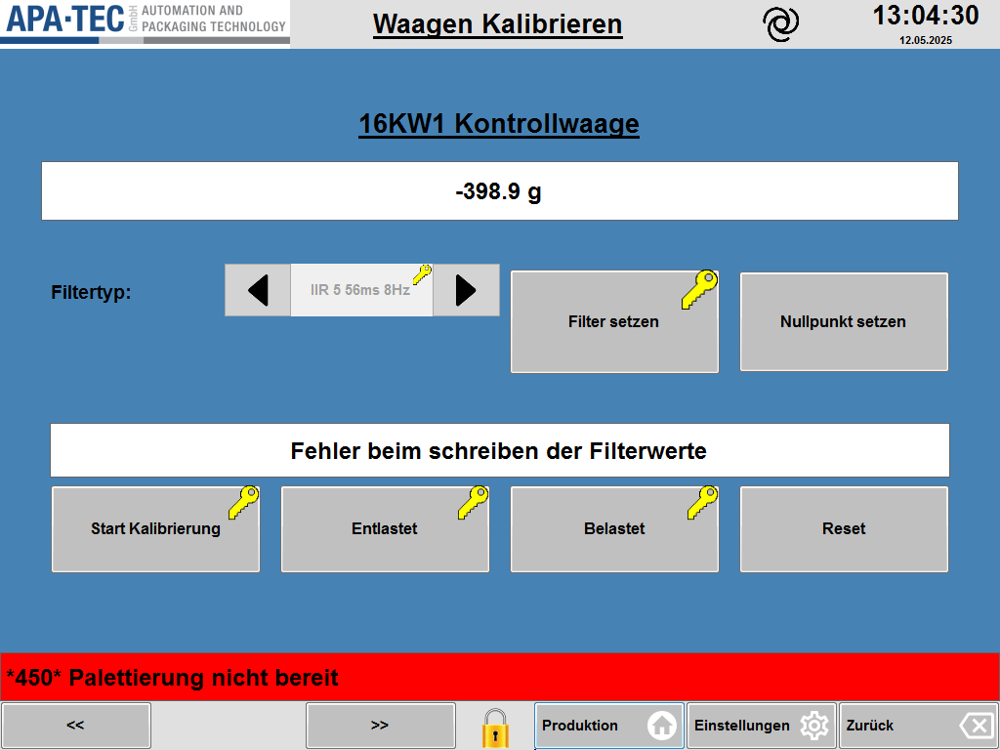

# RS-27 – Waagen Kalibrieren
- Quelle: `src_Data/Referenz/Referenz.docx`, Kapitel 27 „Waagen Kalibrieren“ (Zweck, Seitenübersicht, Funktionsbeschreibung mit Steuerelemente, Kalibriervorgang, Navigationsbereich (unten links)); Bild [RS-27_01](../Medien/RS-27_01.png); Tabellen T37 (Steuerelemente, 10 Zeilen inkl. Kopfzeile) und T38 (Navigationsbereich, 2 Zeilen inkl. Kopfzeile)
- Navigationspfad: Einstellung › Waagen kalibrieren (Eintrag in [RS-04](RS-04_Einstellungen.md), dort „Systemseite zu Kalibrierung von Waagen und Wägezellen.“); Pfeiltasten „<<“ / „>>“ unten links blättern zwischen den verbauten Waagen. Im Bild zeigt die Kopfzeile nur den Seitentitel „Waagen Kalibrieren“, keinen Brotkrümelpfad.

## Zweck
Wörtlich: „Dieser Bereich dient der Kalibrierung der Waage. Eine Kalibrierung ist erforderlich, wenn das angezeigte Gewicht ungenau ist, mechanische Veränderungen an der Waage vorgenommen wurden oder die Waage ersetzt wurde.“

## Aufbau (Bereiche, Layout)
Bild: [RS-27_01.png](../Medien/RS-27_01.png) (1024 × 768, Referenz-HMI).

Beschreibung des Bildes von oben nach unten:
1. **Kopfzeile** (hellgrau): links Logo „APA-TEC GmbH – AUTOMATION AND PACKAGING TECHNOLOGY“; mittig der unterstrichene Seitentitel „Waagen Kalibrieren“; rechts daneben ein rundes, spiralförmiges Symbol (ohne Beschriftung); ganz rechts Uhrzeit „13:04:30“ (groß) und Datum „12.05.2025“ (klein).
2. **Arbeitsfläche** (blauer Hintergrund):
   - Unterstrichene Überschrift „16KW1 Kontrollwaage“ (Name der gerade angewählten Waage, zentriert).
   - Breites weißes Anzeigefeld darunter mit dem Livegewicht: „-398.9 g“ (zentriert, fett).
   - Zeile „Filtertyp:“ (Beschriftung links) mit einem Auswahlfeld: linke Pfeiltaste (◄), Mittelfeld mit dem grau/ausgegrauten Text „IIR 5 56ms 8Hz“ und kleinem gelben Schlüsselsymbol an der oberen rechten Ecke, rechte Pfeiltaste (►).
   - Rechts daneben zwei Tasten: „Filter setzen“ (mit gelbem Schlüsselsymbol oben rechts) und „Nullpunkt setzen“ (ohne Schlüssel).
   - Weißes, breites Textfeld (Statusanzeige) mit dem Text „Fehler beim schreiben der Filterwerte“ (fett, zentriert).
   - Untere Tastenreihe mit vier Tasten: „Start Kalibrierung“ (Schlüssel), „Entlastet“ (Schlüssel), „Belastet“ (Schlüssel), „Reset“ (kein Schlüssel).
3. **Meldezeile** (volle Breite, roter Hintergrund, schwarze Schrift): „\*450\* Palettierung nicht bereit“.
4. **Untere Funktionsleiste** (hellgrau): links Taste „<<“, daneben (mit Abstand) Taste „>>“; in der Mitte ein gelbes Schloss-Symbol; rechts drei Tasten „Produktion“ (Haus-Symbol), „Einstellungen“ (Zahnrad-Symbol), „Zurück“ (Rücktasten-Symbol).

Die Handbuchbeschreibung der Seite („Nachfolgend ist die Seite Waagen Kalibrierung dargestellt.“) enthält keine weitere Layoutbeschreibung.

## Elemente (Tabelle: Element | Typ | Funktion | verwendetes Modul)

Tabelle T37 „Steuerelemente“ (9 Datenzeilen, Wortlaut der Beschreibung aus dem Handbuch). Spalten Handbuch: Funktion | Beschreibung.

| Element | Typ | Funktion (Wortlaut Handbuch) | verwendetes Modul |
|---|---|---|---|
| Gewichtsanzeige | Anzeigefeld (Zahl mit Einheit „g“, im Bild „-398.9 g“) | „Zeigt das Livegewicht der ausgewählten Waage an.“ | [RM-07](../Module/RM-07_Anzeigefeld.md) (Livewert mit Einheit) |
| Filtertyp | Auswahlfeld mit Pfeiltasten (◄ ►), Schlüsselsymbol; im Bild „IIR 5 56ms 8Hz“ | „Auswahl eines digitalen Filters zur Stabilisierung der Gewichtsanzeige. Änderungen wirken sich auf die Reaktionsgeschwindigkeit und Genauigkeit aus.“ | [RM-32](../Module/RM-32_Auswahlfeld-mit-Pfeiltasten.md); [RM-05](../Module/RM-05_Eingabefeld-mit-Schluesselsymbol.md) |
| Filter setzen | Taste, Schlüsselsymbol | „Speichert den ausgewählten Filtertyp. Ein fehlerhaftes Schreiben wird angezeigt im Feld darunter angezeigt.“ (Wortlaut inkl. Doppelung „angezeigt“) | [RM-11](../Module/RM-11_Aktionstaste.md) mit Schlüsselsymbol |
| Nullpunkt setzen | Taste, ohne Schlüsselsymbol | „Setzt den Nullpunkt der Waage bei unbelasteter Waage.“ | [RM-11](../Module/RM-11_Aktionstaste.md) |
| Statusanzeige | Textfeld (nur Anzeige) | „Zeigt Meldungen, Fehler und Hinweise zur angewählten Waage an.“ Im Bild: „Fehler beim schreiben der Filterwerte“ | [RM-23](../Module/RM-23_Hinweis-Textfeld.md) |
| Start Kalibrierung | Taste, Schlüsselsymbol | „Startet den Kalibriervorgang. Siehe untenstehenden Abschnitt für den Ablauf.“ | [RM-11](../Module/RM-11_Aktionstaste.md) mit Schlüsselsymbol |
| Entlastet | Taste, Schlüsselsymbol | „Wird während der Kalibrierung gedrückt, wenn sich kein Gewicht auf der Waage befindet.“ | [RM-11](../Module/RM-11_Aktionstaste.md) mit Schlüsselsymbol |
| Belastet | Taste, Schlüsselsymbol | „Wird gedrückt, wenn das Kalibriergewicht auf der Waage liegt und sich die Anzeige stabilisiert hat.“ | [RM-11](../Module/RM-11_Aktionstaste.md) mit Schlüsselsymbol |
| Reset | Taste, ohne Schlüsselsymbol | „Bricht den Kalibriervorgang ab und setzt alle Zwischenschritte zurück. Quittiert anstehende Fehler der aktuellen Waage.“ | [RM-11](../Module/RM-11_Aktionstaste.md) |

Zusätzliche, nur im Bild sichtbare Elemente (nicht in T37 beschrieben):

| Element | Typ | Funktion | verwendetes Modul |
|---|---|---|---|
| Überschrift „16KW1 Kontrollwaage“ | Textanzeige (unterstrichen) | Name der angewählten Waage; im Handbuchtext nicht beschrieben | [RM-25](../Module/RM-25_Objekt-Ueberschrift.md) (Name der angewählten Waage) |
| Seitentitel „Waagen Kalibrieren“, Logo, spiralförmiges Symbol, Uhrzeit, Datum | Kopfzeile | Rahmenelement, im Handbuch nicht beschrieben | [RM-01](../Module/RM-01_Kopfzeile.md) (Logo, Titel, Uhr/Datum) |
| Meldezeile „\*450\* Palettierung nicht bereit“ | Meldezeile (rot) | Rahmenelement, im Handbuch nicht auf dieser Seite beschrieben (vgl. [RS-38](RS-38_Meldeanzeige.md)) | [RM-02](../Module/RM-02_Meldezeile.md) |
| Schloss-Symbol (gelb) | Symbol in unterer Leiste | im Handbuch nicht beschrieben | [RM-03](../Module/RM-03_Funktionsleiste-unten.md) |
| Tasten „Produktion“, „Einstellungen“, „Zurück“ | Navigationstasten (Haus, Zahnrad, Rücktaste) | im Handbuch für diese Seite nicht beschrieben | [RM-03](../Module/RM-03_Funktionsleiste-unten.md) |

Tabelle T38 „Navigationsbereich (unten links)“ (1 Datenzeile):

| Element | Typ | Funktion (Wortlaut Handbuch) | verwendetes Modul |
|---|---|---|---|
| Pfeiltasten („<<“ / „>>“) | zwei Tasten unten links | „Erlaubt das blättern zwischen den verbauten Waagen.“ | [RM-04](../Module/RM-04_Blaettertasten.md) (Navigation unten links) |

### Kalibriervorgang (Handbuch, 7 Schritte, Wortlaut)
1. „Waage gründlich reinigen. Sie muss korrekt eingebaut und befestigt sein.“
2. „Taste „Start Kalibrierung“ drücken.“
3. „Sobald das System dazu auffordert und das Gewicht stabil ist, Taste „Entlastet“ drücken.“
4. „Gefordertes Kalibriergewicht auf die Waage stellen. Achten Sie darauf, dass das Gewicht freisteht und nicht anliegt. Nach Beruhigung der Anzeige: Taste „Belastet“ drücken.“
5. „Nach erfolgreicher Kalibrierung erscheint eine Bestätigung. Prüfen Sie anschließend den Nullpunkt und ein Prüfgewicht (z. B. 500 g) auf Korrektheit.“
6. „Bei Abbruch: Taste „Reset“ drücken.“
7. „Falls das Gewicht weiterhin nicht korrekt ist, reinigen Sie die Waage erneut und wiederholen Sie den Vorgang.“

Wertebereiche, Standardwerte, Einheiten: Das Handbuch nennt keine. Im Bild erkennbar: Einheit „g“ (Gewichtsanzeige, Wert „-398.9“, eine Nachkommastelle, Dezimalpunkt); Filtertyp-Beispieltext „IIR 5 56ms 8Hz“. Die Liste der wählbaren Filtertypen und das geforderte Kalibriergewicht sind nicht genannt.

## Verwendete Module (IDs)

Module dieser Seite (Definitionen in der [Modulliste](../Module/Modulliste.md)):

- [RM-01](../Module/RM-01_Kopfzeile.md) – Kopfzeile
- [RM-02](../Module/RM-02_Meldezeile.md) – Meldezeile
- [RM-03](../Module/RM-03_Funktionsleiste-unten.md) – Funktionsleiste unten
- [RM-04](../Module/RM-04_Blaettertasten.md) – Blättertasten
- [RM-05](../Module/RM-05_Eingabefeld-mit-Schluesselsymbol.md) – Eingabefeld mit Schlüsselsymbol
- [RM-07](../Module/RM-07_Anzeigefeld.md) – Anzeigefeld
- [RM-11](../Module/RM-11_Aktionstaste.md) – Aktionstaste
- [RM-23](../Module/RM-23_Hinweis-Textfeld.md) – Hinweis-Textfeld
- [RM-25](../Module/RM-25_Objekt-Ueberschrift.md) – Objekt-Überschrift
- [RM-32](../Module/RM-32_Auswahlfeld-mit-Pfeiltasten.md) – Auswahlfeld mit Pfeiltasten
- Kein Modul: Kalibrier-Ablauf (Tastenfolge Start Kalibrierung, Entlastet, Belastet, Reset), seitenspezifisch (A-22)

## Zustände und Interaktion (inkl. Pop-ups, Berechtigungen, Fehlerfälle)
- **Waagenwahl:** „<<“ / „>>“ unten links wechseln zwischen den verbauten Waagen; die Überschrift (im Bild „16KW1 Kontrollwaage“) und die Livegewichtsanzeige beziehen sich auf die gewählte Waage. Anzahl und Namen der Waagen sind im Handbuch nicht genannt.
- **Filter:** Filtertyp mit den Pfeiltasten (◄ ►) im Auswahlfeld wählen, dann „Filter setzen“ drücken, um den Typ zu speichern. Fehlerhaftes Schreiben wird in der Statusanzeige darunter angezeigt (im Bild: „Fehler beim schreiben der Filterwerte“).
- **Nullpunkt:** „Nullpunkt setzen“ bei unbelasteter Waage.
- **Kalibrierung:** Ablauf siehe oben (Start Kalibrierung → Entlastet → Belastet → Bestätigung). „Reset“ bricht ab, setzt Zwischenschritte zurück und quittiert anstehende Fehler der aktuellen Waage. „Nach erfolgreicher Kalibrierung erscheint eine Bestätigung“ (Form der Bestätigung nicht beschrieben; vermutlich in der Statusanzeige, nicht belegt).
- **Berechtigungen:** Im Bild tragen das Filtertyp-Auswahlfeld sowie die Tasten „Filter setzen“, „Start Kalibrierung“, „Entlastet“ und „Belastet“ ein gelbes Schlüsselsymbol; „Nullpunkt setzen“ und „Reset“ tragen keines. Das Handbuch erklärt das Symbol auf dieser Seite nicht; Annahme: Schlüssel = berechtigungspflichtig (Konsistenz mit A-08). Der Filtertyp-Text erscheint im Bild ausgegraut.
- **Fehlerfälle:** Statusanzeige zeigt „Meldungen, Fehler und Hinweise zur angewählten Waage“; Reset quittiert Fehler.
- **Pop-ups / Unterseiten:** keine beschrieben.
- **Navigation:** untere Leiste „Produktion“ (Haus), „Einstellungen“ (Zahnrad), „Zurück“ (Rücktaste); Zielseiten im Handbuch für diese Seite nicht beschrieben (vgl. Referenz-Uebersicht.md).

## Prüfpunkte
| ID | Prüfung | erwartetes Ergebnis | Status |
|---|---|---|---|
| RS-27-P01 | Seitenname und Pfad | Seite heißt „Waagen Kalibrieren“; erreichbar über Einstellung › Waagen kalibrieren (Eintrag aus RS-04) | offen |
| RS-27-P02 | Gewichtsanzeige | Zeigt Livegewicht der ausgewählten Waage in g mit einer Nachkommastelle (Bild: „-398.9 g“); negative Werte werden mit Minus dargestellt | offen |
| RS-27-P03 | Waagentitel | Name der angewählten Waage steht als Überschrift über der Gewichtsanzeige (Bild: „16KW1 Kontrollwaage“) | offen |
| RS-27-P04 | Filtertyp-Auswahl | Auswahlfeld mit linker und rechter Pfeiltaste wählt einen digitalen Filter; Bildbeispiel „IIR 5 56ms 8Hz“; Schlüsselsymbol am Feld | offen |
| RS-27-P05 | Filter setzen | Speichert den gewählten Filtertyp; Taste trägt Schlüsselsymbol | offen |
| RS-27-P06 | Fehler beim Filter schreiben | Fehlerhaftes Schreiben wird in der Statusanzeige unter den Tasten angezeigt (Bildtext: „Fehler beim schreiben der Filterwerte“) | offen |
| RS-27-P07 | Nullpunkt setzen | Taste ohne Schlüsselsymbol setzt den Nullpunkt bei unbelasteter Waage | offen |
| RS-27-P08 | Statusanzeige | Textfeld zeigt Meldungen, Fehler und Hinweise zur angewählten Waage | offen |
| RS-27-P09 | Tastenreihe Kalibrierung | Vier Tasten in der Reihenfolge Start Kalibrierung, Entlastet, Belastet, Reset; die ersten drei mit Schlüsselsymbol, Reset ohne | offen |
| RS-27-P10 | Ablauf Kalibrierung | Start Kalibrierung → Systemaufforderung → Entlastet (kein Gewicht, stabil) → Kalibriergewicht auflegen → Belastet (Anzeige beruhigt) → Bestätigung nach Erfolg | offen |
| RS-27-P11 | Reset | Bricht Kalibrierung ab, setzt alle Zwischenschritte zurück und quittiert anstehende Fehler der aktuellen Waage | offen |
| RS-27-P12 | Waagen blättern | „<<“ und „>>“ unten links wechseln zwischen den verbauten Waagen; Überschrift und Livegewicht wechseln mit | offen |
| RS-27-P13 | Rahmenelemente | Kopfzeile mit Logo, Titel, Uhrzeit und Datum; Meldezeile; untere Leiste mit Produktion, Einstellungen, Zurück und Schloss-Symbol | offen |
| RS-27-P14 | Prüfung nach Kalibrierung | Hinweis beachtet: Nullpunkt und ein Prüfgewicht (z. B. 500 g) werden nach der Kalibrierung auf Korrektheit geprüft | offen |
| RS-27-P15 | Vollständigkeit | Alle 9 Zeilen aus T37, die Zeile aus T38, die 7 Kalibrierschritte und das Bild RS-27_01 sind erfasst | offen |

## Offene Punkte
1. Brotkrümelpfad: Bild zeigt nur den Titel; Pfad „Einstellung › Waagen kalibrieren“ stammt aus der Menüstruktur (RS-04).
2. Wählbare Filtertypen, Standardfilter und ihre Reihenfolge sind nicht angegeben.
3. Gefordertes Kalibriergewicht (Wert, Einheit) ist nicht genannt („Gefordertes Kalibriergewicht“; Systemaufforderung nicht beschrieben).
4. Form der Aufforderung und der Bestätigung (Meldung, Pop-up, Statusanzeige) ist nicht beschrieben.
5. Bedeutung des gelben Schlüssels (Berechtigungsstufe, wer darf bedienen) und des Schloss-Symbols in der unteren Leiste sind nicht erläutert; „Nullpunkt setzen“ und „Reset“ ohne Schlüssel.
6. Zahl und Namen der verbauten Waagen sowie Verhalten am ersten/letzten Eintrag (Umlauf oder Anschlag) sind nicht angegeben.
7. Wortlaut „Filter setzen“-Beschreibung ist grammatikalisch fehlerhaft („angezeigt im Feld darunter angezeigt“); „Feld darunter“ = Statusanzeige (Annahme anhand des Bildes).
8. Bedeutung des spiralförmigen Symbols rechts neben dem Titel nicht beschrieben.
9. Rechtschreibfehler im Bildtext („schreiben“ statt „Schreiben“) – Übernahme in das neue HMI offen.
10. Bildgröße 1024 × 768 (4:3) gegenüber Zielauflösung 1920 × 1080: Anordnung muss neu gesetzt werden.
