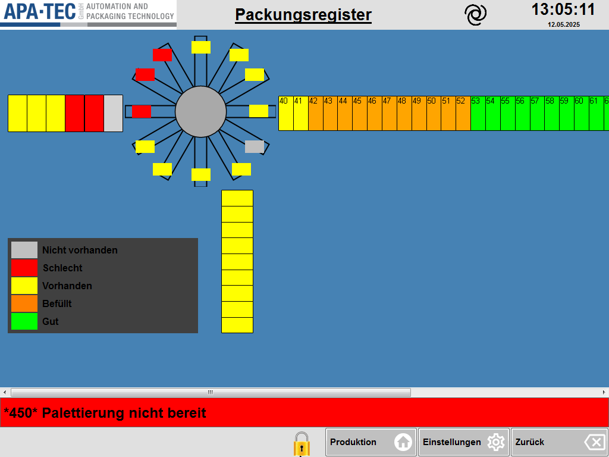

# RS-28 – Packungsregister
- Quelle: `src_Data/Referenz/Referenz.docx`, Kapitel 28 „Packungsregister“ (Zweck, Seitenübersicht, Funktionsbeschreibung); Bild [RS-28_01](../Medien/RS-28_01.png); Tabelle T39 (Anzeigezustände, 6 Zeilen inkl. Kopfzeile)
- Navigationspfad: Einstellung › Packungsregister (Eintrag in [RS-04](RS-04_Einstellungen.md): „Zeigt den Status aller Packungen in der Maschine an.“). Im Bild zeigt die Kopfzeile nur den Titel „Packungsregister“.

## Zweck
Wörtlich: „Das Packungsregister stellt die einzelnen Stationen in der Maschine grafisch dar und zeigt für jede Position an, ob sich dort eine Packung befindet und in welchem Zustand sie ist. Es dient der Nachverfolgung des Packungsstatus durch den Maschinenverlauf.“

## Aufbau (Bereiche, Layout)
Bild: [RS-28_01.png](../Medien/RS-28_01.png) (1024 × 768).

Beschreibung des Bildes:
1. **Kopfzeile** (hellgrau): Logo APA-TEC links, unterstrichener Titel „Packungsregister“, spiralförmiges Symbol, Uhrzeit „13:05:11“, Datum „12.05.2025“.
2. **Arbeitsfläche** (blauer Hintergrund) mit der grafischen Darstellung der Maschinenstationen; alle Stationen sind Rechtecke, Farbe = Zustand:
   - **Linker Block** (am linken Rand, horizontal): 6 Felder nebeneinander ohne Nummern: von links 3 gelb, 2 rot, 1 grau.
   - **Drehstern** (Mitte oben): grauer Kreis mit 12 strahlenförmig angeordneten Armen; am Ende jedes Arms ein kleines Feld (12 Felder, ohne Nummern). Im Bild von oben im Uhrzeigersinn: gelb (oben), gelb, gelb, gelb (rechts), grau (rechts unten), gelb, gelb, gelb, gelb (links unten), rot (links), rot, rot. Der Stern ist über einen horizontalen Streifen mit dem linken Block und der rechten Reihe verbunden.
   - **Rechte Reihe** (horizontal, vom Stern nach rechts, am rechten Bildrand abgeschnitten): nummerierte Felder; sichtbar Nr. 40 bis 61 (die Nummer des letzten, am Rand angeschnittenen Feldes ist nicht lesbar): 40 und 41 gelb, 42 bis 52 orange, 53 bis 61 grün.
   - **Vertikale Spalte** unterhalb des Sterns: 9 gelbe Felder übereinander, ohne Nummern.
   - **Legende** (links unten, dunkelgrauer Kasten, weiße/schwarze Schrift) mit fünf Einträgen: grau „Nicht vorhanden“, rot „Schlecht“, gelb „Vorhanden“, orange „Befüllt“, grün „Gut“.
   - **Horizontale Bildlaufleiste** unten an der Arbeitsfläche (Pfeile links/rechts, Griff in der Mitte): die Darstellung ist seitlich scrollbar.
3. **Meldezeile** (rot): „\*450\* Palettierung nicht bereit“.
4. **Untere Funktionsleiste:** gelbes Schloss-Symbol, Tasten „Produktion“ (Haus), „Einstellungen“ (Zahnrad), „Zurück“ (Rücktaste). Anders als in RS-27 sind keine Tasten „<<“ / „>>“ vorhanden.

## Elemente (Tabelle: Element | Typ | Funktion | verwendetes Modul)

Tabelle T39 „Funktionsbeschreibung“ (5 Datenzeilen; Spalten Handbuch: Anzeigezustand | Bedeutung):

| Element | Typ | Funktion (Wortlaut Handbuch) | verwendetes Modul |
|---|---|---|---|
| Feld grau | Zustandsfeld einer Station | „An dieser Position befindet sich aktuell keine Packung.“ (Legende im Bild: „Nicht vorhanden“) | Modulkandidat: Packungsstation-Feld (Zustandsfarbe) |
| Feld rot | Zustandsfeld einer Station | „Die Packung ist als Schlechtpackung markiert und wird ausgestoßen.“ (Legende: „Schlecht“) | Modulkandidat: Packungsstation-Feld (Zustandsfarbe) |
| Feld gelb | Zustandsfeld einer Station | „Es befindet sich eine Packung an dieser Position, sie wurde jedoch noch nicht befüllt oder gewogen.“ (Legende: „Vorhanden“) | Modulkandidat: Packungsstation-Feld (Zustandsfarbe) |
| Feld orange | Zustandsfeld einer Station | „Die Packung wurde mit Produkt befüllt.“ (Legende: „Befüllt“) | Modulkandidat: Packungsstation-Feld (Zustandsfarbe) |
| Feld grün | Zustandsfeld einer Station | „Die Packung wurde von der Endkontrollwaage (EKW) als in Ordnung bewertet.“ (Legende: „Gut“) | Modulkandidat: Packungsstation-Feld (Zustandsfarbe) |

Fließtext der Funktionsbeschreibung (Wortlaut):
- „Durch Antippen eines Felds kann der Zustand einer Station manuell verändert werden.“
- „Bestimmte Maschinenfunktionen (z. B. Blaslüfte) arbeiten nur korrekt, wenn im Packungsregister eine Packung vorhanden ist.“

Zusätzliche, nur im Bild sichtbare Elemente:

| Element | Typ | Funktion | verwendetes Modul |
|---|---|---|---|
| Linker Block (6 Felder) | Stationsreihe | Im Handbuch nicht benannt | Modulkandidat: Stationsreihe/Packungsregister-Grafik |
| Drehstern (12 Felder) | Stationskranz mit Mittelkreis | Im Handbuch nicht benannt | Modulkandidat: Stationsreihe/Packungsregister-Grafik |
| Rechte Reihe (Nr. 40 bis mind. 61) | nummerierte Stationsreihe | Im Handbuch nicht benannt | Modulkandidat: Stationsreihe/Packungsregister-Grafik |
| Vertikale Spalte (9 Felder) | Stationsreihe | Im Handbuch nicht benannt | Modulkandidat: Stationsreihe/Packungsregister-Grafik |
| Legende (5 Einträge) | Farblegende | Entspricht T39 mit anderen Kurzbezeichnungen | Modulkandidat: Zustandslegende |
| Bildlaufleiste horizontal | Scrollleiste | Seitlich scrollen | Modulkandidat: Scrollbereich |
| Kopfzeile, Meldezeile, untere Leiste (Produktion, Einstellungen, Zurück, Schloss) | Rahmen | Im Handbuch nicht beschrieben | Modulkandidat: Seitenkopf; Modulkandidat: Meldezeile; Modulkandidat: Untere Funktionsleiste |

## Verwendete Module (IDs)
Modulkandidaten (RM-IDs später):
- Modulkandidat: Packungsstation-Feld (Zustandsfarbe)
- Modulkandidat: Zustandslegende
- Modulkandidat: Stationsreihe/Packungsregister-Grafik
- Modulkandidat: Scrollbereich
- Modulkandidat: Seitenkopf (Logo, Titel, Uhr/Datum)
- Modulkandidat: Meldezeile
- Modulkandidat: Untere Funktionsleiste

## Zustände und Interaktion (inkl. Pop-ups, Berechtigungen, Fehlerfälle)
- **Zustände je Station (5):** grau = nicht vorhanden, rot = Schlecht (wird ausgestoßen), gelb = vorhanden (noch nicht befüllt/gewogen), orange = befüllt, grün = gut (EKW-Bewertung in Ordnung). Zustände sind im Referenz-HMI nur über Farbe dargestellt (im neuen HMI zusätzlich Symbol/Text nötig, Agent.md Abschnitt 6).
- **Bedienung:** Antippen eines Felds ändert den Zustand der Station manuell. Welche Zustandsfolge dabei durchlaufen wird, ist nicht beschrieben.
- **Abhängigkeit:** Funktionen wie Blaslüfte arbeiten nur korrekt, wenn im Register eine Packung vorhanden ist.
- **Berechtigungen:** Auf dieser Seite ist im Bild kein Schlüsselsymbol zu sehen; das Handbuch nennt keine Berechtigung für das manuelle Ändern.
- **Pop-ups / Unterseiten:** keine beschrieben.
- **Fehlerfälle:** keine beschrieben.
- **Navigation:** untere Leiste mit Produktion (Haus), Einstellungen (Zahnrad), Zurück; keine Blättertasten.

## Prüfpunkte
| ID | Prüfung | erwartetes Ergebnis | Status |
|---|---|---|---|
| RS-28-P01 | Seitenname und Pfad | Seite „Packungsregister“, erreichbar über Einstellung › Packungsregister | offen |
| RS-28-P02 | Grafische Darstellung | Maschinenstationen werden grafisch dargestellt: Block links (6 Felder), Drehstern (12 Felder), nummerierte Reihe rechts (ab Nr. 40), vertikale Spalte (9 Felder) | offen |
| RS-28-P03 | Zustand grau | Feld grau = keine Packung an dieser Position | offen |
| RS-28-P04 | Zustand rot | Feld rot = Schlechtpackung, wird ausgestoßen | offen |
| RS-28-P05 | Zustand gelb | Feld gelb = Packung vorhanden, noch nicht befüllt oder gewogen | offen |
| RS-28-P06 | Zustand orange | Feld orange = Packung mit Produkt befüllt | offen |
| RS-28-P07 | Zustand grün | Feld grün = von der Endkontrollwaage (EKW) als in Ordnung bewertet | offen |
| RS-28-P08 | Legende | Legende zeigt 5 Einträge: Nicht vorhanden (grau), Schlecht (rot), Vorhanden (gelb), Befüllt (orange), Gut (grün) | offen |
| RS-28-P09 | Manuelle Änderung | Antippen eines Felds ändert den Zustand der Station manuell | offen |
| RS-28-P10 | Abhängigkeit Maschinenfunktion | Funktionen wie Blaslüfte arbeiten nur bei vorhandener Packung im Register; Hinweis ist dokumentiert | offen |
| RS-28-P11 | Nummerierung | Felder der rechten Reihe tragen Nummern (im Bild 40 bis 61 sichtbar, fortlaufend) | offen |
| RS-28-P12 | Scrollen | Darstellung ist seitlich scrollbar (horizontale Bildlaufleiste im Bild) | offen |
| RS-28-P13 | Rahmenelemente | Kopfzeile, Meldezeile und untere Leiste (Produktion, Einstellungen, Zurück, Schloss) vorhanden; keine Tasten „<<“ / „>>“ | offen |
| RS-28-P14 | Vollständigkeit | Alle 5 Datenzeilen aus T39, beide Fließtextaussagen und Bild RS-28_01 sind erfasst | offen |

## Offene Punkte
1. Zahl der Stationen gesamt und Zuordnung der Gruppen (Block links, Drehstern, rechte Reihe, Spalte) zu realen Maschinenstationen sind nicht benannt; die rechte Reihe ist im Bild abgeschnitten (letzte Nummer nicht lesbar, Gesamtzahl unbekannt).
2. Nur die rechte Reihe trägt Nummern; die Stationen der anderen Gruppen sind unnummeriert.
3. Zustandsfolge beim Antippen (Zyklus oder Auswahl-Pop-up) und Berechtigung dafür sind nicht beschrieben.
4. Legenden-Kurzbezeichnungen im Bild (Nicht vorhanden/Schlecht/Vorhanden/Befüllt/Gut) weichen von den Handbuch-Bezeichnungen (Feld grau … grün) ab; Zuordnung per Farbe.
5. Verwendung von gelb = „vorhanden, nicht befüllt oder gewogen“ umfasst zwei Zustände; unklar, ob „gewogen“ einen eigenen Zustand hat.
6. Bedeutung von Schloss-Symbol (gelb, untere Leiste) und spiralförmigem Symbol (Kopfzeile, rechts neben dem Titel) sind im Handbuch nicht erläutert; beide Symbole sind in RS-28_01 sichtbar.
7. Zustandsdarstellung nur über Farbe (ISA-101: zusätzliche Kennzeichnung im neuen HMI nötig).
