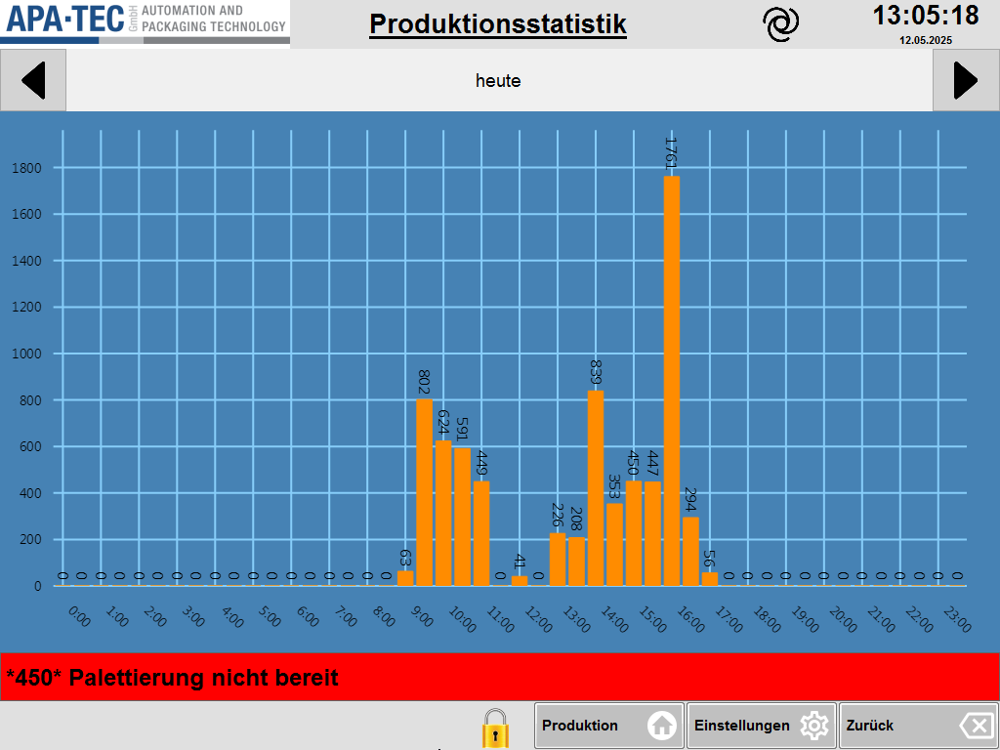

# RS-29 – Produktionsstatistik
- Quelle: `src_Data/Referenz/Referenz.docx`, Kapitel 29 „Produktionsstatistik“ (Zweck, Seitenübersicht, Funktionsbeschreibung); Bild [RS-29_01](../Medien/RS-29_01.png); keine Tabellen
- Navigationspfad: Einstellung › Produktionsstatistik (Eintrag in [RS-04](RS-04_Einstellungen.md): „Eine grafische Darstellung der Produktion der letzten 30 Tage.“); Pfeiltasten über dem Diagramm wechseln zwischen den letzten 30 Tagen. Im Bild zeigt die Kopfzeile nur den Titel „Produktionsstatistik“.

## Zweck
Wörtlich: „Die Seite Produktionsstatistik zeigt den Verlauf der Produktion eines Tages in einem Balkendiagramm an. Es ist möglich die Verläufe der letzten 30 Tage zu betrachten.“

## Aufbau (Bereiche, Layout)
Bild: [RS-29_01.png](../Medien/RS-29_01.png) (1024 × 768).

Beschreibung des Bildes:
1. **Kopfzeile** (hellgrau): Logo APA-TEC links, unterstrichener Titel „Produktionsstatistik“, spiralförmiges Symbol, Uhrzeit „13:05:18“, Datum „12.05.2025“.
2. **Datumsleiste** direkt unter der Kopfzeile, volle Breite: linke Pfeiltaste (◄, grau, am linken Rand), mittig ein weißes/hellgraues Textfeld mit dem Text „heute“, rechte Pfeiltaste (►, grau, am rechten Rand).
3. **Balkendiagramm** (blauer Hintergrund, hellblaue Gitternetzlinien): 
   - Y-Achse ohne Titel und ohne Einheit, Teilung 0 bis 1800 in Schritten von 200 (Beschriftung 0, 200, …, 1800).
   - X-Achse mit stündlicher Beschriftung 0:00, 1:00, … 23:00 (schräg gestellt).
   - Orange Balken; über jedem Balken der Zahlenwert (senkrecht gedreht, schwarz), auch „0“ bei leeren Balken. Je Stundenbeschriftung sind im Bild zwei Balken erkennbar (insgesamt etwa 48 Balken, Schätzung); die Balkenbreite entspricht damit vermutlich einem Halbstunden-Intervall (nicht belegt).
   - Werte im Bild (von links nach rechts, nach etwa 18 Nullbalken): 63, 802, 624, 591, 449, 0, 41, 0, 226, 208, 839, 353, 450, 447, 1761, 294, 56, danach wieder Nullbalken bis zum rechten Rand. Höchster Balken: 1761. Die Balken liegen zwischen den Beschriftungen 8:00 und 17:00.
4. **Meldezeile** (rot): „\*450\* Palettierung nicht bereit“.
5. **Untere Funktionsleiste:** gelbes Schloss-Symbol, Tasten „Produktion“ (Haus), „Einstellungen“ (Zahnrad), „Zurück“ (Rücktaste). Keine Tasten „<<“ / „>>“.

## Elemente (Tabelle: Element | Typ | Funktion | verwendetes Modul)
Das Handbuch enthält keine Tabelle; die Funktionsbeschreibung besteht aus einem Satz: „Mit den Pfeiltasten über dem Diagramm kann zwischen den letzten 30 Tagen gewechselt werden. Das Textfeld zeigt das Datum an.“

| Element | Typ | Funktion | verwendetes Modul |
|---|---|---|---|
| Pfeiltaste links (◄) | Taste | „Mit den Pfeiltasten über dem Diagramm kann zwischen den letzten 30 Tagen gewechselt werden.“ Richtung (früher/später) nicht angegeben | [RM-30](../Module/RM-30_Tagesbalkendiagramm.md) (Pfeiltasten mit Datumsfeld) |
| Pfeiltaste rechts (►) | Taste | wie links | [RM-30](../Module/RM-30_Tagesbalkendiagramm.md) (Pfeiltasten mit Datumsfeld) |
| Textfeld Datum (im Bild „heute“) | Textanzeige | „Das Textfeld zeigt das Datum an.“ Im Bild für den aktuellen Tag „heute“ | [RM-30](../Module/RM-30_Tagesbalkendiagramm.md) (Pfeiltasten mit Datumsfeld) |
| Balkendiagramm Tagesverlauf | Diagramm (Balken, X = Uhrzeit 0:00 bis 23:00, Y = Zahl 0 bis 1800) | „Verlauf der Produktion eines Tages in einem Balkendiagramm“ | [RM-30](../Module/RM-30_Tagesbalkendiagramm.md) (Tagesverlauf) |
| Zahlenwerte über den Balken | Beschriftung | Wert je Balken, im Handbuch nicht beschrieben | [RM-30](../Module/RM-30_Tagesbalkendiagramm.md) (Tagesverlauf) |
| Kopfzeile, Meldezeile, untere Leiste (Produktion, Einstellungen, Zurück, Schloss) | Rahmen | Im Handbuch nicht beschrieben | [RM-01](../Module/RM-01_Kopfzeile.md); [RM-02](../Module/RM-02_Meldezeile.md); [RM-03](../Module/RM-03_Funktionsleiste-unten.md) |

## Verwendete Module (IDs)

Module dieser Seite (Definitionen in der [Modulliste](../Module/Modulliste.md)):

- [RM-01](../Module/RM-01_Kopfzeile.md) – Kopfzeile
- [RM-02](../Module/RM-02_Meldezeile.md) – Meldezeile
- [RM-03](../Module/RM-03_Funktionsleiste-unten.md) – Funktionsleiste unten
- [RM-30](../Module/RM-30_Tagesbalkendiagramm.md) – Tagesbalkendiagramm
- [RM-32](../Module/RM-32_Auswahlfeld-mit-Pfeiltasten.md) – Auswahlfeld mit Pfeiltasten (Datumsfeld mit Pfeiltasten)

## Zustände und Interaktion (inkl. Pop-ups, Berechtigungen, Fehlerfälle)
- **Tageswahl:** Die Pfeiltasten wechseln zwischen den letzten 30 Tagen; das Textfeld zeigt das gewählte Datum. Beim aktuellen Tag steht im Bild „heute“.
- **Anzeige:** Balkendiagramm mit dem Produktionsverlauf des gewählten Tages (Wert je Zeitintervall).
- **Berechtigungen:** keine im Bild (kein Schlüsselsymbol) und keine im Handbuch genannt.
- **Pop-ups / Unterseiten / Fehlerfälle:** keine beschrieben.
- **Navigation:** untere Leiste Produktion, Einstellungen, Zurück.

## Prüfpunkte
| ID | Prüfung | erwartetes Ergebnis | Status |
|---|---|---|---|
| RS-29-P01 | Seitenname und Pfad | Seite „Produktionsstatistik“, erreichbar über Einstellung › Produktionsstatistik | offen |
| RS-29-P02 | Diagrammart | Produktionsverlauf eines Tages als Balkendiagramm (orange Balken) | offen |
| RS-29-P03 | Achsen | X-Achse stündlich 0:00 bis 23:00; Y-Achse 0 bis 1800 in Schritten von 200 (Referenzdarstellung; Skalierung vermutlich automatisch, nicht belegt) | offen |
| RS-29-P04 | Wertbeschriftung | Über jedem Balken steht sein Zahlenwert, auch 0 bei leeren Balken | offen |
| RS-29-P05 | Datumsnavigation | Zwei Pfeiltasten links/rechts über dem Diagramm wechseln zwischen den letzten 30 Tagen | offen |
| RS-29-P06 | Datumsfeld | Textfeld zwischen den Pfeiltasten zeigt das Datum des angezeigten Tages; für den aktuellen Tag im Bild „heute“ | offen |
| RS-29-P07 | Zeitraum | Es sind genau die letzten 30 Tage abrufbar | offen |
| RS-29-P08 | Rahmenelemente | Kopfzeile mit Logo, Titel, Uhrzeit, Datum; Meldezeile; untere Leiste Produktion, Einstellungen, Zurück, Schloss; keine Tasten „<<“ / „>>“ | offen |
| RS-29-P09 | Vollständigkeit | Zweck, beide Sätze der Funktionsbeschreibung und Bild RS-29_01 sind erfasst; Seite hat keine Tabelle | offen |

## Offene Punkte
1. Zeitintervall der Balken (stündlich oder halbstündlich: im Bild etwa zwei Balken je Stundenbeschriftung) und die Größe, die der Balken darstellt (Packungen, Stück?), sind nicht beschrieben; Y-Achse hat keine Einheit/Beschriftung.
2. Richtung der Pfeiltasten (links = früher?), Verhalten am Anfang/Ende der 30 Tage und Format des Datums im Textfeld (außer „heute“) sind nicht angegeben.
3. Y-Achsen-Skalierung (fest oder automatisch) nicht beschrieben.
4. Handbuch: „letzten 30 Tage“ – ob „heute“ eingeschlossen ist, ist unklar.
5. Bedeutung von Schloss-Symbol und spiralförmigem Symbol in der Kopfzeile nicht erläutert.
6. Keine Berechtigungsangaben; Diagramm ist nur Anzeige (Annahme).
